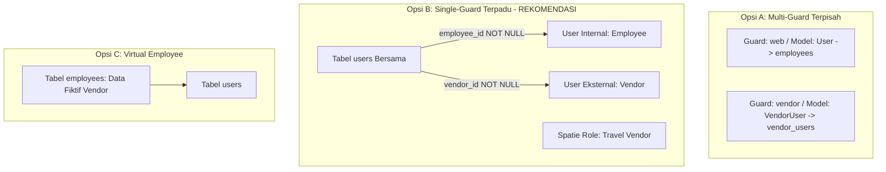
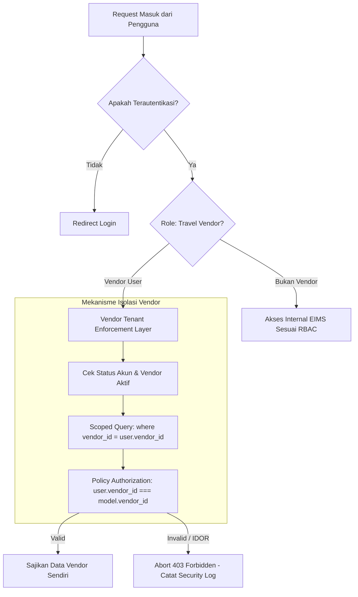
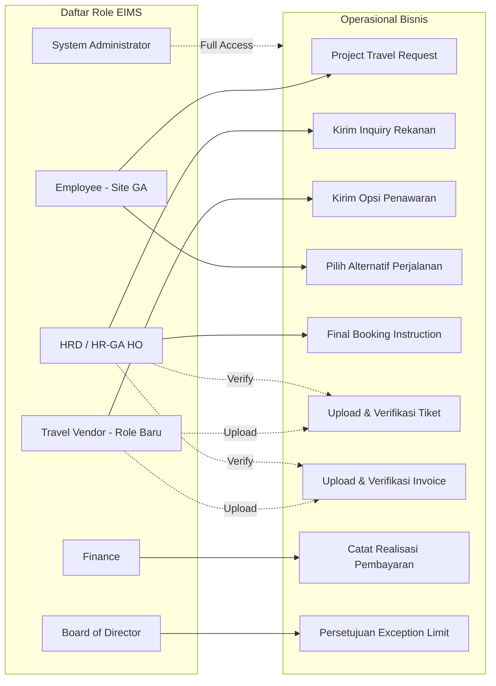

# EIMS AUTHENTICATION & AUTHORIZATION ARCHITECTURE DESIGN (P0.2)
## Modul: Travel Management & Vendor Payment Monitoring
**Aplikasi:** Enterprise Information Management System (EIMS) — Rapid Infrastruktur Indonesia  
**Versi Dokumen:** P0.2 — Refined Auth & RBAC Blueprint  
**Status:** DRAFT SPECIFICATION (REVIEW ONLY — Menunggu Persetujuan Pemilik Proyek)  
**Dokumen Induk:** [`EIMS_TECHNICAL_BLUEPRINT_P0.2.md`](file:///c:/Users/it/Documents/projects/eims/EIMS_TECHNICAL_BLUEPRINT_P0.2.md)

---

## 1. PENDAHULUAN & MASALAH ARSITEKTUR AUTENTIKASI EIMS

### 1.1 Temuan Audit P0 Terkait Model Akun Pengguna
- **[FAKTA TERKONFIRMASI]:** Pada aplikasi EIMS saat ini:
  1. Skema tabel `users` ([database/migrations/2026_09_26_143700_create_users_table.php](file:///c:/Users/it/Documents/projects/eims/database/migrations/2026_09_26_143700_create_users_table.php)) hanya memiliki kolom:
     `id`, `employee_id` (nullable, unique), `username` (unique), `password`, `must_change_password`, `is_active`, `remember_token`, `timestamps`.
  2. **Tabel `users` TIDAK MEMILIKI kolom `email`.**
  3. Model `User` ([app/Models/User.php](file:///c:/Users/it/Documents/projects/eims/app/Models/User.php)) mengambil email melalui relasi:
     ```php
     public function routeNotificationForMail($notification) {
         return $this->employee?->email;
     }
     ```
  4. Controller Admin User ([app/Http/Controllers/Admin/UserController.php](file:///c:/Users/it/Documents/projects/eims/app/Http/Controllers/Admin/UserController.php)) baris 75–79 secara ketat mewajibkan `employee_id` harus diisi saat membuat user baru:
     ```php
     'employee_id' => ['required', 'integer', 'exists:employees,id']
     ```
- **Masalah Struktural:**  
  Kebutuhan PRD v1.2 klausul **FR-05** mewajibkan tersedianya **Portal Vendor** bagi biro perjalanan rekanan eksternal. Rekanan Vendor **bukan karyawan internal RII** dan **tidak boleh dibuatkan data fiktif di tabel `employees`** (karena akan mengotori master data penggajian, struktur organisasi, dan BPJS).

---

## 2. ANALISIS ALTERNATIF ARSITEKTUR LOGIN VENDOR

Untuk memecahkan masalah ini tanpa merusak alur autentikasi internal eksisting, dievaluasi 3 opsi teknis:



### 2.1 Perbandingan Komprehensif Antar-Opsi

| Parameter Evaluasi | Opsi A: Multi-Guard Terpisah (`vendor`) | Opsi B: Single-Guard Terpadu (`users.vendor_id`) | Opsi C: Virtual Employee (Data Fiktif) |
|---|---|---|---|
| **Struktur Database** | Membuat tabel baru `vendor_users` dan model `VendorUser`. | Menambahkan kolom `vendor_id` dan `email` (nullable) pada tabel `users`. | Tidak mengubah skema tabel sama sekali. |
| **Dampak Kode Eksisting** | **Rendah pada core**, namun menambah kompleksitas config `auth.guards`. | **Sangat Rendah:** Alur employee eksisting tetap 100% utuh. | **Buruk:** Mengotori data SDM dengan data non-karyawan. |
| **Spatie Permission** | Memerlukan registrasi guard baru `vendor` pada tabel permissions (`guard_name = 'vendor'`). | **Sepenuhnya Reusable:** Menggunakan guard `web` standar yang sudah ada. | Reusable pada guard `web`. |
| **Session & Middleware** | Memerlukan cookie session terpisah (`vendor_session`) dan middleware redirect berbeda. | Menggunakan 1 pipeline session standar Laravel yang stabil. | Menggunakan session standar. |
| **Risiko Regresi** | Sedang (risiko tabrakan auth state saat admin membuka tab vendor). | **Sangat Rendah (Aman & Backward-Compatible).** | Tinggi (laporan HR dan headcount karyawan menjadi salah). |

### 2.2 Keputusan Desain & Rekomendasi Teknis
**[REKOMENDASI TEKNIS]:** Dipilih **Opsi B (Single-Guard Terpadu dengan Kolom `vendor_id` dan `email` Nullable)**.
- **Alasan Pemilihan:**
  1. Sangat bersahabat dengan ekosistem `spatie/laravel-permission` yang sudah terpasang di EIMS tanpa perlu menduplikasi roles/permissions ke multi-guard.
  2. Menjaga integritas tabel `employees` tetap bersih hanya untuk karyawan riil RII.
  3. Memanfaatkan rate-limiter, session management, proteksi brute-force, dan force password change yang sudah teruji di `AuthController`.

### 2.3 Rincian Penyesuaian Model & Skema `User` (Opsi B)
1. **Perubahan Skema `users` (Migrasi Tambahan):**
   ```sql
   ALTER TABLE `users` 
   ADD COLUMN `vendor_id` BIGINT UNSIGNED NULL AFTER `employee_id`,
   ADD COLUMN `email` VARCHAR(255) NULL AFTER `username`,
   ADD CONSTRAINT `fk_users_vendor` FOREIGN KEY (`vendor_id`) 
       REFERENCES `vendors` (`id`) ON UPDATE CASCADE ON DELETE RESTRICT;
   ```
2. **Constraint Integritas Akun:**  
   Akun pengguna harus bersifat mutually exclusive atau memiliki tipe yang jelas:
   - User Internal: `employee_id IS NOT NULL AND vendor_id IS NULL`.
   - User Vendor: `employee_id IS NULL AND vendor_id IS NOT NULL`.
3. **Penyempurnaan Notifikasi Email di `User.php`:**
   ```php
   public function routeNotificationForMail($notification): ?string
   {
       // Jika user internal, prioritaskan email karyawan
       if ($this->employee_id && $this->employee) {
           return $this->employee->email;
       }
       
       // Jika user vendor, gunakan email akun atau email resmi vendor
       if ($this->vendor_id) {
           return $this->email ?? $this->vendor?->email;
       }
       
       return $this->email;
   }
   ```

---

## 3. ARSITEKTUR OTORISASI: PEMETAAN STAKEHOLDER & SPATIE RBAC

### 3.1 Telaah Kritis Stakeholder PRD v1.2 vs Role Eksisting
- **[FAKTA TERKONFIRMASI]:** Role eksisting pada `RolePermissionSeeder.php` adalah:
  1. `System Administrator`
  2. `Employee`
  3. `Employee Approval`
  4. `Finance`
  5. `HRD`
  6. `Document Control`
  7. `Board of Director`

- **[ANALISIS KRITIS PEMETAAN STAKEHOLDER]:**
  1. **HR/GA HO $\ne$ Sekadar HRD Biasa:**  
     Dalam modul SPD eksisting, `HRD` bertugas membuat draf SPD dan memantau realisasi. Dalam Travel Management, personil HR/GA HO memegang wewenang pengadaan (*procurement*), negosiasi biaya tiket, pemilihan rekanan, dan pengiriman *Final Booking Instruction* yang mengikat kewajiban finansial korporat. Memberikan hak ini secara serampangan kepada seluruh staf pemegang role `HRD` dapat melanggar pemisahan fungsi (*segregation of duties*).
     - *Solusi:* Buat permissions spesifik (`travel.manage`, `travel.final-booking`) dan tugaskan ke role `HRD` dengan opsi membatasi personel tertentu.
  2. **Management $\ne$ Seluruh Board of Director:**  
     Di EIMS saat ini, role `Board of Director` hanya memiliki akses read-only (`employee.view-any`, `report.view`, `report.export`). BoD saat ini **tidak memiliki alur transaksi harian**. Jika persetujuan pelampauan kredit (*Credit Limit Exception*) dialamatkan ke role `Board of Director`, para direktur akan dibebani approval operasional tiket.
     - *Solusi:* Buat permission `travel.exception-approve`. Izin ini secara *default* dapat disematkan pada `Board of Director` atau `Finance Manager` / `General Manager` sesuai keputusan final manajemen (O-09).
  3. **HR/GA Site $\ne$ Employee Biasa:**  
     Personel HR/GA Site saat ini memiliki role `Employee`. Namun, mereka membutuhkan wewenang khusus untuk membuat *Project Travel Request* dan memilih opsi alternatif quotation.
     - *Solusi:* Buat permission `travel.site-request` dan `travel.select-quotation`. Personel Site yang ditunjuk diberikan permission ini secara langsung atau melalui sub-role.

### 3.2 Matriks Permission Modul Travel Management

| Kode Permission | Deskripsi Wewenang | Role yang Direkomendasikan |
|---|---|---|
| `travel.view-queue` | Melihat antrean terpusat Travel Request (SPD & Project) | `HRD`, `Finance`, `Board of Director` |
| `travel.site-request` | Membuat Project Travel Request multi-penumpang | Personel Site (`Employee` bertanda khusus) |
| `travel.select-quotation` | Memilih / menolak opsi alternatif quotation vendor | Personel Site (`Employee` bertanda khusus) |
| `travel.manage` | Memeriksa kelengkapan request, mengelola master vendor | `HRD`, `System Administrator` |
| `travel.inquiry` | Mengirim inquiry perjalanan ke vendor aktif | `HRD` |
| `travel.review-quotation`| Memeriksa penawaran awal vendor sebelum diteruskan | `HRD` |
| `travel.final-booking` | Mengirim instruksi konfirmasi booking final ke vendor | `HRD` (Authorized HR/GA HO) |
| `travel.verify-ticket` | Memverifikasi kecocokan e-ticket dengan persetujuan | `HRD` |
| `travel.verify-invoice` | Memverifikasi faktur tagihan vendor & item perjalanan | `HRD` (Authorized HR/GA HO) |
| `travel.payment-record` | Mencatat realisasi pembayaran yang telah ditransfer | `Finance` |
| `travel.payment-allocate`| Mengalokasikan dana transfer ke invoice vendor | `Finance` |
| `travel.vendor-activate`| Mengubah vendor aktif dan menonaktifkan vendor lama | `System Administrator`, `HRD` |
| `travel.credit-manage` | Menetapkan dan mengubah plafon credit limit vendor | `Finance`, `Board of Director` |
| `travel.exception-approve`| Menyetujui booking yang melampaui credit limit | `Board of Director` (Management) |
| `travel.vendor-portal` | Hak akses login dan operasional Portal Vendor | **`Travel Vendor` (Role Baru)** |

---

## 4. TENANT ISOLATION UNTUK REKANAN (VENDOR PORTAL)

### 4.1 Ancaman Keamanan: Kebocoran Data Antar-Vendor (Insecure Direct Object Reference - IDOR)
- **Skenario Risiko:**  
  Vendor A dan Vendor B keduanya memiliki akun di sistem EIMS. Vendor A mencoba mengganti ID pada URL (misal: `/travel/vendor/inquiries/15`) untuk melihat harga penawaran, rincian diskon, atau dokumen tagihan milik Vendor B.

### 4.2 Desain Proteksi Multi-Lapis (*Multi-Layer Tenant Isolation*)



#### Lapis 1: Global Query Scope pada Model Rekanan
Setiap model transaksi yang diakses oleh portal vendor (`VendorQuotation`, `TravelBooking`, `TravelTicket`, `VendorInvoice`) menerapkan query scope otomatis:
```php
namespace App\Models\Travel;

use Illuminate\Database\Eloquent\Builder;
use Illuminate\Database\Eloquent\Model;

abstract class VendorScopedModel extends Model
{
    protected static function booted(): void
    {
        static::addGlobalScope('vendor_tenant', function (Builder $builder) {
            $user = auth()->user();
            // Jika user yang login adalah rekanan vendor, batasi hanya datanya
            if ($user && $user->hasRole('Travel Vendor') && $user->vendor_id) {
                $builder->where($builder->getModel()->getTable() . '.vendor_id', $user->vendor_id);
            }
        });
    }
}
```

#### Lapis 2: Controller & Policy Enforcement (Mencegah IDOR)
Setiap aksi pengunduhan file atau mutasi status divalidasi melalui Laravel Policy:
```php
namespace App\Policies\Travel;

use App\Models\User;
use App\Models\Travel\VendorInvoice;

class VendorInvoicePolicy
{
    public function view(User $user, VendorInvoice $invoice): bool
    {
        // Internal HR/GA HO & Finance boleh melihat
        if ($user->can('travel.verify-invoice') || $user->can('travel.payment-record')) {
            return true;
        }

        // Vendor HANYA boleh melihat invoice miliknya sendiri
        return $user->hasRole('Travel Vendor') 
            && (int) $user->vendor_id === (int) $invoice->vendor_id;
    }
}
```

#### Lapis 3: Proteksi Unduhan Dokumen Privat (FR-24)
- Berkas tiket, tagihan invoice, dan bukti transfer **tidak diletakkan di direktori publik**.
- Berkas disajikan melalui streaming response terproteksi:
  ```php
  public function downloadInvoice(VendorInvoice $invoice)
  {
      $this->authorize('view', $invoice);

      if (!Storage::disk('private')->exists($invoice->file_path)) {
          abort(404, 'Berkas dokumen tidak ditemukan.');
      }

      return Storage::disk('private')->download(
          $invoice->file_path, 
          'Invoice-' . $invoice->invoice_number . '.pdf'
      );
  }
  ```

---

## 5. RANGKUMAN IMPLEMENTASI RBAC TRAVEL MANAGEMENT



---
*Rancangan autentikasi dan otorisasi selesai. Lanjutkan penelaahan pada rencana pengujian regresi modul SPD.*
