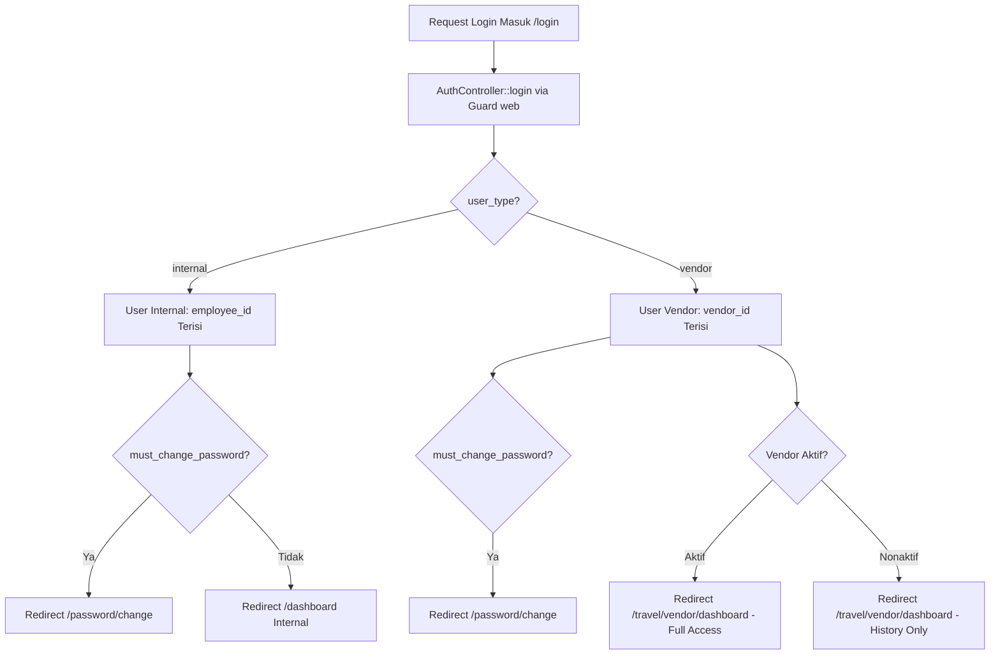
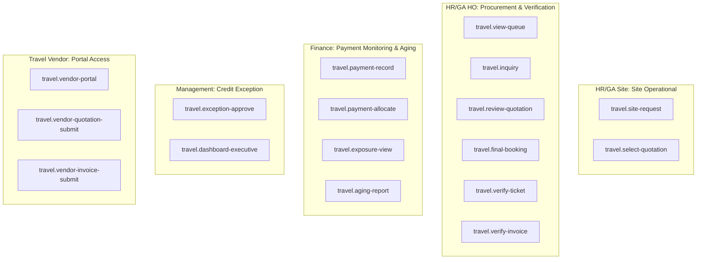

# EIMS AUTHENTICATION & AUTHORIZATION ARCHITECTURE DESIGN (P0.3)
## Modul: Travel Management & Vendor Payment Monitoring
**Aplikasi:** Enterprise Information Management System (EIMS) — Rapid Infrastruktur Indonesia  
**Versi Dokumen:** P0.3 — Refined Security & Access Control Specification  
**Status:** DRAFT SPECIFICATION (REVIEW ONLY — Menunggu Persetujuan Pemilik Proyek)  
**Dokumen Induk:** [`EIMS_TECHNICAL_BLUEPRINT_P0.3.md`](file:///c:/Users/it/Documents/projects/eims/EIMS_TECHNICAL_BLUEPRINT_P0.3.md)

---

## 1. PENDAHULUAN & TAKSONOMI INFORMASI

### 1.1 Tujuan Dokumen
Dokumen ini menetapkan spesifikasi arsitektur autentikasi, manajemen pengguna, dan kontrol otorisasi berbasis peran (*Role-Based Access Control / RBAC*) versi **P0.3** untuk modul **Travel Management & Vendor Payment Monitoring**. Dokumen ini secara khusus mengaudit dan merancang:
1. Rekomendasi autentikasi **Single Guard (`web`)** terpadu dan audit seluruh dampaknya terhadap sistem login internal, session, middleware `ForcePasswordChange`, user management, notifikasi, dan reset password.
2. Penegasan kolom `user_type` dan `vendor_id` pada tabel `users`.
3. Mekanisme **Tenant Isolation** multi-vendor berbasis *Global Query Scope* dan Laravel Policy pada seluruh endpoint (detail, update, download, pencarian).
4. Pembedaan hak akses antara rekanan aktif (untuk booking baru) dan rekanan nonaktif (akses read-only / penagihan transaksi historis).
5. Penerapan prinsip **Least Privilege** untuk membatasi hak akses operasional tanpa menyamaratakan role secara otomatis.

### 1.2 Taksonomi Status Informasi
- **`[FAKTA REPOSITORY]`**: Kondisi riil kode sumber `AuthController.php`, `User.php`, `UserController.php`, dan `ForcePasswordChange.php`.
- **`[REKOMENDASI TEKNIS]`**: Rancangan penyesuaian model, policy, scope, dan permission modul Travel Management.
- **`[KEPUTUSAN BISNIS BELUM FINAL (OPEN DECISIONS)]`**: Pembagian wewenang final antar-jabatan yang menunggu persetujuan manajemen (O-09).

---

## 2. AUDIT DAMPAK SINGLE GUARD TERPADU TERHADAP SISTEM EKSISTING

### 2.1 Desain Skema Akun Pengguna `users` P0.3 `[REKOMENDASI TEKNIS]`
Untuk mendukung akun rekanan vendor tanpa menciptakan data fiktif di tabel `employees`, skema tabel `users` disesuaikan melalui migrasi penambahan kolom:
```sql
ALTER TABLE `users`
ADD COLUMN `user_type` ENUM('internal', 'vendor') NOT NULL DEFAULT 'internal' AFTER `id`,
ADD COLUMN `vendor_id` BIGINT UNSIGNED NULL AFTER `employee_id`,
ADD COLUMN `email` VARCHAR(255) NULL AFTER `username`,
ADD CONSTRAINT `fk_users_vendor` FOREIGN KEY (`vendor_id`) 
    REFERENCES `vendors` (`id`) ON UPDATE CASCADE ON DELETE RESTRICT;
```

### 2.2 Matriks Audit Dampak Single Guard Terhadap Alur Kerja Eksisting



| Area Fungsionalitas | Perilaku Eksisting `[FAKTA REPOSITORY]` | Penyesuaian untuk User Vendor `[REKOMENDASI TEKNIS]` | Dampak Terhadap Karyawan Eksisting |
|---|---|---|---|
| **Form Login & AuthController** | Login menggunakan kredensial `username` & `password`. Verifikasi `is_active = true` dan proteksi rate limiter 5x/menit. | User vendor login menggunakan username & password yang sama pada guard `web`. Dapat diarahkan ke endpoint khusus `/vendor/login` atau tetap di `/login`. | **NOL (Zero Impact).** Logika login karyawan internal tidak berubah sama sekali. |
| **Session & Cookie Handling** | Menggunakan 1 session cookie standar Laravel (`laravel_session`). | Tetap menggunakan session cookie yang sama. Tidak ada tabrakan session multi-guard. | **NOL.** Sesi karyawan tetap aman dan konsisten. |
| **Force Password Change** | Middleware `ForcePasswordChange` mencegat user yang memiliki `must_change_password = true` dan mengalihkan ke `/password/change`. | Berlaku identik bagi user vendor baru saat pertama kali menerima kredensial akun dari admin. | **NOL.** Standar keamanan sandi berlaku sama kuatnya untuk vendor. |
| **User Management Eksisting (`Admin\UserController`)** | Validasi store mewajibkan `'employee_id' => ['required', 'exists:employees,id']`. | **DILARANG mengubah `Admin\UserController` eksisting.** Dibuat controller terpisah: `App\Http\Controllers\Travel\VendorUserController` untuk CRUD akun vendor. | **NOL.** Modul administrasi user internal tidak disentuh. |
| **Notifikasi Email (`routeNotificationForMail`)** | Mengambil email dari `$this->employee?->email`. Jika `employee_id = null`, return null. | Diperbarui agar membaca email dari akun atau master vendor: `return $this->employee?->email ?? $this->email ?? $this->vendor?->email;`. | **NOL.** Notifikasi untuk karyawan tetap menggunakan `$this->employee->email`. |
| **Reset Password** | Tabel `password_reset_tokens` menggunakan primary key `email`. | Karena tabel `users` kini memiliki kolom `email`, fitur reset password standar Laravel dapat digunakan oleh akun internal maupun vendor. | **POSITIF.** Karyawan yang akunnya diisi email dapat memanfaatkan fitur reset password. |

---

## 3. ARSITEKTUR TENANT ISOLATION MULTI-VENDOR SECARA MENYELURUH

### 3.1 Pembedaan Hak Akses Vendor Aktif vs Vendor Nonaktif `[PRD D-04, D-05]`
Sistem membedakan dua status operasional rekanan vendor:

| Fitur / Aksi di Portal | Rekanan Aktif (`is_active = 1`) | Rekanan Nonaktif (`is_active = 0`) | Alasan Bisnis |
|---|---|---|---|
| **Login ke Portal Vendor** | Diizinkan | Diizinkan | Rekanan lama tetap berhak memantau pembayaran dan tagihannya (D-05). |
| **Menerima Inquiry Baru** | Diizinkan | **DITOLAK (403 Forbidden)** | Hanya rekanan aktif yang berhak menerima order baru (D-04). |
| **Mengirim Quotation Baru** | Diizinkan | **DITOLAK (403 Forbidden)** | Mencegah rekanan nonaktif mengajukan penawaran baru. |
| **Menerima Konfirmasi Booking** | Diizinkan | **DITOLAK (403 Forbidden)** | Booking baru hanya untuk vendor aktif. |
| **Upload Dokumen E-Ticket** | Diizinkan | Diizinkan (khusus pesanan lama) | Tiket untuk booking yang terlanjur terbit sebelum nonaktif tetap wajib diunggah. |
| **Upload Tagihan Invoice** | Diizinkan | Diizinkan (khusus pesanan lama) | Rekanan berhak menagihkan pesanan masa lalu yang belum ditagihkan. |
| **Melihat Riwayat Pembayaran** | Diizinkan | Diizinkan | Transparansi histori pembayaran rekanan lama. |

### 3.2 Penegakan Global Query Scope Berbasis `vendor_id` Langsung `[REKOMENDASI TEKNIS]`
Pada P0.2, tabel `travel_tickets` belum memiliki `vendor_id` langsung sehingga Global Scope berisiko lambat karena multi-join. Pada P0.3, seluruh tabel data rekanan telah dilengkapi foreign key **`vendor_id` langsung**:
1. `travel_inquiries`
2. `vendor_quotations`
3. `travel_bookings`
4. `travel_tickets` *(disempurnakan di P0.3)*
5. `vendor_invoices`
6. `vendor_payments`
7. `vendor_credit_notes`

#### Implementasi Trait `BelongsToVendorScope`:
```php
namespace App\Models\Travel\Concerns;

use Illuminate\Database\Eloquent\Builder;

trait BelongsToVendorScope
{
    protected static function bootBelongsToVendorScope(): void
    {
        static::addGlobalScope('vendor_tenant', function (Builder $builder) {
            $user = auth()->user();

            // Jika user login bertipe 'vendor', batasi hanya data miliknya sendiri
            if ($user && $user->user_type === 'vendor' && $user->vendor_id) {
                $builder->where($builder->getModel()->getTable() . '.vendor_id', $user->vendor_id);
            }
        });
    }
}
```

---

## 4. PENERAPAN POLICY OTORISASI PADA SETIAP ENDPOINT (ANTI-IDOR)

Untuk mencegah serangan *Insecure Direct Object Reference* (IDOR) di mana Vendor A memanipulasi ID di URL untuk mengakses data Vendor B, Laravel Policy wajib diterapkan pada **seluruh endpoint**:

| Endpoint Route | Aksi Controller | Policy Method | Aturan Otorisasi Server-Side |
|---|---|---|---|
| `GET /travel/vendor/inquiries` | `index()` | `viewAny()` | `user->hasRole('Travel Vendor') && user->vendor_id !== null` |
| `GET /travel/vendor/inquiries/{inquiry}` | `show()` | `view(Inquiry)` | `(user->isInternal() && can('travel.inquiry')) || (user->isVendor() && user->vendor_id === inquiry->vendor_id)` |
| `POST /travel/vendor/quotations` | `store()` | `create(Quotation)`| `user->isVendor() && vendor->is_active === true` *(Vendor nonaktif ditolak)* |
| `GET /travel/vendor/bookings/{booking}` | `show()` | `view(Booking)` | `(user->isInternal() && can('travel.view-queue')) || (user->isVendor() && user->vendor_id === booking->vendor_id)` |
| `POST /travel/vendor/tickets/upload` | `upload()` | `uploadTicket(Booking)` | `user->isVendor() && user->vendor_id === booking->vendor_id` |
| `GET /travel/tickets/{ticket}/download` | `download()` | `downloadTicket(Ticket)` | Verifikasi user internal berhak ATAU vendor pemilik tiket (`user->vendor_id === ticket->vendor_id`). |
| `POST /travel/vendor/invoices` | `store()` | `createInvoice()` | `user->isVendor() && user->vendor_id === request->vendor_id` |
| `GET /travel/invoices/{invoice}/download` | `download()` | `downloadInvoice(Invoice)`| Verifikasi hak Finance / HR-HO ATAU vendor pemilik invoice. |

#### Contoh Implementasi Policy: `TravelTicketPolicy.php`
```php
namespace App\Policies\Travel;

use App\Models\User;
use App\Models\Travel\TravelTicket;

class TravelTicketPolicy
{
    public function download(User $user, TravelTicket $ticket): bool
    {
        // 1. User Internal yang berhak (HRD, Finance, Management, atau Karyawan Pelaksana Perjalanan)
        if ($user->user_type === 'internal') {
            if ($user->can('travel.verify-ticket') || $user->can('travel.view-queue')) {
                return true;
            }
            // Karyawan penumpang tiket bersangkutan berhak mengunduh tiketnya sendiri
            if ($ticket->passenger?->employee_id && $user->employee_id === $ticket->passenger->employee_id) {
                return true;
            }
        }

        // 2. User Vendor HANYA berhak jika vendor_id identik
        if ($user->user_type === 'vendor') {
            return (int) $user->vendor_id === (int) $ticket->vendor_id;
        }

        return false;
    }
}
```

---

## 5. PENERAPAN PRINSIP LEAST PRIVILEGE PADA ROLES & PERMISSIONS

Menghindari pemberian wewenang sensitif secara otomatis kepada seluruh pemegang role eksisting, hak akses dipetakan secara terperinci:



### 5.1 Rincian Pembatasan Wewenang (Least Privilege)
1. **Pemisahan HR/GA Site vs HR/GA HO:**
   - Personel Site **DILARANG** memiliki permission `travel.final-booking` (karena persetujuan alternatif Site bukan instruksi booking final, D-03).
   - Personel Site **DILARANG** memiliki permission `travel.verify-invoice` (verifikasi tagihan adalah wewenang eksklusif HO).
2. **Pemisahan HR/GA HO vs Finance:**
   - HR/GA HO memverifikasi kebenaran transaksi e-ticket dan keabsahan rincian tagihan vendor (`travel.verify-invoice`).
   - Namun, HR/GA HO **DILARANG** memiliki permission `travel.payment-record` atau `travel.payment-allocate` (pencatatan dan alokasi pembayaran adalah fungsi kontrol eksklusif Finance).
3. **Pemisahan Finance vs Management Exception:**
   - Finance memantau posisi credit exposure dan outstanding vendor (`travel.exposure-view`).
   - Namun, saat credit limit vendor habis, Finance **DILARANG** menyetujui pelampauan limit sendiri. Persetujuan exception diisolasi hanya pada permission `travel.exception-approve` (Management).

---
*Rancangan autentikasi & otorisasi P0.3 selesai. Lanjutkan penelaahan pada rencana pengujian regresi P0.3.*
