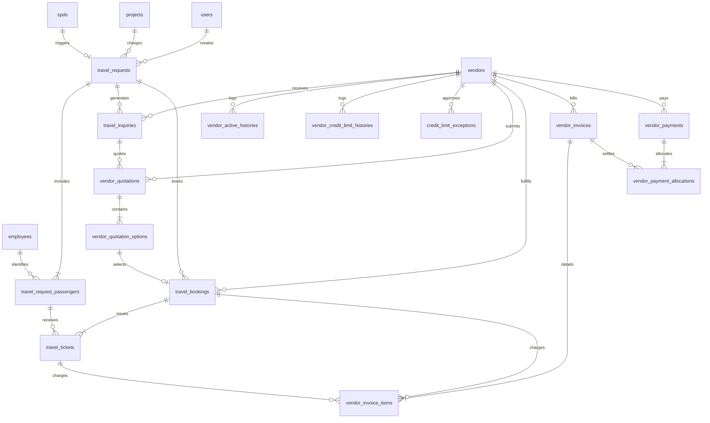

# EIMS DATABASE ARCHITECTURE & SCHEMA DESIGN (P0.2)
## Modul: Travel Management & Vendor Payment Monitoring
**Aplikasi:** Enterprise Information Management System (EIMS) — Rapid Infrastruktur Indonesia  
**Versi Dokumen:** P0.2 — Refined Database Blueprint  
**Status:** DRAFT SPECIFICATION (REVIEW ONLY — Menunggu Persetujuan Pemilik Proyek)  
**Dokumen Induk:** [`EIMS_TECHNICAL_BLUEPRINT_P0.2.md`](file:///c:/Users/it/Documents/projects/eims/EIMS_TECHNICAL_BLUEPRINT_P0.2.md)

---

## 1. PENDAHULUAN & PRINSIP DESAIN DATABASE

### 1.1 Tujuan Dokumen
Dokumen ini menyajikan rancangan skema database terperinci untuk modul **Travel Management & Vendor Payment Monitoring**, menyempurnakan 16 entitas konseptual yang diusulkan pada tahap P0. Rancangan ini telah ditelaah secara mendalam untuk:
1. Menghilangkan redundansi kolom dan mencegah inkonsistensi normalisasi.
2. Mendukung **multi-penumpang (*multi-passenger*)** baik untuk perjalanan berbasis SPD maupun Project Travel.
3. Mendukung **multi-moda & layanan** (penerbangan/flight, hotel/akomodasi, bus, travel/shuttle, kereta api, dan kapal laut).
4. Mendukung **satu invoice untuk banyak transaksi perjalanan (*multi-item billing*)**.
5. **Mencegah penagihan ganda (*anti-duplicate billing*)** melalui kombinasi indeks unik dan integritas referensial.
6. Mempertahankan **riwayat finansial vendor secara permanen** (*vendor-specific financial ledger*), sehingga pergantian vendor tidak merusak data historis rekanan lama.

### 1.2 Konvensi Teknis Skema
- **Storage Engine:** InnoDB (MySQL 8.0.46) untuk mendukung transaksi ACID dan foreign key constraints.
- **Karakter Set:** `utf8mb4` dengan collation `utf8mb4_unicode_ci`.
- **Nilai Finansial:** Seluruh kolom moneter wajib bertipe `DECIMAL(15, 2)` tanpa pengecualian (dilarang menggunakan `FLOAT` atau `DOUBLE`).
- **Penanggalan:** Menggunakan `DATE` untuk tanggal perjalanan/jatuh tempo dan `DATETIME` / `TIMESTAMP` untuk jejak waktu operasional.
- **Foreign Key Constraints:**
  - `ON UPDATE CASCADE` untuk fleksibilitas pemeliharaan kunci.
  - `ON DELETE RESTRICT` pada seluruh data transaksi finansial untuk mencegah penghapusan data penting secara tidak sengaja.
  - `ON DELETE CASCADE` hanya diizinkan untuk relasi *parent-child* ketat (misal: menghapus quotation option saat quotation induk dihapus pada status *draft*).

---

## 2. ENTITY RELATIONSHIP DIAGRAM (ERD) LENGKAP



---

## 3. REVIEW DAN PENYEMPURNAAN 16 TABEL USULAN (P0 VS P0.2)

Berdasarkan telaah mendalam terhadap kebutuhan PRD v1.2 dan struktur MySQL eksisting, berikut adalah penyempurnaan utama yang dilakukan:

1. **Pemisahan Penumpang dan Permintaan Perjalanan:**  
   Pada rancangan P0 awal, detail penumpang berisiko bercampur di tabel header. Di P0.2, tabel `travel_requests` murni berfungsi sebagai header permintaan, sedangkan daftar orang yang bepergian dipisahkan ke `travel_request_passengers` (mendukung 1 orang pada SPD dan banyak orang pada Project Travel).
2. **Dukungan Layanan Multi-Moda (Flight, Hotel, Transport):**  
   Kolom `service_type` (flight, hotel, bus, train, ferry, other) ditambahkan pada `vendor_quotation_options` dan `travel_tickets`, sehingga rekanan dapat menawarkan kombinasi tiket pesawat dan voucher hotel dalam satu paket perjalanan.
3. **Pemberian Indeks Unik Anti-Duplicate Billing:**  
   Penyempurnaan relasi `vendor_invoice_items` dengan `travel_booking_id` dan `ticket_id` yang dilengkapi indeks unik bersyarat untuk mencegah satu pesanan ditagih berulang kali dalam invoice berbeda.
4. **Isolasi Ledger Finansial Vendor:**  
   Menghapus risiko penggabungan outstanding antar-vendor. Setiap baris pembayaran dan invoice memiliki foreign key permanen ke `vendor_id`.

---

## 4. SPESIFIKASI DDL SKEMA TABEL SECARA RINCI

### 4.1 Master Rekanan & Kontrol Kredit Vendor

#### 1. Tabel `vendors`
Menyimpan profil master rekanan biro perjalanan (Travel Agency).
```sql
CREATE TABLE `vendors` (
    `id` BIGINT UNSIGNED NOT NULL AUTO_INCREMENT,
    `code` VARCHAR(50) NOT NULL,
    `name` VARCHAR(255) NOT NULL,
    `contact_person` VARCHAR(150) NULL,
    `phone` VARCHAR(50) NULL,
    `email` VARCHAR(255) NULL,
    `address` TEXT NULL,
    `bank_name` VARCHAR(100) NULL,
    `bank_account_number` VARCHAR(100) NULL,
    `bank_account_holder` VARCHAR(150) NULL,
    `is_active` TINYINT(1) NOT NULL DEFAULT 0,
    `credit_limit` DECIMAL(15, 2) NOT NULL DEFAULT 0.00,
    `created_at` TIMESTAMP NULL DEFAULT CURRENT_TIMESTAMP,
    `updated_at` TIMESTAMP NULL DEFAULT CURRENT_TIMESTAMP ON UPDATE CURRENT_TIMESTAMP,
    PRIMARY KEY (`id`),
    UNIQUE KEY `vendors_code_unique` (`code`)
) ENGINE=InnoDB DEFAULT CHARSET=utf8mb4 COLLATE=utf8mb4_unicode_ci;
```

#### 2. Tabel `vendor_active_histories`
Mencatat riwayat audit penetapan rekanan aktif, tanggal efektif, dan penonaktifannya.
```sql
CREATE TABLE `vendor_active_histories` (
    `id` BIGINT UNSIGNED NOT NULL AUTO_INCREMENT,
    `vendor_id` BIGINT UNSIGNED NOT NULL,
    `effective_date` DATE NOT NULL,
    `deactivated_date` DATE NULL,
    `changed_by` BIGINT UNSIGNED NOT NULL,
    `reason` TEXT NOT NULL,
    `created_at` TIMESTAMP NULL DEFAULT CURRENT_TIMESTAMP,
    `updated_at` TIMESTAMP NULL DEFAULT CURRENT_TIMESTAMP ON UPDATE CURRENT_TIMESTAMP,
    PRIMARY KEY (`id`),
    KEY `vah_vendor_id_index` (`vendor_id`),
    CONSTRAINT `fk_vah_vendor` FOREIGN KEY (`vendor_id`) 
        REFERENCES `vendors` (`id`) ON UPDATE CASCADE ON DELETE RESTRICT,
    CONSTRAINT `fk_vah_user` FOREIGN KEY (`changed_by`) 
        REFERENCES `users` (`id`) ON UPDATE CASCADE ON DELETE RESTRICT
) ENGINE=InnoDB DEFAULT CHARSET=utf8mb4 COLLATE=utf8mb4_unicode_ci;
```

#### 3. Tabel `vendor_credit_limit_histories`
Menyimpan riwayat perubahan limit kredit, pejabat penyetujui, dan justifikasinya.
```sql
CREATE TABLE `vendor_credit_limit_histories` (
    `id` BIGINT UNSIGNED NOT NULL AUTO_INCREMENT,
    `vendor_id` BIGINT UNSIGNED NOT NULL,
    `previous_limit` DECIMAL(15, 2) NOT NULL,
    `new_limit` DECIMAL(15, 2) NOT NULL,
    `effective_date` DATE NOT NULL,
    `approved_by` BIGINT UNSIGNED NOT NULL,
    `reason` TEXT NOT NULL,
    `created_at` TIMESTAMP NULL DEFAULT CURRENT_TIMESTAMP,
    `updated_at` TIMESTAMP NULL DEFAULT CURRENT_TIMESTAMP ON UPDATE CURRENT_TIMESTAMP,
    PRIMARY KEY (`id`),
    KEY `vclh_vendor_id_index` (`vendor_id`),
    CONSTRAINT `fk_vclh_vendor` FOREIGN KEY (`vendor_id`) 
        REFERENCES `vendors` (`id`) ON UPDATE CASCADE ON DELETE RESTRICT,
    CONSTRAINT `fk_vclh_user` FOREIGN KEY (`approved_by`) 
        REFERENCES `users` (`id`) ON UPDATE CASCADE ON DELETE RESTRICT
) ENGINE=InnoDB DEFAULT CHARSET=utf8mb4 COLLATE=utf8mb4_unicode_ci;
```

#### 4. Tabel `credit_limit_exceptions`
Menyimpan persetujuan khusus Management saat booking melampaui limit kredit.
```sql
CREATE TABLE `credit_limit_exceptions` (
    `id` BIGINT UNSIGNED NOT NULL AUTO_INCREMENT,
    `vendor_id` BIGINT UNSIGNED NOT NULL,
    `travel_booking_id` BIGINT UNSIGNED NULL,
    `exposure_at_approval` DECIMAL(15, 2) NOT NULL,
    `credit_limit_at_approval` DECIMAL(15, 2) NOT NULL,
    `booking_estimated_amount` DECIMAL(15, 2) NOT NULL,
    `reason` TEXT NOT NULL,
    `approved_by` BIGINT UNSIGNED NOT NULL,
    `approved_at` DATETIME NOT NULL,
    `created_at` TIMESTAMP NULL DEFAULT CURRENT_TIMESTAMP,
    `updated_at` TIMESTAMP NULL DEFAULT CURRENT_TIMESTAMP ON UPDATE CURRENT_TIMESTAMP,
    PRIMARY KEY (`id`),
    KEY `cle_vendor_id_index` (`vendor_id`),
    KEY `cle_booking_id_index` (`travel_booking_id`),
    CONSTRAINT `fk_cle_vendor` FOREIGN KEY (`vendor_id`) 
        REFERENCES `vendors` (`id`) ON UPDATE CASCADE ON DELETE RESTRICT,
    CONSTRAINT `fk_cle_user` FOREIGN KEY (`approved_by`) 
        REFERENCES `users` (`id`) ON UPDATE CASCADE ON DELETE RESTRICT
) ENGINE=InnoDB DEFAULT CHARSET=utf8mb4 COLLATE=utf8mb4_unicode_ci;
```

---

### 4.2 Permintaan Perjalanan (Travel Requests & Multi-Passengers)

#### 5. Tabel `travel_requests`
Header permintaan perjalanan terpusat (bersumber dari SPD Approved maupun Project Travel).
```sql
CREATE TABLE `travel_requests` (
    `id` BIGINT UNSIGNED NOT NULL AUTO_INCREMENT,
    `request_number` VARCHAR(50) NOT NULL,
    `source_type` ENUM('spd', 'project') NOT NULL,
    `spd_id` BIGINT UNSIGNED NULL,
    `project_id` BIGINT UNSIGNED NOT NULL,
    `travel_category` ENUM('spd', 'rotation_on', 'rotation_off', 'mobilization', 'demobilization') NOT NULL,
    `status` ENUM(
        'draft',
        'submitted',
        'under_review',
        'need_revision',
        'approved_for_booking',
        'in_booking_process',
        'completed',
        'rejected',
        'cancelled'
    ) NOT NULL DEFAULT 'draft',
    `from_location` VARCHAR(255) NOT NULL,
    `destination_location` VARCHAR(255) NOT NULL,
    `departure_date` DATE NOT NULL,
    `return_date` DATE NULL,
    `notes` TEXT NULL,
    `created_by` BIGINT UNSIGNED NOT NULL,
    `created_at` TIMESTAMP NULL DEFAULT CURRENT_TIMESTAMP,
    `updated_at` TIMESTAMP NULL DEFAULT CURRENT_TIMESTAMP ON UPDATE CURRENT_TIMESTAMP,
    PRIMARY KEY (`id`),
    UNIQUE KEY `tr_request_number_unique` (`request_number`),
    UNIQUE KEY `tr_spd_id_unique` (`spd_id`),
    KEY `tr_source_status_index` (`source_type`, `status`),
    KEY `tr_project_id_index` (`project_id`),
    CONSTRAINT `fk_tr_spd` FOREIGN KEY (`spd_id`) 
        REFERENCES `spds` (`id`) ON UPDATE CASCADE ON DELETE RESTRICT,
    CONSTRAINT `fk_tr_project` FOREIGN KEY (`project_id`) 
        REFERENCES `projects` (`id`) ON UPDATE CASCADE ON DELETE RESTRICT,
    CONSTRAINT `fk_tr_creator` FOREIGN KEY (`created_by`) 
        REFERENCES `users` (`id`) ON UPDATE CASCADE ON DELETE RESTRICT
) ENGINE=InnoDB DEFAULT CHARSET=utf8mb4 COLLATE=utf8mb4_unicode_ci;
```

#### 6. Tabel `travel_request_passengers`
Daftar seluruh penumpang yang didaftarkan dalam sebuah request (mendukung multi-karyawan dinamis).
```sql
CREATE TABLE `travel_request_passengers` (
    `id` BIGINT UNSIGNED NOT NULL AUTO_INCREMENT,
    `travel_request_id` BIGINT UNSIGNED NOT NULL,
    `employee_id` BIGINT UNSIGNED NULL,
    `passenger_name` VARCHAR(255) NOT NULL,
    `id_card_number` VARCHAR(50) NULL,
    `phone_number` VARCHAR(50) NULL,
    `gender` ENUM('male', 'female') NULL,
    `specific_needs` VARCHAR(255) NULL,
    `created_at` TIMESTAMP NULL DEFAULT CURRENT_TIMESTAMP,
    `updated_at` TIMESTAMP NULL DEFAULT CURRENT_TIMESTAMP ON UPDATE CURRENT_TIMESTAMP,
    PRIMARY KEY (`id`),
    KEY `trp_request_id_index` (`travel_request_id`),
    KEY `trp_employee_id_index` (`employee_id`),
    CONSTRAINT `fk_trp_request` FOREIGN KEY (`travel_request_id`) 
        REFERENCES `travel_requests` (`id`) ON UPDATE CASCADE ON DELETE CASCADE,
    CONSTRAINT `fk_trp_employee` FOREIGN KEY (`employee_id`) 
        REFERENCES `employees` (`id`) ON UPDATE CASCADE ON DELETE SET NULL
) ENGINE=InnoDB DEFAULT CHARSET=utf8mb4 COLLATE=utf8mb4_unicode_ci;
```

---

### 4.3 Inquiry, Quotation, Booking & Multi-Service E-Tickets

#### 7. Tabel `travel_inquiries`
Pesan permintaan penawaran resmi dari HR/GA HO kepada vendor aktif.
```sql
CREATE TABLE `travel_inquiries` (
    `id` BIGINT UNSIGNED NOT NULL AUTO_INCREMENT,
    `inquiry_number` VARCHAR(50) NOT NULL,
    `travel_request_id` BIGINT UNSIGNED NOT NULL,
    `vendor_id` BIGINT UNSIGNED NOT NULL,
    `status` ENUM(
        'draft',
        'sent',
        'responded',
        'revision_requested',
        'unable_to_fulfill',
        'closed',
        'cancelled'
    ) NOT NULL DEFAULT 'draft',
    `instructions` TEXT NULL,
    `sent_at` DATETIME NULL,
    `created_at` TIMESTAMP NULL DEFAULT CURRENT_TIMESTAMP,
    `updated_at` TIMESTAMP NULL DEFAULT CURRENT_TIMESTAMP ON UPDATE CURRENT_TIMESTAMP,
    PRIMARY KEY (`id`),
    UNIQUE KEY `ti_inquiry_number_unique` (`inquiry_number`),
    KEY `ti_request_vendor_index` (`travel_request_id`, `vendor_id`),
    CONSTRAINT `fk_ti_request` FOREIGN KEY (`travel_request_id`) 
        REFERENCES `travel_requests` (`id`) ON UPDATE CASCADE ON DELETE RESTRICT,
    CONSTRAINT `fk_ti_vendor` FOREIGN KEY (`vendor_id`) 
        REFERENCES `vendors` (`id`) ON UPDATE CASCADE ON DELETE RESTRICT
) ENGINE=InnoDB DEFAULT CHARSET=utf8mb4 COLLATE=utf8mb4_unicode_ci;
```

#### 8. Tabel `vendor_quotations`
Header penawaran harga yang diunggah oleh rekanan vendor.
```sql
CREATE TABLE `vendor_quotations` (
    `id` BIGINT UNSIGNED NOT NULL AUTO_INCREMENT,
    `inquiry_id` BIGINT UNSIGNED NOT NULL,
    `vendor_id` BIGINT UNSIGNED NOT NULL,
    `quotation_number` VARCHAR(50) NOT NULL,
    `version` INT UNSIGNED NOT NULL DEFAULT 1,
    `status` ENUM(
        'submitted',
        'under_review',
        'forwarded_to_site',
        'revision_requested',
        'selected',
        'rejected',
        'expired'
    ) NOT NULL DEFAULT 'submitted',
    `valid_until` DATETIME NOT NULL,
    `notes` TEXT NULL,
    `submitted_at` DATETIME NOT NULL,
    `created_at` TIMESTAMP NULL DEFAULT CURRENT_TIMESTAMP,
    `updated_at` TIMESTAMP NULL DEFAULT CURRENT_TIMESTAMP ON UPDATE CURRENT_TIMESTAMP,
    PRIMARY KEY (`id`),
    KEY `vq_inquiry_vendor_index` (`inquiry_id`, `vendor_id`),
    CONSTRAINT `fk_vq_inquiry` FOREIGN KEY (`inquiry_id`) 
        REFERENCES `travel_inquiries` (`id`) ON UPDATE CASCADE ON DELETE RESTRICT,
    CONSTRAINT `fk_vq_vendor` FOREIGN KEY (`vendor_id`) 
        REFERENCES `vendors` (`id`) ON UPDATE CASCADE ON DELETE RESTRICT
) ENGINE=InnoDB DEFAULT CHARSET=utf8mb4 COLLATE=utf8mb4_unicode_ci;
```

#### 9. Tabel `vendor_quotation_options`
Pilihan alternatif perjalanan (penerbangan, hotel, transportasi) yang ditawarkan vendor.
```sql
CREATE TABLE `vendor_quotation_options` (
    `id` BIGINT UNSIGNED NOT NULL AUTO_INCREMENT,
    `vendor_quotation_id` BIGINT UNSIGNED NOT NULL,
    `option_code` VARCHAR(20) NOT NULL, -- Contoh: 'OPSI-A', 'OPSI-B'
    `service_type` ENUM('flight', 'hotel', 'bus', 'train', 'ferry', 'other') NOT NULL DEFAULT 'flight',
    `operator_name` VARCHAR(150) NOT NULL, -- Nama maskapai / nama hotel / operator travel
    `class_type` VARCHAR(50) NULL, -- Economy, Business, Superior, Deluxe, dll.
    `departure_datetime` DATETIME NULL,
    `arrival_datetime` DATETIME NULL,
    `route_details` VARCHAR(255) NULL, -- Misal: CGK - BPN (GA-562)
    `baggage_allowance` VARCHAR(100) NULL,
    `price_per_pax` DECIMAL(15, 2) NOT NULL DEFAULT 0.00,
    `total_price` DECIMAL(15, 2) NOT NULL DEFAULT 0.00,
    `refund_policy` TEXT NULL,
    `is_selected` TINYINT(1) NOT NULL DEFAULT 0,
    `created_at` TIMESTAMP NULL DEFAULT CURRENT_TIMESTAMP,
    `updated_at` TIMESTAMP NULL DEFAULT CURRENT_TIMESTAMP ON UPDATE CURRENT_TIMESTAMP,
    PRIMARY KEY (`id`),
    KEY `vqo_quotation_id_index` (`vendor_quotation_id`),
    CONSTRAINT `fk_vqo_quotation` FOREIGN KEY (`vendor_quotation_id`) 
        REFERENCES `vendor_quotations` (`id`) ON UPDATE CASCADE ON DELETE CASCADE
) ENGINE=InnoDB DEFAULT CHARSET=utf8mb4 COLLATE=utf8mb4_unicode_ci;
```

#### 10. Tabel `travel_bookings`
Instruksi booking final yang disahkan oleh HR/GA HO berdasarkan opsi quotation yang disetujui Site.
```sql
CREATE TABLE `travel_bookings` (
    `id` BIGINT UNSIGNED NOT NULL AUTO_INCREMENT,
    `booking_number` VARCHAR(50) NOT NULL,
    `travel_request_id` BIGINT UNSIGNED NOT NULL,
    `vendor_id` BIGINT UNSIGNED NOT NULL,
    `selected_option_id` BIGINT UNSIGNED NOT NULL,
    `final_agreed_price` DECIMAL(15, 2) NOT NULL,
    `status` ENUM(
        'awaiting_confirmation',
        'confirmation_sent',
        'vendor_processing',
        'ticket_uploaded',
        'ticket_verified',
        'failed',
        'cancelled',
        'refund_pending',
        'refund_verified'
    ) NOT NULL DEFAULT 'awaiting_confirmation',
    `instruction_notes` TEXT NULL,
    `instruction_sent_at` DATETIME NULL,
    `confirmed_by` BIGINT UNSIGNED NULL,
    `created_at` TIMESTAMP NULL DEFAULT CURRENT_TIMESTAMP,
    `updated_at` TIMESTAMP NULL DEFAULT CURRENT_TIMESTAMP ON UPDATE CURRENT_TIMESTAMP,
    PRIMARY KEY (`id`),
    UNIQUE KEY `tb_booking_number_unique` (`booking_number`),
    KEY `tb_request_vendor_index` (`travel_request_id`, `vendor_id`),
    CONSTRAINT `fk_tb_request` FOREIGN KEY (`travel_request_id`) 
        REFERENCES `travel_requests` (`id`) ON UPDATE CASCADE ON DELETE RESTRICT,
    CONSTRAINT `fk_tb_vendor` FOREIGN KEY (`vendor_id`) 
        REFERENCES `vendors` (`id`) ON UPDATE CASCADE ON DELETE RESTRICT,
    CONSTRAINT `fk_tb_option` FOREIGN KEY (`selected_option_id`) 
        REFERENCES `vendor_quotation_options` (`id`) ON UPDATE CASCADE ON DELETE RESTRICT,
    CONSTRAINT `fk_tb_user` FOREIGN KEY (`confirmed_by`) 
        REFERENCES `users` (`id`) ON UPDATE CASCADE ON DELETE SET NULL
) ENGINE=InnoDB DEFAULT CHARSET=utf8mb4 COLLATE=utf8mb4_unicode_ci;
```

#### 11. Tabel `travel_tickets`
Berkas e-ticket / voucher akomodasi yang diunggah vendor dan diverifikasi oleh HR/GA HO.
```sql
CREATE TABLE `travel_tickets` (
    `id` BIGINT UNSIGNED NOT NULL AUTO_INCREMENT,
    `travel_booking_id` BIGINT UNSIGNED NOT NULL,
    `passenger_id` BIGINT UNSIGNED NOT NULL,
    `service_type` ENUM('flight', 'hotel', 'bus', 'train', 'ferry', 'other') NOT NULL DEFAULT 'flight',
    `ticket_or_voucher_number` VARCHAR(100) NOT NULL,
    `booking_reference_pnr` VARCHAR(50) NULL,
    `file_path` VARCHAR(255) NOT NULL, -- Tersimpan privat di disk local (FR-24)
    `is_verified` TINYINT(1) NOT NULL DEFAULT 0,
    `verified_by` BIGINT UNSIGNED NULL,
    `verified_at` DATETIME NULL,
    `rejection_reason` TEXT NULL,
    `created_at` TIMESTAMP NULL DEFAULT CURRENT_TIMESTAMP,
    `updated_at` TIMESTAMP NULL DEFAULT CURRENT_TIMESTAMP ON UPDATE CURRENT_TIMESTAMP,
    PRIMARY KEY (`id`),
    KEY `tt_booking_id_index` (`travel_booking_id`),
    KEY `tt_passenger_id_index` (`passenger_id`),
    CONSTRAINT `fk_tt_booking` FOREIGN KEY (`travel_booking_id`) 
        REFERENCES `travel_bookings` (`id`) ON UPDATE CASCADE ON DELETE RESTRICT,
    CONSTRAINT `fk_tt_passenger` FOREIGN KEY (`passenger_id`) 
        REFERENCES `travel_request_passengers` (`id`) ON UPDATE CASCADE ON DELETE RESTRICT,
    CONSTRAINT `fk_tt_verifier` FOREIGN KEY (`verified_by`) 
        REFERENCES `users` (`id`) ON UPDATE CASCADE ON DELETE SET NULL
) ENGINE=InnoDB DEFAULT CHARSET=utf8mb4 COLLATE=utf8mb4_unicode_ci;
```

---

### 4.4 Invoice, Payment Monitoring & Anti-Duplicate Billing

#### 12. Tabel `vendor_invoices`
Header tagihan dari vendor (dapat memuat banyak transaksi perjalanan/booking).
```sql
CREATE TABLE `vendor_invoices` (
    `id` BIGINT UNSIGNED NOT NULL AUTO_INCREMENT,
    `vendor_id` BIGINT UNSIGNED NOT NULL,
    `invoice_number` VARCHAR(100) NOT NULL,
    `invoice_date` DATE NOT NULL,
    `due_date` DATE NOT NULL,
    `subtotal_amount` DECIMAL(15, 2) NOT NULL DEFAULT 0.00,
    `tax_amount` DECIMAL(15, 2) NOT NULL DEFAULT 0.00,
    `total_amount` DECIMAL(15, 2) NOT NULL DEFAULT 0.00,
    `paid_amount` DECIMAL(15, 2) NOT NULL DEFAULT 0.00,
    `balance_amount` DECIMAL(15, 2) NOT NULL DEFAULT 0.00,
    `file_path` VARCHAR(255) NOT NULL, -- PDF faktur disimpan di storage privat
    `status` ENUM(
        'submitted',
        'under_verification',
        'need_clarification',
        'verified',
        'rejected',
        'partially_paid',
        'paid',
        'overdue'
    ) NOT NULL DEFAULT 'submitted',
    `verification_notes` TEXT NULL,
    `verified_by` BIGINT UNSIGNED NULL,
    `verified_at` DATETIME NULL,
    `created_at` TIMESTAMP NULL DEFAULT CURRENT_TIMESTAMP,
    `updated_at` TIMESTAMP NULL DEFAULT CURRENT_TIMESTAMP ON UPDATE CURRENT_TIMESTAMP,
    PRIMARY KEY (`id`),
    -- Garansi nomor invoice tidak boleh kembar untuk vendor yang sama
    UNIQUE KEY `vi_vendor_invoice_number_unique` (`vendor_id`, `invoice_number`),
    KEY `vi_status_due_date_index` (`status`, `due_date`),
    KEY `vi_vendor_id_index` (`vendor_id`),
    CONSTRAINT `fk_vi_vendor` FOREIGN KEY (`vendor_id`) 
        REFERENCES `vendors` (`id`) ON UPDATE CASCADE ON DELETE RESTRICT,
    CONSTRAINT `fk_vi_verifier` FOREIGN KEY (`verified_by`) 
        REFERENCES `users` (`id`) ON UPDATE CASCADE ON DELETE SET NULL
) ENGINE=InnoDB DEFAULT CHARSET=utf8mb4 COLLATE=utf8mb4_unicode_ci;
```

#### 13. Tabel `vendor_invoice_items`
Rincian pesanan perjalanan yang ditagihkan di dalam invoice. Dilengkapi indeks unik untuk **mencegah penagihan ganda (*anti-duplicate billing*)**.
```sql
CREATE TABLE `vendor_invoice_items` (
    `id` BIGINT UNSIGNED NOT NULL AUTO_INCREMENT,
    `vendor_invoice_id` BIGINT UNSIGNED NOT NULL,
    `travel_booking_id` BIGINT UNSIGNED NOT NULL,
    `ticket_id` BIGINT UNSIGNED NULL,
    `description` VARCHAR(255) NOT NULL,
    `amount` DECIMAL(15, 2) NOT NULL DEFAULT 0.00,
    `tax_amount` DECIMAL(15, 2) NOT NULL DEFAULT 0.00,
    `total_amount` DECIMAL(15, 2) NOT NULL DEFAULT 0.00,
    `created_at` TIMESTAMP NULL DEFAULT CURRENT_TIMESTAMP,
    `updated_at` TIMESTAMP NULL DEFAULT CURRENT_TIMESTAMP ON UPDATE CURRENT_TIMESTAMP,
    PRIMARY KEY (`id`),
    KEY `vii_invoice_id_index` (`vendor_invoice_id`),
    KEY `vii_booking_id_index` (`travel_booking_id`),
    -- Cek integritas: Memastikan item terikat ke booking dan invoice
    CONSTRAINT `fk_vii_invoice` FOREIGN KEY (`vendor_invoice_id`) 
        REFERENCES `vendor_invoices` (`id`) ON UPDATE CASCADE ON DELETE RESTRICT,
    CONSTRAINT `fk_vii_booking` FOREIGN KEY (`travel_booking_id`) 
        REFERENCES `travel_bookings` (`id`) ON UPDATE CASCADE ON DELETE RESTRICT,
    CONSTRAINT `fk_vii_ticket` FOREIGN KEY (`ticket_id`) 
        REFERENCES `travel_tickets` (`id`) ON UPDATE CASCADE ON DELETE SET NULL
) ENGINE=InnoDB DEFAULT CHARSET=utf8mb4 COLLATE=utf8mb4_unicode_ci;
```
*Aturan Anti-Duplicate Billing di Tingkat Aplikasi:*  
Sebelum `vendor_invoice_items` disimpan, query verifikasi dijalankan:
```sql
SELECT vii.id, vi.invoice_number 
FROM vendor_invoice_items vii
JOIN vendor_invoices vi ON vi.id = vii.vendor_invoice_id
WHERE vii.travel_booking_id = :booking_id 
  AND vi.status NOT IN ('rejected', 'cancelled');
```
Jika ditemukan record aktif, request invoice ditolak dengan kode validasi 422: *"Transaksi pesanan ini telah ditagihkan sebelumnya pada Invoice No. [X]."*

#### 14. Tabel `vendor_payments`
Pencatatan realisasi pembayaran riil oleh tim Finance EIMS (Payment Monitoring).
```sql
CREATE TABLE `vendor_payments` (
    `id` BIGINT UNSIGNED NOT NULL AUTO_INCREMENT,
    `vendor_id` BIGINT UNSIGNED NOT NULL,
    `payment_number` VARCHAR(50) NOT NULL,
    `payment_date` DATE NOT NULL,
    `amount` DECIMAL(15, 2) NOT NULL,
    `payment_method` VARCHAR(100) NOT NULL, -- Bank Transfer, Giro, dll.
    `reference_number` VARCHAR(100) NULL, -- Nomor referensi bank transfer
    `rfp_reference_number` VARCHAR(100) NULL, -- Referensi nomor RFP internal (opsional, FR-14)
    `proof_file_path` VARCHAR(255) NULL, -- Bukti transfer disimpan privat
    `notes` TEXT NULL,
    `recorded_by` BIGINT UNSIGNED NOT NULL,
    `created_at` TIMESTAMP NULL DEFAULT CURRENT_TIMESTAMP,
    `updated_at` TIMESTAMP NULL DEFAULT CURRENT_TIMESTAMP ON UPDATE CURRENT_TIMESTAMP,
    PRIMARY KEY (`id`),
    UNIQUE KEY `vp_payment_number_unique` (`payment_number`),
    KEY `vp_vendor_date_index` (`vendor_id`, `payment_date`),
    CONSTRAINT `fk_vp_vendor` FOREIGN KEY (`vendor_id`) 
        REFERENCES `vendors` (`id`) ON UPDATE CASCADE ON DELETE RESTRICT,
    CONSTRAINT `fk_vp_recorder` FOREIGN KEY (`recorded_by`) 
        REFERENCES `users` (`id`) ON UPDATE CASCADE ON DELETE RESTRICT
) ENGINE=InnoDB DEFAULT CHARSET=utf8mb4 COLLATE=utf8mb4_unicode_ci;
```

#### 15. Tabel `vendor_payment_allocations`
Alokasi dana pembayaran terhadap satu atau banyak tagihan (mendukung *partial payment* dan *bulk settlement*).
```sql
CREATE TABLE `vendor_payment_allocations` (
    `id` BIGINT UNSIGNED NOT NULL AUTO_INCREMENT,
    `vendor_payment_id` BIGINT UNSIGNED NOT NULL,
    `vendor_invoice_id` BIGINT UNSIGNED NOT NULL,
    `allocated_amount` DECIMAL(15, 2) NOT NULL,
    `created_at` TIMESTAMP NULL DEFAULT CURRENT_TIMESTAMP,
    `updated_at` TIMESTAMP NULL DEFAULT CURRENT_TIMESTAMP ON UPDATE CURRENT_TIMESTAMP,
    PRIMARY KEY (`id`),
    KEY `vpa_payment_id_index` (`vendor_payment_id`),
    KEY `vpa_invoice_id_index` (`vendor_invoice_id`),
    CONSTRAINT `fk_vpa_payment` FOREIGN KEY (`vendor_payment_id`) 
        REFERENCES `vendor_payments` (`id`) ON UPDATE CASCADE ON DELETE RESTRICT,
    CONSTRAINT `fk_vpa_invoice` FOREIGN KEY (`vendor_invoice_id`) 
        REFERENCES `vendor_invoices` (`id`) ON UPDATE CASCADE ON DELETE RESTRICT
) ENGINE=InnoDB DEFAULT CHARSET=utf8mb4 COLLATE=utf8mb4_unicode_ci;
```

#### 16. Tabel `travel_audit_logs`
Mencatat seluruh rekam jejak keputusan bisnis, perubahan status, harga penawaran, dan approval exception.
```sql
CREATE TABLE `travel_audit_logs` (
    `id` BIGINT UNSIGNED NOT NULL AUTO_INCREMENT,
    `auditable_type` VARCHAR(100) NOT NULL,
    `auditable_id` BIGINT UNSIGNED NOT NULL,
    `action` VARCHAR(50) NOT NULL, -- create, update, approve, reject, verify, allocate
    `actor_id` BIGINT UNSIGNED NOT NULL,
    `old_values` JSON NULL,
    `new_values` JSON NULL,
    `ip_address` VARCHAR(45) NULL,
    `user_agent` TEXT NULL,
    `created_at` TIMESTAMP NOT NULL DEFAULT CURRENT_TIMESTAMP,
    PRIMARY KEY (`id`),
    KEY `tal_auditable_index` (`auditable_type`, `auditable_id`),
    KEY `tal_actor_id_index` (`actor_id`),
    CONSTRAINT `fk_tal_actor` FOREIGN KEY (`actor_id`) 
        REFERENCES `users` (`id`) ON UPDATE CASCADE ON DELETE RESTRICT
) ENGINE=InnoDB DEFAULT CHARSET=utf8mb4 COLLATE=utf8mb4_unicode_ci;
```

---

## 5. SKENARIO INTEGRITAS DATA KHUSUS

### 5.1 Penanganan Multi-Moda & Multi-Layanan
Satu perjalanan dinas seringkali membutuhkan penerbangan sekaligus reservasi hotel.
- Tabel `vendor_quotation_options` memiliki kolom `service_type` (`flight`, `hotel`, dll.). Rekanan dapat memasukkan beberapa alternatif untuk masing-masing moda.
- Saat booking disahkan, tabel `travel_tickets` menampung tiket penerbangan (PNR) dan voucher hotel untuk masing-masing penumpang secara fleksibel.

### 5.2 Penanganan Multi-Item Invoicing & Pembayaran Parsial
- Satu vendor invoice dapat memiliki banyak baris item pada `vendor_invoice_items`, di mana masing-masing baris item mereferensikan `travel_booking_id` yang berbeda.
- Total faktur divalidasi:
  $$\text{subtotal\_amount} = \sum (\text{item.amount})$$
  $$\text{total\_amount} = \text{subtotal\_amount} + \text{tax\_amount}$$
- Saat pembayaran dicatat oleh Finance di `vendor_payments`, alokasi ke invoice disimpan di `vendor_payment_allocations`.
- Saldo invoice diperbarui secara otomatis:
  $$\text{paid\_amount} = \sum (\text{allocated\_amount})$$
  $$\text{balance\_amount} = \text{total\_amount} - \text{paid\_amount}$$
- Status invoice secara otomatis berganti dari `partially_paid` menjadi `paid` tepat saat $\text{balance\_amount} = 0.00$.

---
*Rancangan database P0.2 selesai. Lanjutkan penelaahan pada dokumen arsitektur autentikasi dan otorisasi.*
