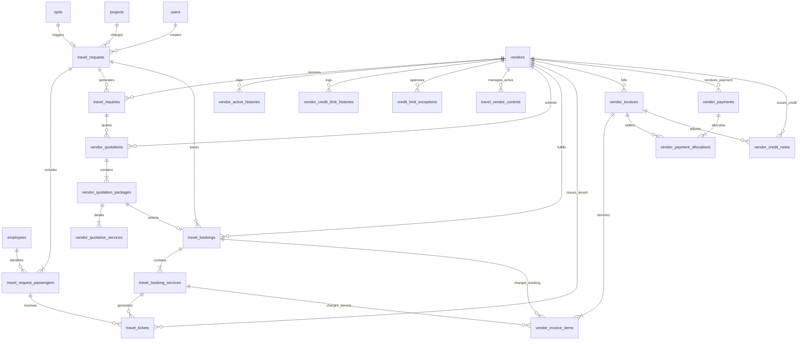

# EIMS DATABASE ARCHITECTURE & SCHEMA DESIGN (P0.3)
## Modul: Travel Management & Vendor Payment Monitoring
**Aplikasi:** Enterprise Information Management System (EIMS) — Rapid Infrastruktur Indonesia  
**Versi Dokumen:** P0.3 — Refined Database Specification  
**Status:** DRAFT SPECIFICATION (REVIEW ONLY — Menunggu Persetujuan Pemilik Proyek)  
**Dokumen Induk:** [`EIMS_TECHNICAL_BLUEPRINT_P0.3.md`](file:///c:/Users/it/Documents/projects/eims/EIMS_TECHNICAL_BLUEPRINT_P0.3.md)

---

## 1. PENDAHULUAN & TAKSONOMI INFORMASI

### 1.1 Tujuan Dokumen
Dokumen ini menetapkan spesifikasi skema basis data MySQL 8.0.46 versi **P0.3** untuk modul **Travel Management & Vendor Payment Monitoring**, menyempurnakan rancangan P0.2 dengan fokus pada:
1. Paket penawaran multi-layanan (*multi-service quotation package*): mendukung satu opsi perjalanan yang terdiri atas gabungan penerbangan, akomodasi hotel, dan transportasi darat.
2. Penegasan relasi hierarki antara Booking, Penumpang, Service Item, dan E-Ticket.
3. Mekanisme **anti-double billing** yang kokoh terhadap kondisi *race condition* konkurensi di MySQL 8.
4. Validasi integritas lintas-vendor (*cross-vendor integrity validation*) pada alokasi pembayaran.
5. Mekanisme koreksi / pembatalan pembayaran (*payment reversal*) dengan jejak audit lengkap.
6. Penanganan nota kredit, pembatalan, dan *refund*.

### 1.2 Taksonomi Status Informasi
- **`[FAKTA REPOSITORY]`**: Berdasarkan skema tabel eksisting di database MySQL `eims` (18 migrasi berstatus *Ran*).
- **`[REKOMENDASI TEKNIS]`**: Rancangan skema delta baru, indeks, constraints, dan kontrol integritas transaksional.
- **`[KEPUTUSAN BISNIS BELUM FINAL (OPEN DECISIONS)]`**: Poin-poin O-01 s/d O-12 yang parameter finalnya memerlukan persetujuan pemilik proyek.

---

## 2. ENTITY RELATIONSHIP DIAGRAM (ERD) LENGKAP P0.3



---

## 3. RELASI DETAIL: BOOKING, PENUMPANG, SERVICE ITEM, DAN TIKET

Salah satu penyempurnaan utama P0.3 adalah penataan hierarki pemesanan agar dapat merepresentasikan perjalanan bisnis nyata:
1. **`travel_requests` & `travel_request_passengers`:**  
   Menentukan *siapa* yang bepergian dan *kebutuhan layanannya* (misal: 3 orang karyawan ke Site Balikpapan).
2. **`vendor_quotations`, `vendor_quotation_packages`, & `vendor_quotation_services`:**  
   Vendor mengajukan penawaran berupa **Paket Pilihan** (misal: "Paket Opsi 1: Garuda + Hotel Novotel" vs "Paket Opsi 2: Lion Air + Hotel Ibis"). Masing-masing paket memuat rincian layanan (*services*).
3. **`travel_bookings` & `travel_booking_services`:**  
   Saat HR/GA HO menerbitkan konfirmasi booking final berdasarkan paket yang disetujui HR/GA Site, pesanan dipecah menjadi *booking service items* (Tiket Pesawat Pergi, Voucher Hotel 3 Malam, Tiket Pesawat Pulang).
4. **`travel_tickets`:**  
   Masing-masing penumpang pada masing-masing layanan menerima tiket / voucher spesifik (contoh: Penumpang A menerima E-Ticket Garuda GA-562 dan Voucher Hotel Novotel; Penumpang B menerima tiket yang sama dengan nomor tiket individual).
   - **Penyempurnaan Tenant Isolation:** Tabel `travel_tickets` diberikan kolom **`vendor_id` langsung** (denormalized FK) yang diindeks, sehingga query vendor portal tidak perlu melakukan multi-table join untuk memverifikasi kepemilikan tiket.

---

## 4. SKEMA TABEL LENGKAP & SPESIFIKASI DDL (MYSQL 8.0.46)

### 4.1 Master Rekanan, Kontrol Kredit & Singleton Mutex

#### 1. Tabel `vendors` `[REKOMENDASI TEKNIS]`
```sql
CREATE TABLE `vendors` (
    `id` BIGINT UNSIGNED NOT NULL AUTO_INCREMENT,
    `code` VARCHAR(50) NOT NULL,
    `name` VARCHAR(255) NOT NULL,
    `contact_person` VARCHAR(150) NULL,
    `phone` VARCHAR(50) NULL,
    `email` VARCHAR(255) NULL,
    `address` TEXT NULL,
    `bank_name` VARCHAR(100) NULL,
    `bank_account_number` VARCHAR(100) NULL,
    `bank_account_holder` VARCHAR(150) NULL,
    `is_active` TINYINT(1) NOT NULL DEFAULT 0,
    `credit_limit` DECIMAL(15, 2) NOT NULL DEFAULT 0.00,
    `created_at` TIMESTAMP NULL DEFAULT CURRENT_TIMESTAMP,
    `updated_at` TIMESTAMP NULL DEFAULT CURRENT_TIMESTAMP ON UPDATE CURRENT_TIMESTAMP,
    PRIMARY KEY (`id`),
    UNIQUE KEY `vendors_code_unique` (`code`)
) ENGINE=InnoDB DEFAULT CHARSET=utf8mb4 COLLATE=utf8mb4_unicode_ci;
```

#### 2. Tabel `travel_vendor_controls` (Singleton Mutex Lock) `[REKOMENDASI TEKNIS]`
Menyimpan satu baris data (*id = 1*) sebagai pengunci konkurensi aktivasi vendor.
```sql
CREATE TABLE `travel_vendor_controls` (
    `id` TINYINT UNSIGNED NOT NULL DEFAULT 1,
    `active_vendor_id` BIGINT UNSIGNED NULL,
    `updated_at` TIMESTAMP NULL DEFAULT CURRENT_TIMESTAMP ON UPDATE CURRENT_TIMESTAMP,
    PRIMARY KEY (`id`),
    CONSTRAINT `fk_tvc_vendor` FOREIGN KEY (`active_vendor_id`) 
        REFERENCES `vendors` (`id`) ON UPDATE CASCADE ON DELETE RESTRICT,
    CONSTRAINT `chk_tvc_singleton` CHECK (`id` = 1)
) ENGINE=InnoDB DEFAULT CHARSET=utf8mb4 COLLATE=utf8mb4_unicode_ci;
```

#### 3. Tabel `vendor_active_histories` `[REKOMENDASI TEKNIS]`
```sql
CREATE TABLE `vendor_active_histories` (
    `id` BIGINT UNSIGNED NOT NULL AUTO_INCREMENT,
    `vendor_id` BIGINT UNSIGNED NOT NULL,
    `effective_date` DATE NOT NULL,
    `deactivated_date` DATE NULL,
    `changed_by` BIGINT UNSIGNED NOT NULL,
    `reason` TEXT NOT NULL,
    `created_at` TIMESTAMP NULL DEFAULT CURRENT_TIMESTAMP,
    `updated_at` TIMESTAMP NULL DEFAULT CURRENT_TIMESTAMP ON UPDATE CURRENT_TIMESTAMP,
    PRIMARY KEY (`id`),
    KEY `vah_vendor_id_index` (`vendor_id`),
    CONSTRAINT `fk_vah_vendor` FOREIGN KEY (`vendor_id`) 
        REFERENCES `vendors` (`id`) ON UPDATE CASCADE ON DELETE RESTRICT,
    CONSTRAINT `fk_vah_user` FOREIGN KEY (`changed_by`) 
        REFERENCES `users` (`id`) ON UPDATE CASCADE ON DELETE RESTRICT
) ENGINE=InnoDB DEFAULT CHARSET=utf8mb4 COLLATE=utf8mb4_unicode_ci;
```

#### 4. Tabel `vendor_credit_limit_histories` `[REKOMENDASI TEKNIS]`
Menyimpan riwayat penetapan dan persetujuan formal kredit limit.
```sql
CREATE TABLE `vendor_credit_limit_histories` (
    `id` BIGINT UNSIGNED NOT NULL AUTO_INCREMENT,
    `vendor_id` BIGINT UNSIGNED NOT NULL,
    `previous_limit` DECIMAL(15, 2) NOT NULL DEFAULT 0.00,
    `new_limit` DECIMAL(15, 2) NOT NULL,
    `approval_status` ENUM('pending', 'approved', 'rejected') NOT NULL DEFAULT 'pending',
    `effective_date` DATE NOT NULL,
    `approved_by` BIGINT UNSIGNED NULL,
    `approved_at` DATETIME NULL,
    `reason` TEXT NOT NULL,
    `created_at` TIMESTAMP NULL DEFAULT CURRENT_TIMESTAMP,
    `updated_at` TIMESTAMP NULL DEFAULT CURRENT_TIMESTAMP ON UPDATE CURRENT_TIMESTAMP,
    PRIMARY KEY (`id`),
    KEY `vclh_vendor_status_index` (`vendor_id`, `approval_status`),
    CONSTRAINT `fk_vclh_vendor` FOREIGN KEY (`vendor_id`) 
        REFERENCES `vendors` (`id`) ON UPDATE CASCADE ON DELETE RESTRICT,
    CONSTRAINT `fk_vclh_user` FOREIGN KEY (`approved_by`) 
        REFERENCES `users` (`id`) ON UPDATE CASCADE ON DELETE SET NULL
) ENGINE=InnoDB DEFAULT CHARSET=utf8mb4 COLLATE=utf8mb4_unicode_ci;
```

#### 5. Tabel `credit_limit_exceptions` `[REKOMENDASI TEKNIS]`
```sql
CREATE TABLE `credit_limit_exceptions` (
    `id` BIGINT UNSIGNED NOT NULL AUTO_INCREMENT,
    `vendor_id` BIGINT UNSIGNED NOT NULL,
    `travel_booking_id` BIGINT UNSIGNED NULL,
    `exposure_at_approval` DECIMAL(15, 2) NOT NULL,
    `credit_limit_at_approval` DECIMAL(15, 2) NOT NULL,
    `booking_estimated_amount` DECIMAL(15, 2) NOT NULL,
    `reason` TEXT NOT NULL,
    `approved_by` BIGINT UNSIGNED NOT NULL,
    `approved_at` DATETIME NOT NULL,
    `created_at` TIMESTAMP NULL DEFAULT CURRENT_TIMESTAMP,
    `updated_at` TIMESTAMP NULL DEFAULT CURRENT_TIMESTAMP ON UPDATE CURRENT_TIMESTAMP,
    PRIMARY KEY (`id`),
    KEY `cle_vendor_index` (`vendor_id`),
    CONSTRAINT `fk_cle_vendor` FOREIGN KEY (`vendor_id`) 
        REFERENCES `vendors` (`id`) ON UPDATE CASCADE ON DELETE RESTRICT,
    CONSTRAINT `fk_cle_user` FOREIGN KEY (`approved_by`) 
        REFERENCES `users` (`id`) ON UPDATE CASCADE ON DELETE RESTRICT
) ENGINE=InnoDB DEFAULT CHARSET=utf8mb4 COLLATE=utf8mb4_unicode_ci;
```

---

### 4.2 Permintaan Perjalanan (Travel Requests & Multi-Passengers)

#### 6. Tabel `travel_requests` `[REKOMENDASI TEKNIS]`
Dilengkapi field operasional lengkap sesuai PRD v1.2: tanggal/waktu request, jendela waktu keberangkatan/kepulangan, dan kebutuhan layanan.
```sql
CREATE TABLE `travel_requests` (
    `id` BIGINT UNSIGNED NOT NULL AUTO_INCREMENT,
    `request_number` VARCHAR(50) NOT NULL,
    `source_type` ENUM('spd', 'project') NOT NULL,
    `spd_id` BIGINT UNSIGNED NULL,
    `project_id` BIGINT UNSIGNED NOT NULL,
    `travel_category` ENUM('spd', 'rotation_on', 'rotation_off', 'mobilization', 'demobilization') NOT NULL,
    `status` ENUM(
        'draft',
        'submitted',
        'under_review',
        'need_revision',
        'approved_for_booking',
        'in_booking_process',
        'completed',
        'rejected',
        'cancelled'
    ) NOT NULL DEFAULT 'draft',
    `request_date` DATE NOT NULL,
    `from_location` VARCHAR(255) NOT NULL,
    `destination_location` VARCHAR(255) NOT NULL,
    `departure_date` DATE NOT NULL,
    `departure_time_window` ENUM('morning', 'afternoon', 'evening', 'flexible') NOT NULL DEFAULT 'flexible',
    `return_date` DATE NULL,
    `return_time_window` ENUM('morning', 'afternoon', 'evening', 'flexible') NULL DEFAULT 'flexible',
    -- Kebutuhan layanan (Service Requirements)
    `need_flight` TINYINT(1) NOT NULL DEFAULT 1,
    `need_hotel` TINYINT(1) NOT NULL DEFAULT 0,
    `need_local_transport` TINYINT(1) NOT NULL DEFAULT 0,
    `hotel_notes` VARCHAR(255) NULL,
    `purpose_description` TEXT NOT NULL,
    `notes` TEXT NULL,
    `created_by` BIGINT UNSIGNED NOT NULL,
    `created_at` TIMESTAMP NULL DEFAULT CURRENT_TIMESTAMP,
    `updated_at` TIMESTAMP NULL DEFAULT CURRENT_TIMESTAMP ON UPDATE CURRENT_TIMESTAMP,
    PRIMARY KEY (`id`),
    UNIQUE KEY `tr_request_number_unique` (`request_number`),
    UNIQUE KEY `tr_spd_id_unique` (`spd_id`),
    KEY `tr_source_status_index` (`source_type`, `status`),
    KEY `tr_project_id_index` (`project_id`),
    CONSTRAINT `fk_tr_spd` FOREIGN KEY (`spd_id`) 
        REFERENCES `spds` (`id`) ON UPDATE CASCADE ON DELETE RESTRICT,
    CONSTRAINT `fk_tr_project` FOREIGN KEY (`project_id`) 
        REFERENCES `projects` (`id`) ON UPDATE CASCADE ON DELETE RESTRICT,
    CONSTRAINT `fk_tr_creator` FOREIGN KEY (`created_by`) 
        REFERENCES `users` (`id`) ON UPDATE CASCADE ON DELETE RESTRICT
) ENGINE=InnoDB DEFAULT CHARSET=utf8mb4 COLLATE=utf8mb4_unicode_ci;
```

#### 7. Tabel `travel_request_passengers` `[REKOMENDASI TEKNIS]`
```sql
CREATE TABLE `travel_request_passengers` (
    `id` BIGINT UNSIGNED NOT NULL AUTO_INCREMENT,
    `travel_request_id` BIGINT UNSIGNED NOT NULL,
    `employee_id` BIGINT UNSIGNED NULL, -- Nullable jika ada penumpang non-karyawan / konsultan proyek
    `passenger_name` VARCHAR(255) NOT NULL,
    `id_card_number` VARCHAR(50) NULL,
    `phone_number` VARCHAR(50) NULL,
    `gender` ENUM('male', 'female') NULL,
    `specific_needs` VARCHAR(255) NULL,
    `created_at` TIMESTAMP NULL DEFAULT CURRENT_TIMESTAMP,
    `updated_at` TIMESTAMP NULL DEFAULT CURRENT_TIMESTAMP ON UPDATE CURRENT_TIMESTAMP,
    PRIMARY KEY (`id`),
    KEY `trp_request_id_index` (`travel_request_id`),
    KEY `trp_employee_id_index` (`employee_id`),
    CONSTRAINT `fk_trp_request` FOREIGN KEY (`travel_request_id`) 
        REFERENCES `travel_requests` (`id`) ON UPDATE CASCADE ON DELETE CASCADE,
    CONSTRAINT `fk_trp_employee` FOREIGN KEY (`employee_id`) 
        REFERENCES `employees` (`id`) ON UPDATE CASCADE ON DELETE SET NULL
) ENGINE=InnoDB DEFAULT CHARSET=utf8mb4 COLLATE=utf8mb4_unicode_ci;
```

---

### 4.3 Inquiry, Paket Penawaran Multi-Layanan, Booking & Tiket

#### 8. Tabel `travel_inquiries` `[REKOMENDASI TEKNIS]`
```sql
CREATE TABLE `travel_inquiries` (
    `id` BIGINT UNSIGNED NOT NULL AUTO_INCREMENT,
    `inquiry_number` VARCHAR(50) NOT NULL,
    `travel_request_id` BIGINT UNSIGNED NOT NULL,
    `vendor_id` BIGINT UNSIGNED NOT NULL,
    `status` ENUM(
        'draft',
        'sent',
        'responded',
        'revision_requested',
        'unable_to_fulfill',
        'closed',
        'cancelled'
    ) NOT NULL DEFAULT 'draft',
    `instructions` TEXT NULL,
    `sent_at` DATETIME NULL,
    `created_at` TIMESTAMP NULL DEFAULT CURRENT_TIMESTAMP,
    `updated_at` TIMESTAMP NULL DEFAULT CURRENT_TIMESTAMP ON UPDATE CURRENT_TIMESTAMP,
    PRIMARY KEY (`id`),
    UNIQUE KEY `ti_inquiry_number_unique` (`inquiry_number`),
    KEY `ti_request_vendor_index` (`travel_request_id`, `vendor_id`),
    CONSTRAINT `fk_ti_request` FOREIGN KEY (`travel_request_id`) 
        REFERENCES `travel_requests` (`id`) ON UPDATE CASCADE ON DELETE RESTRICT,
    CONSTRAINT `fk_ti_vendor` FOREIGN KEY (`vendor_id`) 
        REFERENCES `vendors` (`id`) ON UPDATE CASCADE ON DELETE RESTRICT
) ENGINE=InnoDB DEFAULT CHARSET=utf8mb4 COLLATE=utf8mb4_unicode_ci;
```

#### 9. Tabel `vendor_quotations` `[REKOMENDASI TEKNIS]`
```sql
CREATE TABLE `vendor_quotations` (
    `id` BIGINT UNSIGNED NOT NULL AUTO_INCREMENT,
    `inquiry_id` BIGINT UNSIGNED NOT NULL,
    `vendor_id` BIGINT UNSIGNED NOT NULL,
    `quotation_number` VARCHAR(50) NOT NULL,
    `version` INT UNSIGNED NOT NULL DEFAULT 1,
    `status` ENUM(
        'submitted',
        'under_review',
        'forwarded_to_site',
        'revision_requested',
        'selected',
        'rejected',
        'expired'
    ) NOT NULL DEFAULT 'submitted',
    `valid_until` DATETIME NOT NULL,
    `notes` TEXT NULL,
    `submitted_at` DATETIME NOT NULL,
    `created_at` TIMESTAMP NULL DEFAULT CURRENT_TIMESTAMP,
    `updated_at` TIMESTAMP NULL DEFAULT CURRENT_TIMESTAMP ON UPDATE CURRENT_TIMESTAMP,
    PRIMARY KEY (`id`),
    KEY `vq_inquiry_vendor_index` (`inquiry_id`, `vendor_id`),
    CONSTRAINT `fk_vq_inquiry` FOREIGN KEY (`inquiry_id`) 
        REFERENCES `travel_inquiries` (`id`) ON UPDATE CASCADE ON DELETE RESTRICT,
    CONSTRAINT `fk_vq_vendor` FOREIGN KEY (`vendor_id`) 
        REFERENCES `vendors` (`id`) ON UPDATE CASCADE ON DELETE RESTRICT
) ENGINE=InnoDB DEFAULT CHARSET=utf8mb4 COLLATE=utf8mb4_unicode_ci;
```

#### 10. Tabel `vendor_quotation_packages` (Opsi Alternatif Paket) `[REKOMENDASI TEKNIS]`
Satu penawaran dapat memuat beberapa alternatif paket (misal: "Opsi 1 - Maskapai Full Service + Hotel Bintang 4" vs "Opsi 2 - Maskapai Low Cost + Hotel Bintang 3").
```sql
CREATE TABLE `vendor_quotation_packages` (
    `id` BIGINT UNSIGNED NOT NULL AUTO_INCREMENT,
    `vendor_quotation_id` BIGINT UNSIGNED NOT NULL,
    `package_code` VARCHAR(20) NOT NULL, -- Contoh: 'OPSI-1', 'OPSI-2'
    `package_name` VARCHAR(150) NOT NULL,
    `total_package_price` DECIMAL(15, 2) NOT NULL DEFAULT 0.00,
    `is_selected` TINYINT(1) NOT NULL DEFAULT 0,
    `site_selection_notes` TEXT NULL,
    `created_at` TIMESTAMP NULL DEFAULT CURRENT_TIMESTAMP,
    `updated_at` TIMESTAMP NULL DEFAULT CURRENT_TIMESTAMP ON UPDATE CURRENT_TIMESTAMP,
    PRIMARY KEY (`id`),
    KEY `vqp_quotation_id_index` (`vendor_quotation_id`),
    CONSTRAINT `fk_vqp_quotation` FOREIGN KEY (`vendor_quotation_id`) 
        REFERENCES `vendor_quotations` (`id`) ON UPDATE CASCADE ON DELETE CASCADE
) ENGINE=InnoDB DEFAULT CHARSET=utf8mb4 COLLATE=utf8mb4_unicode_ci;
```

#### 11. Tabel `vendor_quotation_services` (Rincian Layanan per Paket) `[REKOMENDASI TEKNIS]`
Rincian item layanan di dalam suatu paket penawaran (tiket penerbangan, hotel, transport darat, dll.).
```sql
CREATE TABLE `vendor_quotation_services` (
    `id` BIGINT UNSIGNED NOT NULL AUTO_INCREMENT,
    `quotation_package_id` BIGINT UNSIGNED NOT NULL,
    `service_type` ENUM('flight', 'hotel', 'bus', 'train', 'ferry', 'other') NOT NULL DEFAULT 'flight',
    `operator_name` VARCHAR(150) NOT NULL,
    `class_type` VARCHAR(50) NULL,
    `departure_datetime` DATETIME NULL,
    `arrival_datetime` DATETIME NULL,
    `origin` VARCHAR(100) NULL,
    `destination` VARCHAR(100) NULL,
    `quantity_pax` INT UNSIGNED NOT NULL DEFAULT 1,
    `units` VARCHAR(50) NOT NULL DEFAULT 'pax', -- pax, room_night, vehicle_day
    `unit_price` DECIMAL(15, 2) NOT NULL DEFAULT 0.00,
    `total_price` DECIMAL(15, 2) NOT NULL DEFAULT 0.00,
    `baggage_allowance` VARCHAR(100) NULL,
    `cancellation_policy` TEXT NULL,
    `notes` TEXT NULL,
    `created_at` TIMESTAMP NULL DEFAULT CURRENT_TIMESTAMP,
    `updated_at` TIMESTAMP NULL DEFAULT CURRENT_TIMESTAMP ON UPDATE CURRENT_TIMESTAMP,
    PRIMARY KEY (`id`),
    KEY `vqs_package_id_index` (`quotation_package_id`),
    CONSTRAINT `fk_vqs_package` FOREIGN KEY (`quotation_package_id`) 
        REFERENCES `vendor_quotation_packages` (`id`) ON UPDATE CASCADE ON DELETE CASCADE
) ENGINE=InnoDB DEFAULT CHARSET=utf8mb4 COLLATE=utf8mb4_unicode_ci;
```

#### 12. Tabel `travel_bookings` `[REKOMENDASI TEKNIS]`
Header pemesanan final yang disahkan oleh HR/GA HO.
```sql
CREATE TABLE `travel_bookings` (
    `id` BIGINT UNSIGNED NOT NULL AUTO_INCREMENT,
    `booking_number` VARCHAR(50) NOT NULL,
    `travel_request_id` BIGINT UNSIGNED NOT NULL,
    `vendor_id` BIGINT UNSIGNED NOT NULL,
    `quotation_package_id` BIGINT UNSIGNED NOT NULL,
    `total_booking_amount` DECIMAL(15, 2) NOT NULL,
    `status` ENUM(
        'awaiting_confirmation',
        'confirmation_sent',
        'vendor_processing',
        'ticket_uploaded',
        'ticket_verified',
        'failed',
        'cancelled',
        'refund_pending',
        'refund_verified'
    ) NOT NULL DEFAULT 'awaiting_confirmation',
    `instruction_notes` TEXT NULL,
    `instruction_sent_at` DATETIME NULL,
    `confirmed_by` BIGINT UNSIGNED NULL,
    `created_at` TIMESTAMP NULL DEFAULT CURRENT_TIMESTAMP,
    `updated_at` TIMESTAMP NULL DEFAULT CURRENT_TIMESTAMP ON UPDATE CURRENT_TIMESTAMP,
    PRIMARY KEY (`id`),
    UNIQUE KEY `tb_booking_number_unique` (`booking_number`),
    KEY `tb_request_vendor_index` (`travel_request_id`, `vendor_id`),
    CONSTRAINT `fk_tb_request` FOREIGN KEY (`travel_request_id`) 
        REFERENCES `travel_requests` (`id`) ON UPDATE CASCADE ON DELETE RESTRICT,
    CONSTRAINT `fk_tb_vendor` FOREIGN KEY (`vendor_id`) 
        REFERENCES `vendors` (`id`) ON UPDATE CASCADE ON DELETE RESTRICT,
    CONSTRAINT `fk_tb_package` FOREIGN KEY (`quotation_package_id`) 
        REFERENCES `vendor_quotation_packages` (`id`) ON UPDATE CASCADE ON DELETE RESTRICT,
    CONSTRAINT `fk_tb_user` FOREIGN KEY (`confirmed_by`) 
        REFERENCES `users` (`id`) ON UPDATE CASCADE ON DELETE SET NULL
) ENGINE=InnoDB DEFAULT CHARSET=utf8mb4 COLLATE=utf8mb4_unicode_ci;
```

#### 13. Tabel `travel_booking_services` `[REKOMENDASI TEKNIS]`
Rincian per item layanan dari booking final.
```sql
CREATE TABLE `travel_booking_services` (
    `id` BIGINT UNSIGNED NOT NULL AUTO_INCREMENT,
    `travel_booking_id` BIGINT UNSIGNED NOT NULL,
    `quotation_service_id` BIGINT UNSIGNED NOT NULL,
    `service_type` ENUM('flight', 'hotel', 'bus', 'train', 'ferry', 'other') NOT NULL DEFAULT 'flight',
    `operator_name` VARCHAR(150) NOT NULL,
    `description` VARCHAR(255) NOT NULL,
    `service_cost` DECIMAL(15, 2) NOT NULL DEFAULT 0.00,
    `created_at` TIMESTAMP NULL DEFAULT CURRENT_TIMESTAMP,
    `updated_at` TIMESTAMP NULL DEFAULT CURRENT_TIMESTAMP ON UPDATE CURRENT_TIMESTAMP,
    PRIMARY KEY (`id`),
    KEY `tbs_booking_id_index` (`travel_booking_id`),
    CONSTRAINT `fk_tbs_booking` FOREIGN KEY (`travel_booking_id`) 
        REFERENCES `travel_bookings` (`id`) ON UPDATE CASCADE ON DELETE CASCADE,
    CONSTRAINT `fk_tbs_service` FOREIGN KEY (`quotation_service_id`) 
        REFERENCES `vendor_quotation_services` (`id`) ON UPDATE CASCADE ON DELETE RESTRICT
) ENGINE=InnoDB DEFAULT CHARSET=utf8mb4 COLLATE=utf8mb4_unicode_ci;
```

#### 14. Tabel `travel_tickets` `[REKOMENDASI TEKNIS]`
E-ticket / voucher individual per penumpang. Dilengkapi **`vendor_id`** langsung untuk isolasi tenant.
```sql
CREATE TABLE `travel_tickets` (
    `id` BIGINT UNSIGNED NOT NULL AUTO_INCREMENT,
    `travel_booking_id` BIGINT UNSIGNED NOT NULL,
    `travel_booking_service_id` BIGINT UNSIGNED NOT NULL,
    `passenger_id` BIGINT UNSIGNED NOT NULL,
    `vendor_id` BIGINT UNSIGNED NOT NULL, -- Direct Tenant Key
    `service_type` ENUM('flight', 'hotel', 'bus', 'train', 'ferry', 'other') NOT NULL DEFAULT 'flight',
    `ticket_or_voucher_number` VARCHAR(100) NOT NULL,
    `booking_reference_pnr` VARCHAR(50) NULL,
    `file_path` VARCHAR(255) NOT NULL, -- Tersimpan privat di disk local (FR-24)
    `is_verified` TINYINT(1) NOT NULL DEFAULT 0,
    `verified_by` BIGINT UNSIGNED NULL,
    `verified_at` DATETIME NULL,
    `rejection_reason` TEXT NULL,
    `created_at` TIMESTAMP NULL DEFAULT CURRENT_TIMESTAMP,
    `updated_at` TIMESTAMP NULL DEFAULT CURRENT_TIMESTAMP ON UPDATE CURRENT_TIMESTAMP,
    PRIMARY KEY (`id`),
    KEY `tt_vendor_ticket_index` (`vendor_id`, `travel_booking_id`),
    KEY `tt_passenger_index` (`passenger_id`),
    CONSTRAINT `fk_tt_booking` FOREIGN KEY (`travel_booking_id`) 
        REFERENCES `travel_bookings` (`id`) ON UPDATE CASCADE ON DELETE RESTRICT,
    CONSTRAINT `fk_tt_service` FOREIGN KEY (`travel_booking_service_id`) 
        REFERENCES `travel_booking_services` (`id`) ON UPDATE CASCADE ON DELETE RESTRICT,
    CONSTRAINT `fk_tt_passenger` FOREIGN KEY (`passenger_id`) 
        REFERENCES `travel_request_passengers` (`id`) ON UPDATE CASCADE ON DELETE RESTRICT,
    CONSTRAINT `fk_tt_vendor` FOREIGN KEY (`vendor_id`) 
        REFERENCES `vendors` (`id`) ON UPDATE CASCADE ON DELETE RESTRICT,
    CONSTRAINT `fk_tt_verifier` FOREIGN KEY (`verified_by`) 
        REFERENCES `users` (`id`) ON UPDATE CASCADE ON DELETE SET NULL
) ENGINE=InnoDB DEFAULT CHARSET=utf8mb4 COLLATE=utf8mb4_unicode_ci;
```

---

### 4.4 Invoice, Payment Monitoring, Anti-Double Billing & Transaksional

#### 15. Tabel `vendor_invoices` `[REKOMENDASI TEKNIS]`
```sql
CREATE TABLE `vendor_invoices` (
    `id` BIGINT UNSIGNED NOT NULL AUTO_INCREMENT,
    `vendor_id` BIGINT UNSIGNED NOT NULL,
    `invoice_number` VARCHAR(100) NOT NULL,
    `invoice_date` DATE NOT NULL,
    `due_date` DATE NOT NULL,
    `subtotal_amount` DECIMAL(15, 2) NOT NULL DEFAULT 0.00,
    `tax_amount` DECIMAL(15, 2) NOT NULL DEFAULT 0.00,
    `total_amount` DECIMAL(15, 2) NOT NULL DEFAULT 0.00,
    `paid_amount` DECIMAL(15, 2) NOT NULL DEFAULT 0.00,
    `balance_amount` DECIMAL(15, 2) NOT NULL DEFAULT 0.00,
    `file_path` VARCHAR(255) NOT NULL, -- PDF privat
    `status` ENUM(
        'submitted',
        'under_verification',
        'need_clarification',
        'verified',
        'rejected',
        'partially_paid',
        'paid',
        'overdue'
    ) NOT NULL DEFAULT 'submitted',
    `verification_notes` TEXT NULL,
    `verified_by` BIGINT UNSIGNED NULL,
    `verified_at` DATETIME NULL,
    `created_at` TIMESTAMP NULL DEFAULT CURRENT_TIMESTAMP,
    `updated_at` TIMESTAMP NULL DEFAULT CURRENT_TIMESTAMP ON UPDATE CURRENT_TIMESTAMP,
    PRIMARY KEY (`id`),
    UNIQUE KEY `vi_vendor_invoice_unique` (`vendor_id`, `invoice_number`),
    UNIQUE KEY `vi_id_vendor_id_compound` (`id`, `vendor_id`), -- Untuk Compound FK Integritas
    KEY `vi_status_due_date_index` (`status`, `due_date`),
    CONSTRAINT `fk_vi_vendor` FOREIGN KEY (`vendor_id`) 
        REFERENCES `vendors` (`id`) ON UPDATE CASCADE ON DELETE RESTRICT,
    CONSTRAINT `fk_vi_verifier` FOREIGN KEY (`verified_by`) 
        REFERENCES `users` (`id`) ON UPDATE CASCADE ON DELETE SET NULL
) ENGINE=InnoDB DEFAULT CHARSET=utf8mb4 COLLATE=utf8mb4_unicode_ci;
```

#### 16. Tabel `vendor_invoice_items` & Anti-Double Billing `[REKOMENDASI TEKNIS]`
Rincian pesanan yang ditagihkan. Dilindungi terhadap *double billing* melalui transaksi atomik dan indeks khusus.
```sql
CREATE TABLE `vendor_invoice_items` (
    `id` BIGINT UNSIGNED NOT NULL AUTO_INCREMENT,
    `vendor_invoice_id` BIGINT UNSIGNED NOT NULL,
    `travel_booking_id` BIGINT UNSIGNED NOT NULL,
    `travel_booking_service_id` BIGINT UNSIGNED NULL,
    `description` VARCHAR(255) NOT NULL,
    `amount` DECIMAL(15, 2) NOT NULL DEFAULT 0.00,
    `tax_amount` DECIMAL(15, 2) NOT NULL DEFAULT 0.00,
    `total_amount` DECIMAL(15, 2) NOT NULL DEFAULT 0.00,
    `created_at` TIMESTAMP NULL DEFAULT CURRENT_TIMESTAMP,
    `updated_at` TIMESTAMP NULL DEFAULT CURRENT_TIMESTAMP ON UPDATE CURRENT_TIMESTAMP,
    PRIMARY KEY (`id`),
    KEY `vii_invoice_id_index` (`vendor_invoice_id`),
    KEY `vii_booking_id_index` (`travel_booking_id`),
    CONSTRAINT `fk_vii_invoice` FOREIGN KEY (`vendor_invoice_id`) 
        REFERENCES `vendor_invoices` (`id`) ON UPDATE CASCADE ON DELETE RESTRICT,
    CONSTRAINT `fk_vii_booking` FOREIGN KEY (`travel_booking_id`) 
        REFERENCES `travel_bookings` (`id`) ON UPDATE CASCADE ON DELETE RESTRICT,
    CONSTRAINT `fk_vii_service` FOREIGN KEY (`travel_booking_service_id`) 
        REFERENCES `travel_booking_services` (`id`) ON UPDATE CASCADE ON DELETE SET NULL
) ENGINE=InnoDB DEFAULT CHARSET=utf8mb4 COLLATE=utf8mb4_unicode_ci;
```

#### Mekanisme Pencegahan Race Condition Anti-Double Billing (MySQL 8)
Saat invoice disimpan oleh rekanan, sistem mengunci baris pesanan menggunakan `SELECT ... FOR UPDATE`:
```php
DB::transaction(function () use ($invoice, $itemsData) {
    foreach ($itemsData as $item) {
        // 1. Kunci baris booking secara eksklusif (Mencegah dua invoice menagih booking yang sama bersamaan)
        $booking = TravelBooking::where('id', $item['travel_booking_id'])->lockForUpdate()->firstOrFail();

        // 2. Cek apakah booking ini sudah ditagihkan di invoice aktif lain
        $alreadyBilled = DB::table('vendor_invoice_items')
            ->join('vendor_invoices', 'vendor_invoices.id', '=', 'vendor_invoice_items.vendor_invoice_id')
            ->where('vendor_invoice_items.travel_booking_id', $booking->id)
            ->whereNotIn('vendor_invoices.status', ['rejected', 'cancelled'])
            ->exists();

        if ($alreadyBilled) {
            throw ValidationException::withMessages([
                'booking_id' => "Booking #{$booking->booking_number} sudah tercatat dalam tagihan aktif lain. Penagihan ganda ditolak.",
            ]);
        }

        // 3. Simpan item invoice
        VendorInvoiceItem::create([...]);
    }
});
```

#### Penanganan Partial Billing `[KEPUTUSAN BISNIS BELUM FINAL (O-05)]`
- **Jika Full Billing Only:** 1 `travel_booking` hanya diizinkan muncul tepat satu kali di `vendor_invoice_items` aktif.
- **Jika Partial Billing Diizinkan:** Kolom `travel_bookings.total_billed_amount` akan memvalidasi agar $\sum (\text{invoice\_items.amount}) \le \text{booking.final\_agreed\_price}$. Desain skema di atas mendukung kedua opsi secara native.

#### 17. Tabel `vendor_payments` `[REKOMENDASI TEKNIS]`
Menyimpan pencatatan realisasi transfer dana Finance. Mendukung status `reversed` untuk koreksi/pembatalan pembayaran.
```sql
CREATE TABLE `vendor_payments` (
    `id` BIGINT UNSIGNED NOT NULL AUTO_INCREMENT,
    `vendor_id` BIGINT UNSIGNED NOT NULL,
    `payment_number` VARCHAR(50) NOT NULL,
    `payment_date` DATE NOT NULL,
    `amount` DECIMAL(15, 2) NOT NULL,
    `allocated_amount` DECIMAL(15, 2) NOT NULL DEFAULT 0.00,
    `unallocated_amount` DECIMAL(15, 2) NOT NULL DEFAULT 0.00,
    `payment_method` VARCHAR(100) NOT NULL,
    `reference_number` VARCHAR(100) NULL,
    `rfp_reference_number` VARCHAR(100) NULL, -- Referensi nomor RFP internal Finance (FR-14)
    `proof_file_path` VARCHAR(255) NULL,
    `status` ENUM('recorded', 'allocated', 'reversed') NOT NULL DEFAULT 'recorded',
    `reversed_at` DATETIME NULL,
    `reversed_by` BIGINT UNSIGNED NULL,
    `reversal_reason` TEXT NULL,
    `notes` TEXT NULL,
    `recorded_by` BIGINT UNSIGNED NOT NULL,
    `created_at` TIMESTAMP NULL DEFAULT CURRENT_TIMESTAMP,
    `updated_at` TIMESTAMP NULL DEFAULT CURRENT_TIMESTAMP ON UPDATE CURRENT_TIMESTAMP,
    PRIMARY KEY (`id`),
    UNIQUE KEY `vp_payment_number_unique` (`payment_number`),
    UNIQUE KEY `vp_id_vendor_id_compound` (`id`, `vendor_id`), -- Untuk Compound FK Integritas
    KEY `vp_vendor_date_index` (`vendor_id`, `payment_date`),
    CONSTRAINT `fk_vp_vendor` FOREIGN KEY (`vendor_id`) 
        REFERENCES `vendors` (`id`) ON UPDATE CASCADE ON DELETE RESTRICT,
    CONSTRAINT `fk_vp_recorder` FOREIGN KEY (`recorded_by`) 
        REFERENCES `users` (`id`) ON UPDATE CASCADE ON DELETE RESTRICT,
    CONSTRAINT `fk_vp_reverser` FOREIGN KEY (`reversed_by`) 
        REFERENCES `users` (`id`) ON UPDATE CASCADE ON DELETE SET NULL
) ENGINE=InnoDB DEFAULT CHARSET=utf8mb4 COLLATE=utf8mb4_unicode_ci;
```

#### 18. Tabel `vendor_payment_allocations` & Integritas Lintas-Vendor `[REKOMENDASI TEKNIS]`
Mengalokasikan pembayaran ke invoice. Dilengkapi **Compound Foreign Keys** untuk menjamin **secara matematis di tingkat storage engine MySQL bahwa Payment Vendor A TIDAK BISA dialokasikan ke Invoice Vendor B**:
```sql
CREATE TABLE `vendor_payment_allocations` (
    `id` BIGINT UNSIGNED NOT NULL AUTO_INCREMENT,
    `vendor_id` BIGINT UNSIGNED NOT NULL, -- Kunci Penjamin Tenant Konsisten
    `vendor_payment_id` BIGINT UNSIGNED NOT NULL,
    `vendor_invoice_id` BIGINT UNSIGNED NOT NULL,
    `allocated_amount` DECIMAL(15, 2) NOT NULL,
    `created_at` TIMESTAMP NULL DEFAULT CURRENT_TIMESTAMP,
    `updated_at` TIMESTAMP NULL DEFAULT CURRENT_TIMESTAMP ON UPDATE CURRENT_TIMESTAMP,
    PRIMARY KEY (`id`),
    KEY `vpa_payment_index` (`vendor_payment_id`),
    KEY `vpa_invoice_index` (`vendor_invoice_id`),
    -- COMPOUND FOREIGN KEYS: Mengunci pasangan (ID, Vendor_ID) harus identik!
    CONSTRAINT `fk_vpa_payment_compound` FOREIGN KEY (`vendor_payment_id`, `vendor_id`) 
        REFERENCES `vendor_payments` (`id`, `vendor_id`) ON UPDATE CASCADE ON DELETE RESTRICT,
    CONSTRAINT `fk_vpa_invoice_compound` FOREIGN KEY (`vendor_invoice_id`, `vendor_id`) 
        REFERENCES `vendor_invoices` (`id`, `vendor_id`) ON UPDATE CASCADE ON DELETE RESTRICT
) ENGINE=InnoDB DEFAULT CHARSET=utf8mb4 COLLATE=utf8mb4_unicode_ci;
```

#### 19. Tabel `vendor_credit_notes` (Penyesuaian, Pembatalan & Refund) `[REKOMENDASI TEKNIS]`
Mencatat nota kredit / pengembalian dana akibat pembatalan tiket (PRD 10.5).
```sql
CREATE TABLE `vendor_credit_notes` (
    `id` BIGINT UNSIGNED NOT NULL AUTO_INCREMENT,
    `credit_note_number` VARCHAR(50) NOT NULL,
    `vendor_id` BIGINT UNSIGNED NOT NULL,
    `vendor_invoice_id` BIGINT UNSIGNED NULL,
    `travel_booking_id` BIGINT UNSIGNED NULL,
    `amount` DECIMAL(15, 2) NOT NULL,
    `status` ENUM('submitted', 'verified', 'applied', 'rejected') NOT NULL DEFAULT 'submitted',
    `reason` TEXT NOT NULL,
    `verified_by` BIGINT UNSIGNED NULL,
    `verified_at` DATETIME NULL,
    `created_at` TIMESTAMP NULL DEFAULT CURRENT_TIMESTAMP,
    `updated_at` TIMESTAMP NULL DEFAULT CURRENT_TIMESTAMP ON UPDATE CURRENT_TIMESTAMP,
    PRIMARY KEY (`id`),
    UNIQUE KEY `vcn_number_unique` (`credit_note_number`),
    KEY `vcn_vendor_index` (`vendor_id`),
    CONSTRAINT `fk_vcn_vendor` FOREIGN KEY (`vendor_id`) 
        REFERENCES `vendors` (`id`) ON UPDATE CASCADE ON DELETE RESTRICT,
    CONSTRAINT `fk_vcn_invoice` FOREIGN KEY (`vendor_invoice_id`) 
        REFERENCES `vendor_invoices` (`id`) ON UPDATE CASCADE ON DELETE SET NULL,
    CONSTRAINT `fk_vcn_booking` FOREIGN KEY (`travel_booking_id`) 
        REFERENCES `travel_bookings` (`id`) ON UPDATE CASCADE ON DELETE SET NULL,
    CONSTRAINT `fk_vcn_verifier` FOREIGN KEY (`verified_by`) 
        REFERENCES `users` (`id`) ON UPDATE CASCADE ON DELETE SET NULL
) ENGINE=InnoDB DEFAULT CHARSET=utf8mb4 COLLATE=utf8mb4_unicode_ci;
```

#### 20. Tabel `travel_audit_logs` `[REKOMENDASI TEKNIS]`
```sql
CREATE TABLE `travel_audit_logs` (
    `id` BIGINT UNSIGNED NOT NULL AUTO_INCREMENT,
    `auditable_type` VARCHAR(100) NOT NULL,
    `auditable_id` BIGINT UNSIGNED NOT NULL,
    `action` VARCHAR(50) NOT NULL,
    `actor_id` BIGINT UNSIGNED NOT NULL,
    `old_values` JSON NULL,
    `new_values` JSON NULL,
    `ip_address` VARCHAR(45) NULL,
    `user_agent` TEXT NULL,
    `created_at` TIMESTAMP NOT NULL DEFAULT CURRENT_TIMESTAMP,
    PRIMARY KEY (`id`),
    KEY `tal_auditable_index` (`auditable_type`, `auditable_id`),
    KEY `tal_actor_id_index` (`actor_id`),
    CONSTRAINT `fk_tal_actor` FOREIGN KEY (`actor_id`) 
        REFERENCES `users` (`id`) ON UPDATE CASCADE ON DELETE RESTRICT
) ENGINE=InnoDB DEFAULT CHARSET=utf8mb4 COLLATE=utf8mb4_unicode_ci;
```

---

## 5. MEKANISME REVERSAL PEMBAYARAN SECARA TRANSAKSIONAL

Jika tim Finance melakukan kesalahan input nominal pembayaran dan perlu membatalkannya:
```php
DB::transaction(function () use ($paymentId, $reversalReason, $userId) {
    // 1. Kunci record pembayaran secara eksklusif
    $payment = VendorPayment::where('id', $paymentId)->lockForUpdate()->firstOrFail();

    if ($payment->status === 'reversed') {
        throw new \Exception('Pembayaran ini sudah pernah dibatalkan sebelumnya.');
    }

    // 2. Ambil dan kunci seluruh alokasi invoice terkait
    $allocations = VendorPaymentAllocation::where('vendor_payment_id', $payment->id)->get();

    foreach ($allocations as $allocation) {
        $invoice = VendorInvoice::where('id', $allocation->vendor_invoice_id)->lockForUpdate()->firstOrFail();

        // Kembalikan saldo invoice
        $invoice->paid_amount -= $allocation->allocated_amount;
        $invoice->balance_amount += $allocation->allocated_amount;
        
        // Sesuaikan kembali status invoice
        $invoice->status = ($invoice->paid_amount > 0) ? 'partially_paid' : 'verified';
        $invoice->save();

        // Hapus alokasi
        $allocation->delete();
    }

    // 3. Update status pembayaran menjadi 'reversed'
    $payment->status = 'reversed';
    $payment->reversed_at = now();
    $payment->reversed_by = $userId;
    $payment->reversal_reason = $reversalReason;
    $payment->allocated_amount = 0;
    $payment->unallocated_amount = 0;
    $payment->save();

    // 4. Catat jejak audit finansial
    TravelAuditLog::create([
        'auditable_type' => VendorPayment::class,
        'auditable_id' => $payment->id,
        'action' => 'payment_reversal',
        'actor_id' => $userId,
        'new_values' => ['reason' => $reversalReason, 'reversed_amount' => $payment->amount],
        'ip_address' => request()->ip(),
    ]);
});
```

---
*Rancangan database P0.3 selesai. Lanjutkan penelaahan pada dokumen autentikasi & otorisasi P0.3.*
