# LAPORAN KOMPREHENSIF: REVIU PRD & AUDIT REPOSITORY EIMS
## Modul: Travel Management & Vendor Payment Monitoring
**Aplikasi:** Enterprise Information Management System (EIMS) — Rapid Infrastruktur Indonesia (RII)  
**Dokumen Acuan Utama:** `PRD.md` (PRD EIMS Travel Management & Vendor Payment Monitoring v1.2)  
**Tanggal Reviu:** 10 November 2026  
**Auditor / AI Coding Assistant:** Antigravity  
**Status Evaluasi:** REVIEW ONLY — Tidak ada perubahan kode, database, route, controller, model, middleware, atau konfigurasi.

---

## DAFTAR ISI
- [A. Pemahaman PRD](#a-pemahaman-prd)
- [B. Kondisi Repository Aktual](#b-kondisi-repository-aktual)
- [C. PRD vs Existing Repository (Matriks Perbandingan)](#c-prd-vs-existing-repository-matriks-perbandingan)
- [D. Gap Analysis](#d-gap-analysis)
- [E. Impact Analysis](#e-impact-analysis)
- [F. Security & Production Readiness](#f-security--production-readiness)
- [G. Rekomendasi Urutan Implementasi (Milestone Resmi PRD.md)](#g-rekomendasi-urutan-implementasi-milestone-resmi-prdmd)
- [H. Open Issues (Pemisahan Isu Teknis vs Keputusan Pemilik Proyek)](#h-open-issues-pemisahan-isu-teknis-vs-keputusan-pemilik-proyek)

---

## A. PEMAHAMAN PRD

Dokumen `PRD.md` menetapkan kebutuhan bisnis terpadu untuk mengelola siklus perjalanan dinas dan pemantauan kewajiban rekanan biro perjalanan (*travel agency*) pada aplikasi EIMS Rapid Infrastruktur Indonesia.

### 1. Tujuan Bisnis Utama (PRD 1.1)
Membangun proses terintegrasi untuk:
1. Mengelola permintaan perjalanan yang bersumber dari **SPD (Surat Perjalanan Dinas)** maupun **Project Travel Request**.
2. Pemeriksaan dan verifikasi kelengkapan request oleh **HR/GA HO**.
3. Pengiriman permintaan penawaran (*inquiry*) kepada vendor Travel rekanan aktif.
4. Pengajuan alternatif penawaran (*quotation packages*) oleh vendor melalui portal rekanan.
5. Pemilihan alternatif perjalanan oleh **HR/GA Site** (pilihan Site bukan instruksi booking final).
6. Konfirmasi booking final oleh **HR/GA HO** kepada vendor.
7. Pengunggahan konfirmasi booking dan e-ticket oleh vendor, diikuti verifikasi oleh HR/GA HO.
8. Penerimaan, pemeriksaan, dan verifikasi invoice tagihan vendor.
9. Pemantauan kewajiban pembayaran, eksposur kredit (*credit exposure*), saldo hutang (*outstanding*), dan riwayat alokasi pembayaran oleh Finance.
10. Penyediaan dashboard operasional dan eksekutif untuk HR/GA, Finance, dan Management.

### 2. Delapan Keputusan Bisnis yang Telah Disepakati (PRD Bagian 4: D-01 s/d D-08)
- **D-01 (SPD sebagai Sumber Travel Request):** SPD berstatus `Approved` otomatis menjadi pemicu masuk ke antrean Travel Management. Satu SPD = satu travel request (referensi SPD asli wajib dipertahankan, pencegahan duplikasi mutlak). Pembatalan SPD setelah Approved tidak menghapus transaksi historis yang telah terjadi. Integrasi tidak boleh merusak alur SPD eksisting.
- **D-02 (Project Travel Request):** HR/GA Site dapat membuat request langsung untuk tipe *Rotation On*, *Rotation Off*, *Mobilization*, dan *Demobilization*. Mendukung banyak karyawan secara dinamis dalam satu pengajuan.
- **D-03 (Persetujuan Alternatif Quotation):** Vendor mengajukan alternatif $\rightarrow$ HR/GA HO memeriksa kelayakan $\rightarrow$ HO meneruskan ke Site $\rightarrow$ Site memilih/menyetujui $\rightarrow$ Persetujuan Site **bukan** instruksi booking final $\rightarrow$ HO mengirimkan konfirmasi final $\rightarrow$ Vendor hanya boleh mengeksekusi booking setelah konfirmasi final HO.
- **D-04 (Multi-Vendor dengan Satu Vendor Aktif):** Sistem mendukung pencatatan banyak rekanan vendor, namun pada satu waktu **hanya ada satu vendor aktif** untuk menerima booking baru. Pergantian vendor aktif wajib terotorisasi dan diaudit riwayatnya.
- **D-05 (Outstanding Terpisah per Vendor):** Outstanding vendor lama tetap tercatat atas nama vendor bersangkutan dan tidak dipindahkan atau digabungkan ke vendor baru. Invoice dan pembayaran lama tetap dapat diproses sampai lunas.
- **D-06 (Credit Limit Wajib untuk Setiap Vendor):** Setiap rekanan wajib memiliki batas kredit (*credit limit*) yang disetujui sebelum diaktifkan (nilai awal pembahasan: Rp75.000.000). Riwayat perubahan limit wajib dicatat.
- **D-07 (Credit Limit dengan Approval Exception):** Jika credit exposure mencapai/melebihi limit, booking baru otomatis diblokir dari jalur normal. Booking hanya dapat dilanjutkan melalui persetujuan khusus Management (*Credit Limit Exception*). Exception tidak otomatis menaikkan credit limit.
- **D-08 (RFP Tidak Dibangun di Modul Travel):** Prosedur pengajuan dana/RFP (*Request for Payment*) tetap berjalan di luar modul Travel melalui sistem internal Finance. EIMS mengelola verifikasi tagihan vendor (*Ready for Finance*), mencatat realisasi pembayaran yang telah ditransfer (*Payment Monitoring*), dan nomor RFP hanya dicatat sebagai referensi opsional.

### 3. Ruang Lingkup (PRD Bagian 5)
- **In Scope:** Integrasi SPD Approved, pembuatan Project Travel Request, antrean terpusat HR/GA HO, akun portal vendor dan isolasi tenant data, alur inquiry-quotation-booking-eticket, invoice multi-item dan verifikasinya, payment monitoring dan alokasi pembayaran, credit limit dan exposure, vendor lifecycle, dashboard, notifikasi, serta audit trail.
- **Out of Scope:** Membangun ulang sistem RFP, integrasi API langsung ke maskapai/GDS/hotel pihak ketiga (pemesanan otomatis), dan mengubah proses inti SPD atau sistem akuntansi umum.

---

## B. KONDISI REPOSITORY AKTUAL

Pemeriksaan mendalam dilakukan terhadap source code riil aplikasi EIMS di direktori kerja:

### 1. Framework, PHP, dan Dependensi
- **PHP Runtime:** `PHP 8.5.10 (cli)` (Visual C++ 2022 x64).
- **Composer Version:** `2.10.1`.
- **Laravel Framework:** `13.33.0` (kompatibel constraint `composer.json`: `^13.17`).
- **Paket Produksi Kunci (`composer.json`):**
  - `spatie/laravel-permission: ^8.3` (RBAC)
  - `barryvdh/laravel-dompdf: ^3.1` (PDF Generator)
  - `symfony/microsoft-graph-mailer: ^8.1` & `symfony/http-client: ^8.1` (Mail transport Azure Graph API)

### 2. Database MySQL Aktual & Migrasi Eksisting
- **Database Engine:** MySQL `8.0.46` pada `127.0.0.1:3306`, database `eims`.
- **Status Migrasi:** Seluruh **18 file migrasi** telah dieksekusi (*Ran* batch 1 s/d 11):
  1. `0001_01_01_000001_create_cache_table.php` (cache, cache_locks)
  2. `0001_01_01_000002_create_jobs_table.php` (jobs, job_batches, failed_jobs)
  3. `2026_09_25_080552_create_divisions_table.php` (`divisions`: id, code unique, name, is_active)
  4. `2026_09_25_091324_create_positions_table.php` (`positions`: id, division_id FK restrict, name)
  5. `2026_09_25_094513_create_projects_table.php` (`projects`: id, name, location)
  6. `2026_09_26_143621_create_employees_table.php` (`employees`: id, nik unique, full_name, email unique, division_id FK, position_id FK, project_id FK, report_to FK self, spd_limit decimal 15,2 default 0, total_annual_leave decimal 5,2 default 12, photo, softDeletes)
  7. `2026_09_26_143700_create_users_table.php` (`users`: id, employee_id FK nullable unique, username unique, password, must_change_password default 1, is_active default 1)
  8. `2026_09_26_143828_create_permission_tables.php` (Spatie tables: roles, permissions, model_has_roles, dll.)
  9. `2026_09_28_031429_add_approval_employee_id_to_projects_table.php` (`projects.approval_employee_id` FK employees nullOnDelete — approver Cost Control)
  10. `2026_09_28_041258_create_leave_approval_settings_table.php` (`leave_approval_settings`: hr_approver_id FK users)
  11. `2026_09_28_045314_create_leave_requests_table.php` (`leave_requests`: employee_id, leave_type, dates, total_days, manager_id FK, hr_approver_id FK, status)
  12. `2026_10_02_031315_create_spds_table.php` (`spds`: employee_id FK, project_id FK, manager_id FK, approval_document_id FK, travel_type enum domestic/international, from, destination, dates, total_days, meals_per_day, allowance_per_day, local_transport, contingencies, balance_received, transportation enum car/plane/ship/other, advance_payment, purpose, status enum pending_manager/pending_document/approved/rejected, manager_approved_at, document_approved_at, created_by FK users)
  13. `2026_10_02_032357_add_cost_center_to_projects_table.php` (`projects.cost_center`)
  14. `2026_10_02_081634_create_cost_levels_table.php` (`cost_levels`: name, meals_domestic, allowance_domestic, meals_international, allowance_international, is_active)
  15. `2026_10_02_084219_add_cost_level_id_to_employees_table.php` (`employees.cost_level_id` FK cost_levels)
  16. `2026_10_05_063342_create_spd_reports_table.php` (`spd_reports`: spd_id FK unique, employee_id FK, dates, expenses, balance_received, expense_balance, expense_report_total, status_report, settlement_status, expense_evidence)
  17. `2026_10_05_081334_update_spd_reports_for_manager_approval.php` (tambah manager approval kolom & status enum di `spd_reports`)
  18. `2026_10_05_150003_add_document_numbering_to_spds_table.php` (`spds.spd_number` unique, `document_year`, `document_sequence`, unique compound `[document_year, document_sequence]`)

### 3. Model Eloquent Aktual
- Terdapat 10 file model pada `app/Models/`:
  - [`CostLevel.php`](file:///c:/Users/it/Documents/projects/eims/app/Models/CostLevel.php)
  - [`Division.php`](file:///c:/Users/it/Documents/projects/eims/app/Models/Division.php)
  - [`employee.php`](file:///c:/Users/it/Documents/projects/eims/app/Models/employee.php) — **Catatan Faktual:** Nama file pada disk adalah huruf kecil `employee.php`, namun nama class di dalamnya adalah `class Employee extends Model`.
  - [`LeaveApprovalSetting.php`](file:///c:/Users/it/Documents/projects/eims/app/Models/LeaveApprovalSetting.php)
  - [`LeaveRequest.php`](file:///c:/Users/it/Documents/projects/eims/app/Models/LeaveRequest.php)
  - [`Position.php`](file:///c:/Users/it/Documents/projects/eims/app/Models/Position.php)
  - [`Project.php`](file:///c:/Users/it/Documents/projects/eims/app/Models/Project.php)
  - [`Spd.php`](file:///c:/Users/it/Documents/projects/eims/app/Models/Spd.php)
  - [`SpdReport.php`](file:///c:/Users/it/Documents/projects/eims/app/Models/SpdReport.php)
  - [`User.php`](file:///c:/Users/it/Documents/projects/eims/app/Models/User.php) — Menggunakan trait `HasRoles`, `Notifiable`. Method `routeNotificationForMail()` mengembalikan `$this->employee?->email`.

### 4. Controller Eksisting & Logika Alur
- **Autentikasi:** [`AuthController.php`](file:///c:/Users/it/Documents/projects/eims/app/Http/Controllers/AuthController.php) — Menggunakan `username` dan `password` pada guard `web`. Proteksi rate limiting 5 percobaan/menit via `RateLimiter`. Memeriksa `must_change_password`.
- **User Management:** [`Admin\UserController.php`](file:///c:/Users/it/Documents/projects/eims/app/Http/Controllers/Admin/UserController.php) — CRUD akun user internal. Baris 76–79 mewajibkan `'employee_id' => ['required', 'exists:employees,id']`.
- **Karyawan:** [`HR\EmployeeController.php`](file:///c:/Users/it/Documents/projects/eims/app/Http/Controllers/HR/EmployeeController.php) — CRUD biodata karyawan lengkap, upload foto ke storage `public`, penetapan kuota `spd_limit`.
- **SPD Core:** [`HR\SpdController.php`](file:///c:/Users/it/Documents/projects/eims/app/Http/Controllers/HR/SpdController.php) — Pembuatan SPD oleh HRD:
  - Mengambil MySQL lock `SELECT GET_LOCK('eims_spd_numbering_' . $year, 10)` (baris 165–174).
  - Mengunci baris karyawan `Employee::lockForUpdate()` (baris 193).
  - Memotong kuota limit karyawan `$employee->spd_limit = $employee->spd_limit - 1` (baris 413).
  - Format penomoran dokumen: `RII/HC-SPD/{MM}/{YYYY}/{seq:03d}` (baris 344–350).
  - Mengembalikan limit (+1) jika SPD berstatus `pending_manager` dihapus (baris 585).
  - Cetak dokumen PDF via `Barryvdh\DomPDF\Facade\Pdf::loadView('hr.spds.pdf')` (baris 552).
- **SPD Approval:** [`HR\SpdApprovalController.php`](file:///c:/Users/it/Documents/projects/eims/app/Http/Controllers/HR/SpdApprovalController.php) —
  - Tahap 1: Manager me-review SPD `pending_manager`. Jika disetujui, beralih ke `pending_document` dan notifikasi terkirim ke Cost Control proyek. Jika ditolak, kuota limit dipulihkan (+1) dan status beralih ke `rejected`.
  - Tahap 2: Cost Control me-review SPD `pending_document`. Jika disetujui (baris 285), status beralih ke `approved` dan notifikasi hasil terkirim ke pembuat (HR) dan karyawan pelaksana. Jika ditolak, limit dipulihkan (+1).
  - Mendukung approval via signed URL dari email (`emailConfirm`).
- **SPD Report & Settlement:** [`HR\SpdReportController.php`](file:///c:/Users/it/Documents/projects/eims/app/Http/Controllers/HR/SpdReportController.php) & [`SpdReportApprovalController.php`](file:///c:/Users/it/Documents/projects/eims/app/Http/Controllers/HR/SpdReportApprovalController.php) — Pertanggungjawaban biaya riil, kalkulasi otomatis selisih biaya (*reimburse* / *cash clear* / *refund*), upload bukti expense ke disk `public`.

### 5. Otorisasi, Role, dan Middleware
- **Spatie Laravel Permission:** Dikonfigurasi dengan guard `web`.
- **Daftar Role Eksisting (`database/seeders/RolePermissionSeeder.php`):**
  1. `System Administrator` (seluruh 33 permissions)
  2. `Employee`
  3. `Employee Approval`
  4. `Finance`
  5. `HRD`
  6. `Document Control`
  7. `Board of Director`
- **Middleware Alias (`bootstrap/app.php`):**
  - `'force.password.change' => \App\Http\Middleware\ForcePasswordChange::class`
  - `'role' => \Spatie\Permission\Middleware\RoleMiddleware::class`
  - **Catatan Faktual:** Alias middleware `'permission'` **belum didaftarkan** di `bootstrap/app.php`.

### 6. Queue, Mail, dan Infrastruktur Notifikasi
- **Queue Connection:** Driver `database` aktif di `config/queue.php`. Tabel `jobs`, `job_batches`, `failed_jobs` tersedia. Hasil eksekusi `php artisan queue:failed` menunjukkan **0 failed jobs**.
- **Mail Transport:** `AppServiceProvider.php` memperluas MailManager dengan driver kustom `microsoft_graph` menggunakan Azure API credentials dari `services.microsoft_graph`.
- **Notifikasi Eksisting:** Kelas notifikasi (`SpdApprovalResultNotification`, `SpdReportNotification`) mengimplementasikan `ShouldQueue` dan melampirkan file PDF secara dinamis.

### 7. Frontend Layout & UI Stack
- **Engine:** Blade SSR.
- **Framework UI Riil:** Layout utama ([resources/views/layouts/app.blade.php](file:///c:/Users/it/Documents/projects/eims/resources/views/layouts/app.blade.php)) menggunakan **Bootstrap 5.3.3 (CDN)** dan **Bootstrap Icons (CDN)**.
- Sidebar menu navigasi bersifat role-aware menggunakan blade directive `@if(auth()->user()->hasRole(...))`.

### 8. Kondisi Pengujian Otomatis Saat Ini
- Hasil eksekusi `php artisan test` pada audit aktual melempar kegagalan pada `Tests\Feature\ExampleTest`:
  `Expected response status code [200] but received 302.` (karena rute root `'/'` dialihkan ke `/login`).
- Tidak ada unit/feature test untuk modul bisnis eksisting (SPD, Leave, Employee).

---

## C. PRD VS EXISTING REPOSITORY (MATRIKS PERBANDINGAN)

| Kebutuhan PRD v1.2 | Kondisi Aktual Repository | Analisis Ketersediaan & Mekanisme Pemenuhan |
|---|---|---|
| **D-01 / FR-01: Integrasi SPD Approved** | `spds.status = 'approved'` terjadi di `SpdApprovalController::approve()` (baris 285). Belum ada event, observer, atau tabel travel. | **Perlu Dibuat:** Pasang `SpdObserver` terisolasi pada event `updated` pasca-commit (`DB::afterCommit`) untuk memicu pembuatan `TravelRequest` tanpa menyentuh alur SPD eksisting. |
| **D-02 / FR-02: Project Travel Request** | Belum ada form pengajuan perjalanan proyek multi-karyawan. | **Perlu Dibuat:** Form pembuatan Project Travel multi-penumpang dan antrean terpusat di HR/GA HO. |
| **D-03 / FR-08, 09: Alur Quotation & Booking Final** | Belum ada alur penawaran vendor atau instruksi booking. | **Perlu Dibuat:** Tabel penawaran berpaket multi-layanan, form review Site, dan tombol final confirmation HO. |
| **D-04 / FR-04, 19: Multi-Vendor & 1 Vendor Aktif** | Belum ada master vendor biro perjalanan. | **Perlu Dibuat:** Master vendor dan mekanisme penguncian aktivasi rekanan tunggal via control row singleton `travel_vendor_controls`. |
| **D-05: Outstanding Terpisah per Vendor** | Belum ada pencatatan invoice vendor. | **Perlu Dibuat:** Skema tagihan dan pembayaran yang mengikat secara permanen foreign key `vendor_id` pada setiap transaksi. |
| **D-06, 07 / FR-16, 17, 18: Credit Limit & Exposure** | Belum ada sistem batas kredit atau eksposur utang rekanan. | **Perlu Dibuat:** Mesin kalkulasi eksposur kredit terpadu (mencegah double counting) dan approval exception Management. |
| **D-08 / FR-14, 15: Payment Monitoring (Tanpa Alur RFP)** | Belum ada pencatatan realisasi pembayaran vendor di EIMS. | **Perlu Dibuat:** Menu Payment Monitoring untuk tim Finance guna mencatat bukti transfer, alokasi invoice, dan referensi no. RFP (opsional). |
| **FR-05: Portal Vendor & Tenant Isolation** | Akun pengguna (`users`) saat ini wajib terikat ke `employees`. | **Perlu Disesuaikan:** Kolom `users.vendor_id` dan `users.user_type` ditambahkan; terapkan Global Query Scope & Policy di setiap endpoint portal vendor. |
| **FR-10: E-Ticket Multi-Moda & Verifikasi** | Belum ada penyimpanan e-ticket atau voucher akomodasi. | **Perlu Dibuat:** Tabel tiket dengan `vendor_id` langsung dan penyimpanan berkas privat di disk `local` (`storage/app/private/travel`). |
| **FR-11, 12, 13: Invoice Multi-Item & Anti-Double Billing** | Belum ada modul invoice vendor. | **Perlu Dibuat:** Header tagihan, rincian item pesanan, dan proteksi anti-double billing transaksional (`SELECT ... FOR UPDATE`). |
| **FR-20, 25: Dashboard & Laporan** | Dashboard eksisting masih berupa placeholder statistik umum. | **Perlu Dibuat:** Widget monitoring antrean request, tagihan outstanding, aging, dan eksposur kredit per vendor. |
| **FR-22: Audit Trail** | Belum ada activity log / audit log engine. | **Perlu Dibuat:** Tabel `travel_audit_logs` untuk mencatat jejak perubahan harga penawaran, booking confirmation, dan exception limit. |
| **FR-24: Document Management** | File bukti SPD eksisting disimpan di disk `public`. | **Perlu Penegasan:** Berkas tiket, tagihan, dan bukti transfer wajib disimpan di storage privat dengan endpoint download terproteksi. |

---

## D. GAP ANALYSIS

Berdasarkan perbandingan di atas, kesenjangan antara PRD dan repository dikelompokkan ke dalam 4 kategori teknis:

### 1. Fitur yang Sudah Tersedia & Dapat Langsung Digunakan
- **Fondasi Autentikasi:** Session guard `web`, hashing password, verifikasi aktif, brute-force rate limiter, dan middleware `ForcePasswordChange`.
- **Infrastruktur RBAC:** Paket `spatie/laravel-permission` telah terpasang dengan 7 role dasar.
- **Workflow SPD Lengkap:** Pembentukan draf, pemotongan limit kuota, approval Manager & Cost Control, serta penomoran atomik berbasis `GET_LOCK`.
- **Mesin Queue & Mail:** Antrean database (`jobs`) dan integrasi Microsoft Graph API siap digunakan untuk mendispatch notifikasi latar belakang.
- **Mesin PDF:** `barryvdh/laravel-dompdf` siap digunakan untuk mencetak dokumen perjalanan dan tanda terima.

### 2. Fitur yang Belum Ada dan Wajib Dibuat Baru
- **Domain Rekanan:** Master `vendors`, singleton control row `travel_vendor_controls`, riwayat aktivasi `vendor_active_histories`, dan riwayat limit `vendor_credit_limit_histories`.
- **Domain Permintaan Perjalanan:** Header `travel_requests` dan daftar multi-penumpang `travel_request_passengers`.
- **Domain Pengadaan & Penawaran:** `travel_inquiries`, `vendor_quotations`, paket penawaran multi-layanan `vendor_quotation_packages`, dan rincian layanan `vendor_quotation_services`.
- **Domain Pemesanan & Tiket:** `travel_bookings`, rincian layanan pesanan `travel_booking_services`, tiket/voucher individual `travel_tickets`, dan approval exception `credit_limit_exceptions`.
- **Domain Finansial Rekanan:** Tagihan multi-item `vendor_invoices` & `vendor_invoice_items`, pencatatan realisasi pembayaran `vendor_payments`, alokasi pembayaran `vendor_payment_allocations`, nota kredit `vendor_credit_notes`, dan audit trail `travel_audit_logs`.
- **Portal Khusus Rekanan:** Antarmuka web terisolasi untuk login vendor, penerimaan inquiry, pengajuan quotation, upload tiket, dan upload faktur.

### 3. Komponen yang Perlu Disesuaikan / Diperluas
- **Skema `users`:** Menambahkan kolom `user_type` (enum: 'internal', 'vendor'), `vendor_id` (FK nullable), dan `email` (nullable).
- **Model `User`:** Memperbarui method `routeNotificationForMail()` agar dapat mengirim email ke akun rekanan vendor.
- **Middleware Alias:** Menambahkan alias `'permission' => \Spatie\Permission\Middleware\PermissionMiddleware::class` pada `bootstrap/app.php`.
- **Sidebar Navigation:** Menambahkan menu Travel Management di `resources/views/layouts/app.blade.php` dengan pembatasan hak akses berbasis role/permission.

### 4. Titik Integrasi Sensitif (Zero-Breaking Constraint)
- Integrasi ke SPD **DILARANG KERAS** menyisipkan query insert sinkron ke dalam `SpdApprovalController::approve()`.
- Integrasi wajib menggunakan observer decoupled (`SpdObserver`) yang berjalan di dalam hook `DB::afterCommit()`, sehingga jika modul Travel mengalami kendala, status persetujuan SPD tetap aman dan tidak ikut ter-rollback.

---

## E. IMPACT ANALYSIS

Analisis risiko dampak terhadap file, tabel, controller, dan alur kerja aplikasi eksisting:

| Komponen Eksisting | Sifat Interaksi | Potensi Dampak / Risiko | Strategi Pencegahan Regresi |
|---|---|---|---|
| **Alur & Data SPD** (`spds`, `SpdController`, `SpdApprovalController`) | Read-only & Event Listener | Status SPD terganggu jika proses integrasi Travel melempar unhandled exception. | Isolasi total via `SpdObserver` di dalam blok `try-catch` dan `DB::afterCommit`. Logika controller SPD tidak diubah 1 baris pun. Sediakan scheduled command rekonsiliasi mandiri (`travel:reconcile-spd-requests`). |
| **Tabel `users` & Model `User`** | Penambahan Kolom | Risiko mengganggu login karyawan atau seeder user eksisting jika kolom baru diwajibkan (NOT NULL). | Kolom `vendor_id` dan `email` dibuat **nullable**. Kolom `user_type` memiliki nilai default `'internal'`. Akun karyawan eksisting tidak terpengaruh sama sekali. |
| **Manajemen User Internal** (`Admin\UserController`) | Pemisahan Kontrol | Form create user eksisting mewajibkan `employee_id`. Mengubah controller ini berisiko merusak pembuatan akun karyawan HRD. | **Dilarang memodifikasi `Admin\UserController`.** Pembuatan dan pengelolaan akun vendor dipisahkan ke controller baru: `Travel\VendorUserController`. |
| **Alur Cuti Karyawan** (`leave_requests`, `LeaveRequestController`) | Independen | Relasi employee terganggu jika model karyawan dimodifikasi secara ceroboh. | Tidak ada mutasi skema pada tabel `leave_requests` atau `employees`. Alur cuti tetap berjalan 100% normal. |
| **Master Proyek & Cost Center** (`projects`, `ProjectController`) | Referensial (Foreign Key) | Travel Request mereferensikan `project_id` untuk pembebanan biaya perjalanan dinas. | Integritas referensial foreign key diset ke `ON DELETE RESTRICT` untuk mencegah penghapusan proyek yang sedang memiliki transaksi perjalanan aktif. |
| **Tabel Rekanan Lama vs Baru** | Pemisahan Ledger | Risiko pencampuran utang (*outstanding*) rekanan lama saat rekanan baru diaktifkan (melanggar D-05). | Setiap baris invoice dan pembayaran menyimpan foreign key permanen ke `vendor_id`. Pergantian vendor aktif hanya mengubah pointer di `travel_vendor_controls` tanpa menyentuh data historis. |

---

## F. SECURITY & PRODUCTION READINESS

### 1. Keamanan Akses & Isolasi Tenant Multi-Vendor (Anti-IDOR)
- **Ancaman:** Vendor A mencoba menebak ID pada URL endpoint untuk melihat rincian inquiry, harga quotation, file tiket, atau invoice milik Vendor B (*Insecure Direct Object Reference*).
- **Proteksi Server-Side:**
  1. Seluruh query portal vendor menerapkan *Global Query Scope* otomatis: `WHERE vendor_id = auth()->user()->vendor_id`.
  2. Setiap method controller (detail, edit, update, download dokumen) dilindungi oleh Laravel Policy (`TravelInquiryPolicy`, `TravelBookingPolicy`, `TravelTicketPolicy`, `VendorInvoicePolicy`).
  3. Tabel `travel_tickets` diberikan kolom **`vendor_id` langsung** berindeks, menjamin verifikasi kepemilikan tiket dapat dilakukan secara instan tanpa join kompleks.

### 2. Keamanan Penyimpanan Berkas Dokumen (FR-24)
- **Temuan Eksisting:** File bukti SPD saat ini tersimpan di storage `public`.
- **Ketetapan Modul Travel:** E-ticket penerbangan, voucher hotel, faktur tagihan vendor, dan bukti transfer pembayaran memuat data pribadi karyawan (NIK, nama, rute) dan informasi finansial rahasia. Seluruh berkas modul Travel **WAJIB disimpan di disk privat** (`storage/app/private/travel/`).
- Berkas hanya dapat diakses melalui controller streaming terproteksi yang memvalidasi otorisasi pengguna sebelum menyajikan file stream.

### 3. Integritas Transaksi Finansial & Concurrency Control
- **Penguncian Baris Singleton Mutex:** Aktivasi vendor baru menggunakan tabel `travel_vendor_controls` (`id = 1`) yang dikunci dengan `SELECT ... FOR UPDATE` di dalam transaksi database atomik untuk mencegah dua vendor aktif bersamaan akibat *race condition*.
- **Pencegahan Penagihan Ganda (Anti-Double Billing):** Saat invoice baru didaftarkan oleh vendor, sistem mengunci pesanan terkait menggunakan `TravelBooking::lockForUpdate()` dan memvalidasi bahwa booking tersebut belum pernah tercatat di invoice aktif lain.
- **Pencegahan Pembayaran Lintas-Vendor:** Tabel `vendor_payment_allocations` dirancang dengan *Compound Foreign Keys* `(vendor_payment_id, vendor_id)` dan `(vendor_invoice_id, vendor_id)` pada tingkat storage engine InnoDB, menjamin secara matematis dana transfer Vendor A tidak dapat dialokasikan ke tagihan Vendor B.
- **Presisi Perhitungan:** Seluruh kolom finansial menggunakan tipe data `DECIMAL(15, 2)` untuk menghindari galat pembulatan floating-point.

### 4. Kesiapan Lingkungan Testing & Produksi
- **Keterbatasan SQLite:** Pengujian regresi SPD tidak dapat dijalankan di SQLite in-memory karena SQLite tidak mendukung fungsi MySQL native `SELECT GET_LOCK(...)` dan `lockForUpdate()`. Pengujian integrasi dan regresi wajib dieksekusi pada database pengujian MySQL 8 (`eims_testing`).
- **Anomali Nama File Model:** File fisik `app/Models/employee.php` berhuruf kecil di filesystem Windows. Pada server produksi Linux (ext4 case-sensitive), autoloader PSR-4 berisiko gagal memuat class `Employee`. Rekomendasi perbaikan penamaan nama file menjadi `Employee.php` harus diajukan untuk disetujui pada tahap P1.

---

## G. REKOMENDASI URUTAN IMPLEMENTASI (MILESTONE RESMI PRD.MD)

Sesuai instruksi wajib, tahapan implementasi mengikuti rencana resmi pada **PRD.md Bagian 15 (P0 s/d P9)** tanpa membuat roadmap baru:

```mermaid
flowchart LR
    P0[P0: Audit & Blueprint] --> P1[P1: Foundation & Master Vendor]
    P1 --> P2[P2: SPD Integration & Project Travel]
    P2 --> P3[P3: Inquiry & Vendor Portal]
    P3 --> P4[P4: Quotation Review & Approval]
    P4 --> P5[P5: Booking & E-Ticket]
    P5 --> P6[P6: Invoice Management]
    P6 --> P7[P7: Payment Monitoring & Credit Control]
    P7 --> P8[P8: Dashboard, Reporting & Notifications]
    P8 --> P9[P9: Security Hardening, Regression & UAT]
```

| Phase | Fokus Implementasi (Sesuai PRD.md Bagian 15) | Deliverables Utama yang Dihasilkan |
|---|---|---|
| **P0** | **Repository Audit dan Gap Analysis** | Laporan audit repositori (`EIMS_REPOSITORY_AUDIT.md`), cetak biru arsitektur teknis, dan laporan reviu PRD komprehensif ini. *(Tahap ini selesai).* |
| **P1** | **Foundation, Master Vendor, Permission Mapping** | Migrasi tabel `vendors`, `travel_vendor_controls`, riwayat limit kredit; penambahan `vendor_id` pada `users`; seeder permissions Travel; penetapan vendor aktif awal dan credit limit Rp75.000.000; pembentukan baseline test suite. |
| **P2** | **SPD Integration dan Project Travel Request** | Pemasangan `SpdObserver` post-commit; pembuatan antrean terpusat `travel_requests` dan `travel_request_passengers`; form pengajuan Project Travel multi-karyawan oleh HR/GA Site; scheduled command rekonsiliasi. |
| **P3** | **Inquiry dan Vendor Portal** | Antarmuka khusus Portal Vendor (`/travel/vendor`); alur penerimaan dan penayangan inquiry resmi; isolasi tenant berbasis query scope; pengiriman inquiry oleh HR/GA HO. |
| **P4** | **Quotation Review dan Approval** | Pengajuan alternatif penawaran berpaket multi-layanan oleh vendor (`vendor_quotation_packages` & `services`); review awal oleh HR/GA HO; pemilihan paket oleh HR/GA Site; pengembalian revisi penawaran. |
| **P5** | **Booking dan E-Ticket** | Pengiriman Final Booking Confirmation oleh HR/GA HO; upload e-ticket / voucher akomodasi oleh vendor; verifikasi keabsahan tiket oleh HR/GA HO; penyimpanan dokumen privat; penanganan pembatalan. |
| **P6** | **Invoice Management** | Pengunggahan faktur tagihan multi-item oleh vendor; penautan invoice item ke booking; verifikasi invoice oleh HR/GA HO (*Ready for Finance*); validasi anti-double billing transaksional. |
| **P7** | **Payment Monitoring dan Credit Control** | Pencatatan realisasi transfer dana oleh tim Finance; alokasi dana ke invoice (*partial / full payment*); pencatatan referensi no. RFP; perhitungan otomatis eksposur kredit vendor; pemblokiran booking saat limit habis dan alur approval exception Management. |
| **P8** | **Dashboard, Reporting, Notifications** | Dashboard operasional HR/GA; dashboard keuangan Finance (monitoring tagihan, outstanding per vendor, aging); dashboard eksekutif Management; laporan ekspor data; antrean notifikasi email Microsoft Graph API. |
| **P9** | **Security, UAT, Regression, Deployment Readiness** | Eksekusi seluruh automated test suite (regresi SPD & Leave, uji IDOR, uji konkurensi finansial); perapihan checklist deployment produksi; serah terima panduan operasional pengguna; UAT sign-off. |

---

## H. OPEN ISSUES

Untuk memberikan kejelasan bagi para pemangku kepentingan, isu dipisahkan secara tegas antara isu teknis (yang dapat diselesaikan melalui pengkodean) dengan butir keputusan bisnis PRD (yang memerlukan pengesahan pemilik proyek):

### 1. Isu Teknis yang Siap Diimplementasikan (Technical Resolutions)
1. **Pemisahan Akun Karyawan vs Vendor:** Diselesaikan melalui penambahan kolom nullable `users.vendor_id` dan `users.user_type` tanpa mengotori master data karyawan RII.
2. **Jaminan Satu Vendor Aktif:** Diselesaikan melalui penguncian transaksional baris kendali singleton `travel_vendor_controls` (`id = 1`) dengan `SELECT ... FOR UPDATE`.
3. **Pencegahan Double-Billing Konkuren:** Diselesaikan melalui row-level lock `TravelBooking::lockForUpdate()` saat pengajuan item tagihan invoice.
4. **Alokasi Pembayaran Antar-Vendor:** Diselesaikan melalui Compound Foreign Keys `(id, vendor_id)` pada tingkat storage engine InnoDB.
5. **Isolasi Integrasi SPD:** Diselesaikan melalui `SpdObserver` terisolasi di dalam `DB::afterCommit()` dengan garansi idempotensi mutlak `UNIQUE(spd_id)`.
6. **Penataan Paket Penawaran:** Diselesaikan melalui pemisahan tabel paket penawaran (`packages`) dan rincian item moda/hotel (`services`).

### 2. Isu Bisnis yang Memerlukan Keputusan Pemilik Proyek (Open Decisions PRD v1.2: O-01 s/d O-12)
- **O-01 (Titik Mula Perhitungan Credit Exposure):** Apakah eksposur kredit vendor mulai memotong limit sejak *Final Booking Confirmation* disahkan HO, sejak *E-Ticket* diterbitkan vendor, atau sejak invoice diterima? *(Rekomendasi teknis default: sejak Final Booking Confirmation terbit).*
- **O-02 (Titik Pelepasan Credit Exposure):** Kapan eksposur kredit vendor dipulihkan kembali: saat bukti transfer pembayaran diunggah oleh Finance, atau setelah konfirmasi dana masuk diterima dari rekanan? *(Rekomendasi teknis default: saat pembayaran dialokasikan ke invoice oleh Finance).*
- **O-03 (Kebijakan Partial Payment):** Apakah prosedur Finance RII mengizinkan pembayaran bertahap/parsial atas satu faktur tagihan rekanan? *(Skema database P0.3 mendukung secara native; validasi UI dapat disesuaikan).*
- **O-04 (Pembayaran Gelondongan Multi-Invoice):** Apakah satu transaksi transfer bank diizinkan untuk melunasi beberapa invoice tagihan sekaligus? *(Didukung secara native via tabel `vendor_payment_allocations`).*
- **O-05 (Aturan Partial Billing per Pesanan):** Apakah vendor diizinkan menagih sebagian biaya perjalanan dari satu booking (misal tiket pesawat ditagih di awal, hotel ditagih terpisah), atau 1 booking wajib ditagih penuh dalam 1 invoice?
- **O-06 (Dasar Tanggal & Rentang Aging Invoice):** Berapa rentang pengelompokan umur hutang (*aging schedule*) yang menjadi standar Finance RII (misal: 0–30, 31–60, 61–90, >90 hari)?
- **O-07 (Media Penerimaan Faktur):** Apakah faktur tagihan vendor diterima murni secara digital via Portal EIMS, atau tetap mensyaratkan tanda terima berkas fisik kearsipan?
- **O-08 (Standar Data Wajib Project Travel):** Apa saja atribut identitas wajib bagi penumpang non-karyawan / konsultan proyek di Site (misal kewajiban NIK vs nomor KTP/Passport)?
- **O-09 (Matriks Approval Exception Limit Kredit):** Siapa pejabat manajemen yang berwenang menyetujui pelampauan kredit limit saat booking terblokir (apakah Direktur, General Manager, atau Finance Manager)?
- **O-10 (Kebijakan Pembatalan & Pengembalian Dana):** Bagaimana aturan pemotongan biaya administrasi pembatalan tiket dan penerbitan nota kredit (*credit note*) rekanan?
- **O-11 (Batas Waktu Penagihan Vendor Nonaktif):** Berapa lama rekanan lama yang telah dinonaktifkan tetap diizinkan mengunggah invoice tagihan untuk pesanan masa lalu?
- **O-12 (Pengesahan Plafon Kredit Awal):** Konfirmasi formal apakah nilai kredit limit Rp75.000.000 untuk rekanan biro perjalanan aktif saat ini sudah disahkan secara resmi oleh manajemen RII.

---

## KESIMPULAN REVIEW

Seluruh aspek kebutuhan bisnis dalam `PRD.md` dan struktur repositori aktual EIMS telah dipahami secara utuh dan mendalam. Desain integrasi, skema basis data, dan model autentikasi telah diselaraskan agar **tidak mengubah atau merusak modul eksisting (SPD, Leave, Employee, User Management)**.

Laporan komprehensif ini diserahkan kepada pemilik proyek untuk ditinjau. **Pekerjaan dihentikan sepenuhnya di sini. Tidak ada pengkodean (*coding*) atau migrasi database yang dijalankan sampai persetujuan formal diberikan.**
