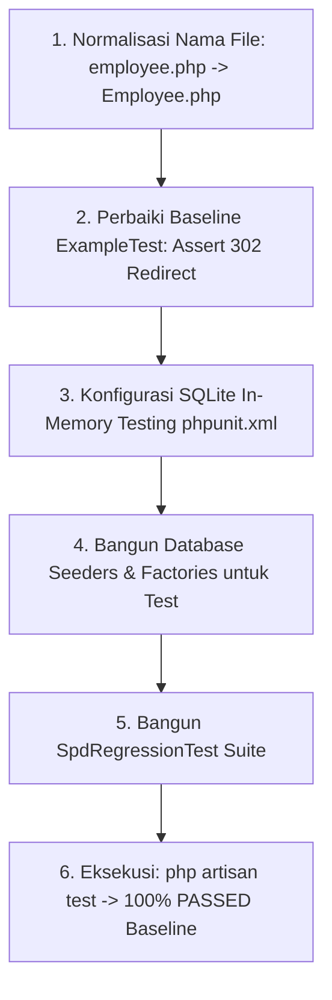
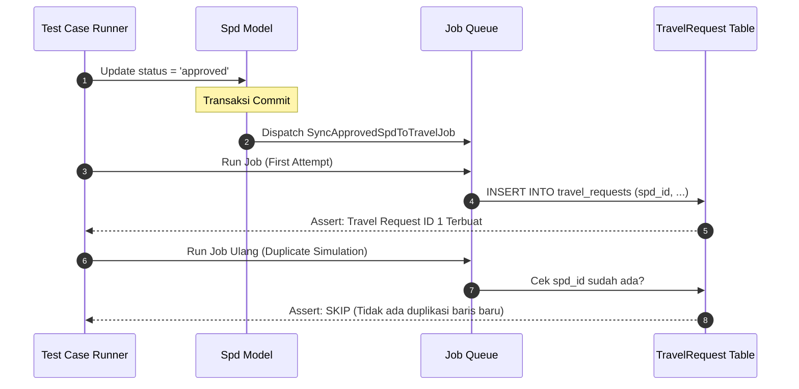

# EIMS REGRESSION TEST PLAN & BASELINE SPECIFICATION (P0.2)
## Modul: Travel Management & Vendor Payment Monitoring
**Aplikasi:** Enterprise Information Management System (EIMS) — Rapid Infrastruktur Indonesia  
**Versi Dokumen:** P0.2 — Quality Assurance & Regression Blueprint  
**Status:** DRAFT SPECIFICATION (REVIEW ONLY — Menunggu Persetujuan Pemilik Proyek)  
**Dokumen Induk:** [`EIMS_TECHNICAL_BLUEPRINT_P0.2.md`](file:///c:/Users/it/Documents/projects/eims/EIMS_TECHNICAL_BLUEPRINT_P0.2.md)

---

## 1. PENDAHULUAN & STRATEGI PENGUJIAN REGRESI

### 1.1 Tujuan Dokumen
Dokumen ini menetapkan strategi dan skenario pengujian menyeluruh (*comprehensive regression test plan*) untuk menjamin bahwa seluruh fungsionalitas modul **Surat Perjalanan Dinas (SPD)**, **Pengajuan Cuti (Leave Request)**, dan **Master Data Karyawan** yang sudah berjalan di EIMS tetap berfungsi 100% normal dan tidak mengalami dampak buruk (*zero breaking change*) akibat pengembangan modul Travel Management.

### 1.2 Masalah Kondisi Baseline Testing Saat Ini (Temuan Audit P0)
- **[FAKTA TERKONFIRMASI]:**
  1. Pada pengujian audit P0 dengan perintah `php artisan test`, test suite menghasilkan status **GAGAL (1 Failed, 1 Passed)**:
     ```
     FAILED Tests\Feature\ExampleTest > the application returns a successful response
     Expected response status code [200] but received 302.
     ```
     *Penyebab:* Rute root `'/'` diproteksi middleware `auth` dan `force.password.change`, sehingga request anonim dialihkan (302 redirect) ke `/login`.
  2. Saat ini **belum ada satu pun unit test maupun feature test otomatis** untuk modul inti bisnis (SPD, Leave, Employee, User).
  3. File model `app/Models/employee.php` berhuruf kecil di filesystem Windows, berisiko error pada runner CI/CD berbasis Linux.

---

## 2. RENCANA PENETAPAN PASSING BASELINE (FASE P0 $\rightarrow$ P1)

Sebelum pengkodean fitur baru dimulai pada Tahap P1, tim pengembang wajib menetapkan **Passing Test Baseline** melalui langkah-langkah persiapan berikut:



### 2.1 Tindakan Perbaikan Baseline
1. **Perbaikan `tests/Feature/ExampleTest.php`:**
   Ubah assertion agar menguji perilaku aplikasi riil:
   ```php
   public function test_guest_is_redirected_to_login(): void
   {
       $response = $this->get('/');
       $response->assertStatus(302);
       $response->assertRedirect('/login');
   }
   ```
2. **Normalisasi Penamaan Model:**
   Ubah `app/Models/employee.php` menjadi `app/Models/Employee.php` dan jalankan `composer dump-autoload`.
3. **Penyelarasan Runtime CLI PHP:**
   Aktifkan `extension=intl` pada `php.ini` sistem agar perintah artisan `Number::format()` dan `db:show` berjalan tanpa crash.

---

## 3. MATRIKS SKENARIO REGRESI DETAIL: MODUL SPD

Seluruh skenario pengujian di bawah ini memetakan logika riil yang terdapat pada `SpdController.php`, `SpdApprovalController.php`, model `Spd`, dan tabel `spds`.

### 3.1 Skenario Pembuatan SPD (SPD Creation & Validation)

| ID Test | Nama Skenario | Kondisi Awal (Preconditions) | Aksi / Input Test | Hasil yang Diharapkan (Expected Result) |
|---|---|---|---|---|
| **SPD-CRT-01** | Pembuatan SPD Sukses (Happy Path) | - Karyawan aktif dengan `spd_limit = 5`<br>- Atasan langsung (`manager_id`) tersedia<br>- Proyek memiliki `approval_employee_id`<br>- Cost level aktif | HRD submit form SPD valid dengan tanggal keberangkatan & kepulangan valid. | - Status HTTP: 302 (Redirect ke `spds.index`)<br>- Flash message: Sukses.<br>- Record SPD tersimpan dengan `status = 'pending_manager'`.<br>- Kuota `spd_limit` karyawan berkurang menjadi `4`.<br>- Nomor SPD terbit format: `RII/HC-SPD/{MM}/{YYYY}/{seq:03d}`.<br>- Notifikasi antrean dikirim ke user manager. |
| **SPD-CRT-02** | Validasi Kuota Limit Habis | Karyawan memiliki `spd_limit = 0`. | HRD mencoba membuat SPD untuk karyawan tersebut. | - Status HTTP: 422 Unprocessable Content.<br>- Pesan: *"This employee has no available SPD limit."*<br>- Tidak ada record SPD baru di database.<br>- Limit karyawan tetap 0. |
| **SPD-CRT-03** | Validasi Ketiadaan Atasan Langsung | Karyawan memiliki kolom `report_to = NULL`. | HRD mencoba membuat SPD untuk karyawan tersebut. | - Status HTTP: 422.<br>- Pesan: *"The selected employee does not have a manager assigned."*<br>- Transaksi dibatalkan secara atomik. |
| **SPD-CRT-04** | Validasi Ketiadaan Approver Dokumen Proyek | Proyek memiliki kolom `approval_employee_id = NULL`. | HRD memilih proyek tersebut pada formulir SPD. | - Status HTTP: 422.<br>- Pesan: *"The selected project does not have an Approval Document employee assigned."*<br>- Transaksi dibatalkan. |
| **SPD-CRT-05** | Validasi Cost Level Tidak Aktif | Cost level karyawan memiliki flag `is_active = false`. | HRD mencoba membuat SPD. | - Status HTTP: 422.<br>- Pesan: *"The Cost Level assigned to this employee is inactive."* |
| **SPD-CRT-06** | Validasi Tanggal Pulang Mundur | Form input diisi `date_return < date_departure`. | HRD submit tanggal pulang lebih awal dari berangkat. | - Validasi form gagal (`after_or_equal:date_departure`).<br>- Muncul error validasi di session. |
| **SPD-CRT-07** | Penomoran Dokumen & MySQL Concurrency Lock | Dua proses request SPD disubmit pada detik yang sama untuk tahun yang sama. | Simulasi 2 thread concurrent request. | - MySQL named lock `SELECT GET_LOCK('eims_spd_numbering_YYYY', 10)` dieksekusi.<br>- `document_sequence` terbit secara urut tanpa lompat nomor atau nomor kembar.<br>- Constraint `UNIQUE(document_year, document_sequence)` tidak pernah terlanggar. |

---

### 3.2 Skenario Alur Persetujuan Berjenjang SPD (2-Stage Approval Workflow)

```mermaid
flowchart TD
    Start[SPD Created: pending_manager] --> Step1{Manager Review}
    Step1 -->|Reject| Rej1[Status: rejected | spd_limit dikembalikan +1]
    Step1 -->|Approve| Step2[Status: pending_document | Notif ke Cost Control]
    
    Step2 --> Step3{Cost Control Review}
    Step3 -->|Reject| Rej2[Status: rejected | spd_limit dikembalikan +1]
    Step3 -->|Approve| Appr[Status: approved | Final | Trigger ke Travel]
```

| ID Test | Nama Skenario | Aktor & State Awal | Aksi / Payload | Hasil yang Diharapkan (Expected Result) |
|---|---|---|---|---|
| **SPD-APP-01** | Approval Tahap 1 oleh Manager Sukses | User Login = Manager yang ditugaskan.<br>SPD state = `pending_manager`. | POST `/spd-approvals/{spd}/approve` | - Status SPD berubah menjadi `pending_document`.<br>- `manager_approved_at` terisi timestamp terkini.<br>- Notifikasi terkirim ke Cost Control (`approvalDocument.user`).<br>- Kuota limit tetap terpotong (tidak berubah). |
| **SPD-APP-02** | Rejection Tahap 1 oleh Manager | User Login = Manager yang ditugaskan.<br>SPD state = `pending_manager`. | POST `/spd-approvals/{spd}/reject`<br>Payload: `rejection_reason = "Jadwal bentrok proyek"` | - Status SPD berubah menjadi `rejected`.<br>- `manager_rejection_reason` tersimpan.<br>- **Kuota `spd_limit` karyawan dikembalikan (+1)** secara otomatis di dalam DB transaction.<br>- Notifikasi penolakan dikirim ke pembuat SPD (HR). |
| **SPD-APP-03** | Approval Tahap 2 oleh Cost Control (Final) | User Login = Cost Control Proyek.<br>SPD state = `pending_document`. | POST `/spd-approvals/{spd}/approve` | - Status SPD berubah menjadi `approved`.<br>- `document_approved_at` terisi timestamp terkini.<br>- Notifikasi hasil dikirim ke Karyawan Pelaksana & HR.<br>- **Pemicu integrasi modul Travel Management dimulai.** |
| **SPD-APP-04** | Rejection Tahap 2 oleh Cost Control | User Login = Cost Control Proyek.<br>SPD state = `pending_document`. | POST `/spd-approvals/{spd}/reject`<br>Payload: `rejection_reason = "Over budget cost center"` | - Status SPD berubah menjadi `rejected`.<br>- `document_rejection_reason` tersimpan.<br>- **Kuota `spd_limit` karyawan dikembalikan (+1)**.<br>- Notifikasi penolakan dikirim ke HR. |
| **SPD-APP-05** | Proteksi Akses Otorisasi Approver Salah | User B (bukan manager yang ditugaskan) mencoba meng-approve SPD milik Karyawan A. | User B submit approval. | - Status HTTP: 403 Forbidden.<br>- Pesan: *"You are not the manager assigned to approve this SPD."*<br>- Status SPD tidak berubah. |
| **SPD-APP-06** | Approval Email Signed URL | Manager membuka tautan konfirmasi dari email berformat signed URL. | GET `/spd-approvals/{spd}/email-confirm/manager` dengan signature valid. | - Halaman konfirmasi approval terbuka normal.<br>- Tombol approve/reject berfungsi valid.<br>- Jika URL signature kedaluwarsa atau dimanipulasi: HTTP 403 Invalid Signature. |

---

### 3.3 Skenario Penghapusan SPD (Deletion & Rollback Rule)

| ID Test | Nama Skenario | Kondisi Awal | Aksi Test | Hasil yang Diharapkan (Expected Result) |
|---|---|---|---|---|
| **SPD-DEL-01** | Penghapusan SPD Berstatus Pending Manager | SPD berstatus `pending_manager`.<br>Limit karyawan saat ini = `4`. | User ber-permission `spd.delete` submit DELETE `/spds/{spd}`. | - Record SPD terhapus dari tabel `spds`.<br>- **Limit karyawan dipulihkan atomik menjadi `5` (`+1`)**.<br>- Flash message: *"SPD berhasil dihapus dan SPD limit employee dikembalikan."* |
| **SPD-DEL-02** | Larangan Hapus SPD Pending Document | SPD berstatus `pending_document`. | User submit DELETE `/spds/{spd}`. | - Status HTTP: 422 Unprocessable Content.<br>- Pesan: *"Only SPD requests waiting for Manager approval can be deleted."*<br>- Record SPD tidak terhapus. |
| **SPD-DEL-03** | Larangan Hapus SPD Approved | SPD berstatus `approved`. | User submit DELETE `/spds/{spd}`. | - Status HTTP: 422.<br>- Data SPD dan jejak transaksi tidak dapat dihapus. |

---

### 3.4 Skenario Pencetakan PDF Dokumen SPD

| ID Test | Nama Skenario | Aktor & Kondisi | Aksi Test | Hasil yang Diharapkan |
|---|---|---|---|---|
| **SPD-PDF-01** | Cetak PDF SPD oleh Pemilik / Manajer / HRD | User login memiliki relasi (karyawan bersangkutan, manager, cost control, atau permission `spd.view-any`). | GET `/spds/{spd}/pdf` | - Status HTTP: 200 OK.<br>- Content-Type: `application/pdf`.<br>- Render DomPDF sukses tanpa error PHP fatal. |
| **SPD-PDF-02** | Proteksi Cetak PDF oleh Pihak Tidak Berwenang | User login tidak memiliki hak akses dan bukan atasan bersangkutan. | GET `/spds/{spd}/pdf` | - Status HTTP: 403 Forbidden.<br>- Akses ditolak. |

---

## 4. SKENARIO PENGUJIAN INTEGRASI SPD KE TRAVEL MANAGEMENT (IDEMPOTENCY & FAULT TOLERANCE)

Pengujian ini memastikan titik sambung (*integration bridge*) antara SPD dan Travel Management bekerja secara aman:



| ID Test | Nama Skenario | Aksi Simulasi | Kriteria Keberhasilan (Pass Criteria) |
|---|---|---|---|
| **INT-SPD-01** | Pemicu Otomatis Permintaan Travel | Cost control menyetujui SPD hingga berstatus `approved`. | 1 record baru terbit di `travel_requests` dengan `source_type = 'spd'` dan `spd_id` terhubung secara benar. |
| **INT-SPD-02** | Uji Idempotensi (Anti-Duplikasi) | Job integrasi dieksekusi 3 kali berturut-turut untuk SPD yang sama. | Jumlah baris di `travel_requests` untuk `spd_id` tersebut **tetap tepat 1 baris** (tidak bertambah). |
| **INT-SPD-03** | Uji Toleransi Kegagalan (*Fault Tolerance*) | Tabel `travel_requests` sengaja dimatikan / dilempar exception simulasi saat approval SPD berlangsung. | 1. Status SPD di database **tetap `approved`** (tidak ikut rollback).<br>2. Error tercatat rapi di log harian tanpa merusak UX user.<br>3. Scheduled command `travel:sync-approved-spds` dapat memulihkan pembuatan request setelah tabel aktif kembali. |

---

## 5. SKENARIO REGRESI FITUR CUTI (LEAVE REQUEST) & MASTER DATA

Untuk memastikan shared components (seperti master `divisions`, `positions`, `projects`, dan `employees`) tidak terganggu:

| Modul | Skenario Pengujian | Hasil yang Diharapkan |
|---|---|---|
| **Leave Request** | Pengajuan cuti oleh karyawan (`leave-requests.store`). | Saldo `total_annual_leave` terpotong tepat sesuai total hari cuti kerja. |
| **Leave Approval** | Approval oleh atasan langsung dan HRD. | Status beralih dari `pending_manager` $\rightarrow$ `approved`. |
| **Employee Master** | CRUD data karyawan oleh HRD (`employees.update`). | Perubahan divisi/jabatan tidak merusak integritas foreign key pada SPD lama yang pernah dibuat karyawan tersebut. |
| **Project Master** | Perubahan nama proyek dan cost center. | SPD historis yang mereferensikan proyek tersebut tetap menampilkan data proyek secara konsisten. |

---

## 6. PERINTAH EKSEKUSI PENGUJIAN OTOMATIS (TEST RUN COMMANDS)

Pada saat fase implementasi P1 dimulai, tim pengembang wajib menjalankan pengujian otomatis dengan urutan perintah berikut:

1. **Menjalankan Seluruh Test Suite Regresi:**
   ```bash
   php artisan test --testsuite=Feature
   ```
2. **Menjalankan Khusus Regresi SPD:**
   ```bash
   php artisan test tests/Feature/SpdRegressionTest.php
   ```
3. **Memeriksa Laporan Code Coverage (PHPUnit):**
   ```bash
   php artisan test --coverage-text
   ```

### Kriteria Kelulusan Mutlak (*Definition of Done for Regression*):
- **$100\%$ Tests Passing** (0 Failure, 0 Error).
- Tidak ada regresi pada alur kerja SPD dan Leave.
- Integritas kuota limit dan format penomoran dokumen terbukti tidak berubah.

---
*Rencana pengujian regresi selesai disusun. Seluruh 4 dokumen cetak biru teknis P0.2 telah lengkap.*
