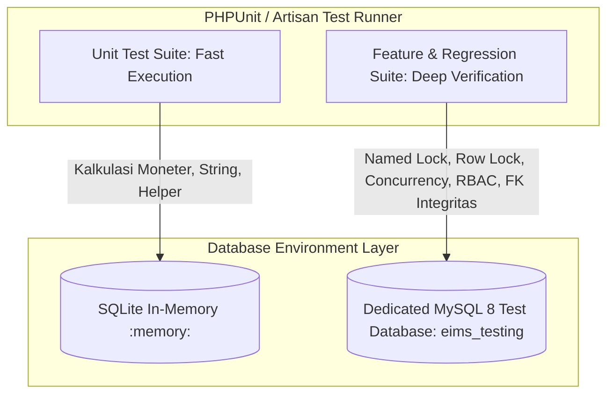
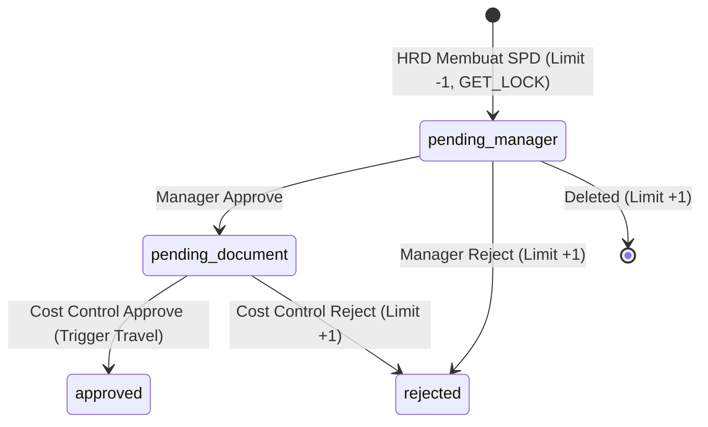
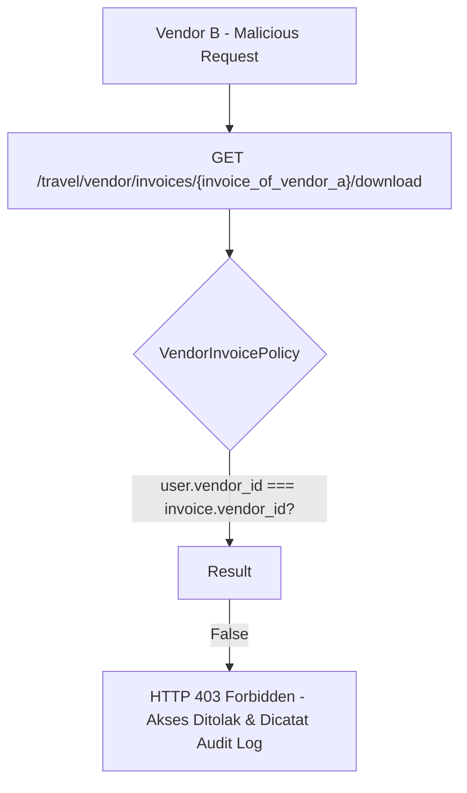

# EIMS REGRESSION TEST PLAN & BASELINE SPECIFICATION (P0.3)
## Modul: Travel Management & Vendor Payment Monitoring
**Aplikasi:** Enterprise Information Management System (EIMS) — Rapid Infrastruktur Indonesia  
**Versi Dokumen:** P0.3 — Comprehensive Quality Assurance & Regression Blueprint  
**Status:** DRAFT SPECIFICATION (REVIEW ONLY — Menunggu Persetujuan Pemilik Proyek)  
**Dokumen Induk:** [`EIMS_TECHNICAL_BLUEPRINT_P0.3.md`](file:///c:/Users/it/Documents/projects/eims/EIMS_TECHNICAL_BLUEPRINT_P0.3.md)

---

## 1. PENDAHULUAN & TAKSONOMI INFORMASI

### 1.1 Tujuan Dokumen
Dokumen ini menetapkan rencana pengujian regresi (*regression test plan*) versi **P0.3** untuk memastikan bahwa seluruh modul inti EIMS yang telah berjalan—terutama **Surat Perjalanan Dinas (SPD)**, **Pengajuan Cuti (Leave Request)**, **Master Data Karyawan & Proyek**, serta **Manajemen Pengguna (User Management)**—tetap berfungsi normal tanpa gangguan (*zero breaking change*).

### 1.2 Taksonomi Status Informasi
- **`[FAKTA REPOSITORY]`**: Berdasarkan pengujian langsung menggunakan `php artisan test` pada repository eksisting dan inspeksi source code.
- **`[REKOMENDASI TEKNIS]`**: Strategi lingkungan database pengujian (MySQL 8 vs SQLite), rancangan test case otomatis, dan skenario simulasi kegagalan antrean.
- **`[KEPUTUSAN BISNIS BELUM FINAL (OPEN DECISIONS)]`**: Parameter pengujian yang bergantung pada pengesahan aturan bisnis (O-01 s/d O-12).

---

## 2. STRATEGI LINGKUNGAN PENGUJIAN: MYSQL 8 TESTING VS SQLITE

### 2.1 Analisis Keterbatasan SQLite In-Memory `[FAKTA REPOSITORY]`
Pada file `phpunit.xml` eksisting, konfigurasi default pengujian diarahkan ke SQLite in-memory:
```xml
<env name="DB_CONNECTION" value="sqlite"/>
<env name="DB_DATABASE" value=":memory:"/>
```
Namun, pengujian regresi modul SPD eksisting **TIDAK DAPAT DIJALANKAN DENGAN BENAR PADA SQLITE** karena fakta teknis berikut:
1. **Fungsi MySQL Named Lock (`GET_LOCK`):**  
   Di dalam [app/Http/Controllers/HR/SpdController.php](file:///c:/Users/it/Documents/projects/eims/app/Http/Controllers/HR/SpdController.php) (baris 165–168), penomoran SPD menggunakan query native MySQL:
   ```php
   $lockResult = DB::selectOne('SELECT GET_LOCK(?, 10) AS acquired', [$lockName]);
   ```
   *SQLite tidak memiliki fungsi `GET_LOCK()` dan akan melempar error fatal syntax database.*
2. **Pessimistic Row-Level Locking (`lockForUpdate`):**  
   SQLite tidak mendukung row-level lock granularitas tinggi seperti InnoDB pada MySQL 8.
3. **Kolom ENUM:**  
   MySQL secara ketat memvalidasi nilai ENUM (misal status SPD: `'pending_manager'`, `'pending_document'`, `'approved'`, `'rejected'`), sedangkan SQLite memperlakukan ENUM sebagai teks bebas tanpa validasi ketat.

### 2.2 Strategi Dua Lapis Pengujian (Dual-Layer Test Strategy) `[REKOMENDASI TEKNIS]`



1. **Layer 1 — Fast Unit Tests (SQLite):**  
   Digunakan untuk pengujian fungsi matematika murni (formula kalkulasi saldo invoice, formatting nomor dokumen, helper tanggal).
2. **Layer 2 — Integration, Concurrency & Regression Tests (Dedicated MySQL 8 `eims_testing`):**  
   Wajib digunakan untuk seluruh pengujian regresi SPD, mutasi limit, alur approval, alokasi pembayaran, dan konkurensi aktivasi vendor.

---

## 3. PENETAPAN PASSING BASELINE (VERIFIKASI AWAL REPOSITORY)

### 3.1 Kondisi Baseline Saat Ini `[FAKTA REPOSITORY]`
- Hasil eksekusi `php artisan test` pada audit P0:
  `Tests\Feature\ExampleTest > the application returns a successful response` melempar error:
  `Expected response status code [200] but received 302.` (karena rute `/` dialihkan ke `/login`).
- File model pada disk fisik: `app/Models/employee.php` (huruf kecil).

### 3.2 Tindakan Pemulihan Baseline P0.3 (Sebelum P1 Dimulai)
1. Perbarui `tests/Feature/ExampleTest.php` untuk memvalidasi bahwa guest dialihkan ke login secara benar (status 302).
2. Tidak melakukan rename fisik `employee.php` saat ini; pengujian otomatis diinstruksikan memanggil class `App\Models\Employee` yang kompatibel dengan autoloader saat ini.
3. Menjalankan perintah verifikasi baseline hingga menghasilkan **100% Passed**:
   ```bash
   php artisan test --testsuite=Feature
   ```

---

## 4. MATRIKS TEST REGRESI DETAIL: WORKFLOW EIMS EKSISTING

### 4.1 Skenario Regresi Modul SPD (Surat Perjalanan Dinas)



| ID Test | Nama Skenario | Titik Kritis yang Diuji | Hasil yang Diharapkan (Expected Result) |
|---|---|---|---|
| **REG-SPD-01** | Pembuatan SPD & Penomoran Dokumen Atomik | Validasi fungsi `GET_LOCK` dan format penomoran `RII/HC-SPD/{MM}/{YYYY}/{seq:03d}`. | - Nomor SPD terbit secara urut tanpa duplikasi.<br>- Saldo kuota `spd_limit` karyawan berkurang 1 secara atomik.<br>- Status awal = `'pending_manager'`. |
| **REG-SPD-02** | Pengujian Konkurensi Pembuatan SPD Simultan | 10 simulasi request paralel pada milidetik yang sama untuk tahun yang sama. | - Tidak ada nomor SPD yang kembar atau terlewati (*no race condition*).<br>- Constraint `UNIQUE(document_year, document_sequence)` di MySQL tetap valid. |
| **REG-SPD-03** | Validasi Kuota Limit Habis | Karyawan dengan `spd_limit <= 0`. | - HTTP 422: *"This employee has no available SPD limit."*<br>- Tidak ada baris SPD yang terbuat. |
| **REG-SPD-04** | Validasi Atasan Langsung & Cost Control | Karyawan tanpa `report_to` atau proyek tanpa `approval_employee_id`. | - HTTP 422: Validasi menolak pembuatan SPD secara atomik. |
| **REG-SPD-05** | Approval Berjenjang Tahap 1 (Manager) | Mutasi status dari `pending_manager` ke `pending_document`. | - `manager_approved_at` terisi timestamp.<br>- Notifikasi email antrean terkirim ke Cost Control. |
| **REG-SPD-06** | Rejection Tahap 1 (Manager) | Penolakan oleh Manager. | - Status beralih ke `'rejected'`.<br>- **Kuota `spd_limit` karyawan dikembalikan (+1)** di dalam transaksi database.<br>- Alasan penolakan tersimpan di `manager_rejection_reason`. |
| **REG-SPD-07** | Approval Berjenjang Tahap 2 (Cost Control) | Mutasi status dari `pending_document` ke `approved`. | - `document_approved_at` terisi.<br>- Status beralih ke `'approved'`.<br>- Notifikasi hasil terkirim ke HR dan Karyawan. |
| **REG-SPD-08** | Rejection Tahap 2 (Cost Control) | Penolakan oleh Cost Control. | - Status beralih ke `'rejected'`.<br>- **Kuota `spd_limit` karyawan dikembalikan (+1)**.<br>- Alasan penolakan tersimpan di `document_rejection_reason`. |
| **REG-SPD-09** | Penghapusan SPD (Aturan Deletion) | Hapus SPD pada status `pending_manager` vs status lainnya. | - Status `pending_manager`: Terhapus, kuota limit dipulihkan (+1).<br>- Status `pending_document` atau `approved`: HTTP 422 (Dilarang dihapus). |
| **REG-SPD-10** | Cetak Dokumen PDF SPD | Eksekusi `Barryvdh\DomPDF` pada method `pdf()`. | - HTTP 200 dengan header `Content-Type: application/pdf`.<br>- Template `hr.spds.pdf` ter-render tanpa error PHP fatal. |

---

### 4.2 Skenario Pengujian Integrasi Decoupled & Toleransi Kegagalan (SPD $\rightarrow$ Travel)

| ID Test | Nama Skenario | Simulasi Kondisi | Hasil yang Diharapkan (Expected Result) |
|---|---|---|---|
| **REG-INT-01** | Pemicuan Asinkron Pasca-Commit | SPD disetujui Cost Control hingga berstatus `'approved'`. | - Job `SyncApprovedSpdToTravelJob` ter-dispatch ke antrean setelah commit database selesai.<br>- 1 record baru terbit di `travel_requests` dengan `spd_id` yang valid. |
| **REG-INT-02** | Pengujian Idempotensi Eksekusi Ganda | Job `SyncApprovedSpdToTravelJob` dieksekusi 5 kali berturut-turut untuk SPD yang sama. | - Jumlah baris di `travel_requests` untuk `spd_id` tersebut **tetap tepat 1 baris**.<br>- Job kedua s/d kelima me-return status skip tanpa error. |
| **REG-INT-03** | Toleransi Kegagalan Antrean (Queue Down) | Server queue atau tabel antrean sengaja digagalkan saat approval SPD berlangsung. | - Status SPD di database **tetap sukses `approved`** (tidak rollback).<br>- User Cost Control tidak melihat error sistem.<br>- Kegagalan dispatch tercatat di log harian. |
| **REG-INT-04** | Pengujian Rekonsiliasi Mandiri | Eksekusi artisan command `php artisan travel:reconcile-spd-requests`. | - Command menemukan SPD approved yang belum memiliki Travel Request dan membuatkannya secara otomatis. |

---

### 4.3 Skenario Regresi Modul Cuti (Leave Request) & Master Data Eksisting

| ID Test | Modul yang Diuji | Skenario Pengujian | Hasil yang Diharapkan |
|---|---|---|---|
| **REG-LEV-01** | Leave Request | Pengajuan cuti oleh karyawan (`leave-requests.store`). | Saldo `total_annual_leave` terpotong tepat sesuai hari kerja. |
| **REG-LEV-02** | Leave Approval | Approval berjenjang atasan dan HRD via web & signed email link. | Status beralih ke `approved`; tanda tangan digital URL divalidasi. |
| **REG-EMP-01** | Employee Master | HRD memperbarui data karyawan di `EmployeeController::update`. | Mutasi data personal/divisi tidak merusak relasi pada record SPD lama. |
| **REG-PRJ-01** | Project Master | Perubahan nama proyek dan kode cost center. | Data historis SPD yang membebankan proyek tersebut tetap konsisten. |
| **REG-USR-01** | User Management | Admin membuat user internal karyawan di `Admin\UserController::store`. | Berjalan normal; validasi `'employee_id' => ['required']` tetap utuh dan role Spatie terhubung valid. |

---

## 5. SKENARIO PENGUJIAN KEAMANAN, TENANT ISOLATION & INTEGRITAS FINANSIAL TRAVEL

### 5.1 Pengujian Tenant Isolation & Anti-IDOR Multi-Vendor



| ID Test | Skenario Keamanan | Aksi Pengujian | Hasil yang Diharapkan (Security Guarantee) |
|---|---|---|---|
| **SEC-TNN-01** | Isolasi Inquiry Antar-Vendor | Vendor B mencoba membuka detail inquiry milik Vendor A via GET `/travel/vendor/inquiries/{id_A}`. | - **HTTP 403 Forbidden** atau HTTP 404 (via Global Query Scope).<br>- Vendor B tidak dapat melihat rute atau instruksi milik Vendor A. |
| **SEC-TNN-02** | Isolasi Unduhan Tiket | Vendor B mencoba mengunduh e-ticket milik Vendor A. | - **HTTP 403 Forbidden**.<br>- Akses file stream privat ditolak. |
| **SEC-TNN-03** | Isolasi Tagihan Invoice | Vendor B mencoba melihat atau mengunduh invoice Vendor A. | - **HTTP 403 Forbidden**.<br>- Rekanan kompetitor tidak dapat mengintip nilai faktur rekanan lain. |
| **SEC-TNN-04** | Pembatasan Vendor Nonaktif | Vendor yang berstatus `is_active = 0` mencoba submit quotation baru. | - **HTTP 403 Forbidden**: Rekanan nonaktif diblokir dari transaksi baru. |

---

### 5.2 Pengujian Integritas Finansial, Anti-Double Billing & Exposure

| ID Test | Skenario Finansial | Kondisi Pengujian | Hasil yang Diharapkan (Financial Integrity) |
|---|---|---|---|
| **FIN-DBL-01** | Pencegahan Penagihan Ganda (Anti-Double Billing) | Vendor mencoba menagihkan `travel_booking_id` yang sama pada 2 invoice berbeda secara simultan. | - Transaksi kedua ditolak oleh validasi penguncian baris (`lockForUpdate`).<br>- Error: *"Booking sudah tercatat dalam tagihan aktif lain."* |
| **FIN-ALC-01** | Alokasi Pembayaran Lintas-Vendor (Cross-Vendor Block) | Finance mencoba mengalokasikan pembayaran milik Vendor A ke invoice milik Vendor B. | - **Ditolak di level database** oleh Compound Foreign Key `fk_vpa_invoice_compound`.<br>- Transaksi gagal sebelum commit. |
| **FIN-REV-01** | Koreksi & Pembatalan Pembayaran (Reversal) | Finance melakukan reversal atas pembayaran yang telah dialokasikan ke 3 invoice. | - Status pembayaran berubah menjadi `'reversed'`.<br>- Saldo ketiga invoice dipulihkan utuh.<br>- Alokasi terhapus dan audit log tercatat rapi. |
| **FIN-EXP-01** | Uji Akurasi Formula Credit Exposure | Booking terkonfirmasi $\rightarrow$ Invoice dibuat $\rightarrow$ Invoice diverifikasi $\rightarrow$ Dibayar sebagian. | - Nilai eksposur kredit tidak pernah bocor atau berkurang prematur pada setiap fase transisi status. |

---

## 6. DAFTAR PERINTAH EKSEKUSI PENGUJIAN OTOMATIS (EXECUTABLE TEST SUITE)

Seluruh test case di atas disusun ke dalam berkas pengujian otomatis PHPUnit yang dapat dieksekusi secara nyata saat fase implementasi P1 disetujui:

| Berkas Pengujian yang Akan Dibuat | Kelompok Skenario | Perintah Eksekusi |
|---|---|---|
| `tests/Feature/ExampleTest.php` | Baseline Guest Redirect | `php artisan test tests/Feature/ExampleTest.php` |
| `tests/Feature/SpdRegressionTest.php` | Regresi Penuh SPD (Creation, Concurrency, Approval, Quota) | `php artisan test tests/Feature/SpdRegressionTest.php` |
| `tests/Feature/TravelIntegrationTest.php` | Integrasi Idempoten & Toleransi Kegagalan Antrean | `php artisan test tests/Feature/TravelIntegrationTest.php` |
| `tests/Feature/LeaveRegressionTest.php` | Regresi Modul Cuti & Kuota Karyawan | `php artisan test tests/Feature/LeaveRegressionTest.php` |
| `tests/Feature/UserManagementRegressionTest.php` | Regresi CRUD User Internal Eksisting | `php artisan test tests/Feature/UserManagementRegressionTest.php` |
| `tests/Feature/VendorTenantIsolationTest.php` | Pengujian IDOR & Isolasi Multi-Vendor | `php artisan test tests/Feature/VendorTenantIsolationTest.php` |
| `tests/Feature/FinancialIntegrityTest.php` | Anti-Double Billing, Alokasi Lintas-Vendor, & Reversal | `php artisan test tests/Feature/FinancialIntegrityTest.php` |

---
*Rencana pengujian regresi P0.3 selesai disusun. Seluruh 4 dokumen cetak biru telah selesai direvisi.*
