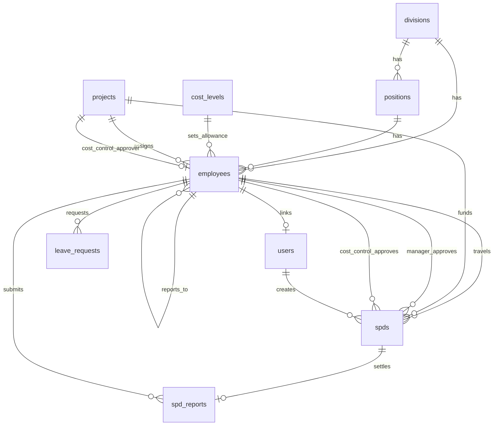
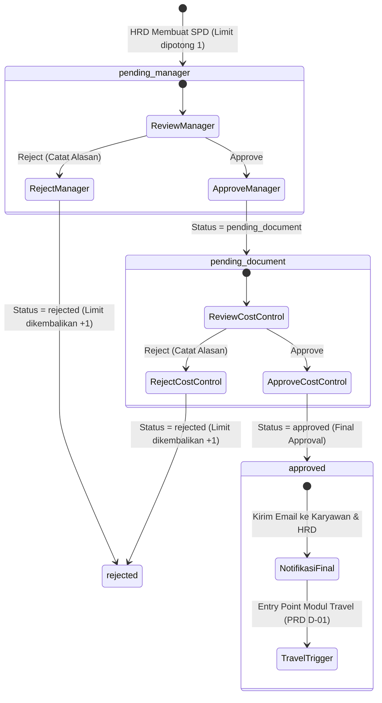

# LAPORAN AUDIT REPOSITORY EIMS (RAPID INFRASTRUKTUR INDONESIA)
## Tahap: P0 — Baseline Audit & Gap Analysis Modul Travel Management & Vendor Payment Monitoring
**Dokumen Acuan:** `PRD_EIMS_Travel_Management_v1.2.md` (`PRD.md`)  
**Tanggal Audit:** 10 November 2026  
**Auditor:** Antigravity AI Coding Assistant  
**Status Audit:** COMPLETED (AUDIT ONLY — Tidak ada perubahan kode, database, atau konfigurasi)

---

## DAFTAR ISI
1. [Ringkasan Eksekutif](#1-ringkasan-eksekutif)
2. [Kondisi Aktual Repository & Lingkungan Sistem](#2-kondisi-aktual-repository--lingkungan-sistem)
3. [Arsitektur Aplikasi & Frontend/Backend](#3-arsitektur-aplikasi--frontendbackend)
4. [Peta Modul Existing](#4-peta-modul-existing)
5. [Peta Database & Relasi (MySQL 8.0.46)](#5-peta-database--relasi-mysql-8046)
6. [Analisis Mendalam Workflow SPD Existing](#6-analisis-mendalam-workflow-spd-existing)
7. [Peta Role, Permission, dan Sistem Otorisasi](#7-peta-role-permission-dan-sistem-otorisasi)
8. [Analisis Queue, Email, dan Notifikasi](#8-analisis-queue-email-dan-notifikasi)
9. [Analisis File Storage dan Upload Dokumen](#9-analisis-file-storage-dan-upload-dokumen)
10. [Security Findings & Kesiapan Deployment](#10-security-findings--kesiapan-deployment)
11. [Gap Analysis Terhadap PRD v1.2](#11-gap-analysis-terhadap-prd-v12)
12. [Rekomendasi Arsitektur Travel Management](#12-rekomendasi-arsitektur-travel-management)
13. [Rekomendasi Database Delta (Schema Usulan)](#13-rekomendasi-database-delta-schema-usulan)
14. [Daftar File yang Perlu Dibuat dan Diubah](#14-daftar-file-yang-perlu-dibuat-dan-diubah)
15. [Risiko Implementasi & Strategi Mitigasi](#15-risiko-implementasi--strategi-mitigasi)
16. [Rencana Testing & Regression Testing](#16-rencana-testing--regression-testing)
17. [Kesimpulan & Rekomendasi Langkah P1](#17-kesimpulan--rekomendasi-langkah-p1)

---

## 1. RINGKASAN EKSEKUTIF

Audit repository EIMS ini dilakukan secara menyeluruh dan berstatus **AUDIT ONLY** untuk mempersiapkan implementasi modul baru **Travel Management & Vendor Payment Monitoring** sesuai spesifikasi `PRD_EIMS_Travel_Management_v1.2.md`.

Pemeriksaan dilakukan langsung terhadap seluruh komponen kode sumber, database MySQL lokal, konfigurasi framework, pustaka dependensi, workflow eksisting (SPD, Leave, Master Data, User/Role), dan sistem notifikasi.

### Temuan Utama Singkat:
1. **Fondasi Framework:** Aplikasi dibangun di atas **Laravel Framework 13.33.0** dengan runtime **PHP 8.5.10 (CLI)** dan **Composer 2.10.1**.
2. **Database:** Menggunakan **MySQL 8.0.46** (`eims`), dengan 18 file migrasi yang seluruhnya telah berstatus *Ran* (batch 1 s/d 11).
3. **Frontend Stack:** Walaupun `package.json` menyertakan Tailwind CSS v4 dan Vite v8, implementasi aktual UI di seluruh Blade view (`layouts/app.blade.php`) menggunakan **Bootstrap 5.3.3 (CDN)** dan **Bootstrap Icons (CDN)**. Modul baru harus mengikuti pola Bootstrap 5 eksisting agar antarmuka konsisten.
4. **Alur SPD (Surat Perjalanan Dinas):** Workflow SPD berjalan 2 tahap approval (`pending_manager` $\rightarrow$ `pending_document` $\rightarrow$ `approved`). Status `approved` merupakan titik masuk (entry point) integrasi Travel Management. Seluruh logika transaksi SPD saat ini berada di dalam Controller tanpa Event/Observer.
5. **Autentikasi & Otorisasi:** Menggunakan `spatie/laravel-permission` dengan 7 Role dan 33 Permission. Autentikasi berbasis username (bukan email). Tidak ada tabel `email` di tabel `users`; email diambil via relasi ke tabel `employees`. Ini merupakan celah struktural kritis untuk calon user Vendor Portal.
6. **Integritas & Risiko Teknis Kritis:**
   - Ditemukan file model `app/Models/employee.php` dengan huruf kecil (lowercase `e`), padahal nama class adalah `Employee`. Di server Linux (case-sensitive ext4), ini berisiko fatal memicu `Class "App\Models\Employee" not found`.
   - Ekstensi PHP `intl` belum aktif di environment CLI PHP 8.5, menyebabkan artisan `db:show` gagal saat memformat angka.
   - Belum ada unit/feature test untuk bisnis (hanya `ExampleTest` bawaan yang gagal karena route `/` memerlukan autentikasi).

---

## 2. KONDISI AKTUAL REPOSITORY & LINGKUNGAN SISTEM

### 2.1 Versi Bahasa & Framework
- **PHP CLI:** `8.5.10 (cli) (built: Aug 25 2026 21:21:19) (ZTS Visual C++ 2022 x64)`
- **Composer:** `2.10.1 (2026-06-04)`
- **Laravel Framework:** `13.33.0` (kompatibel dengan constraint composer `^13.17`)
- **PHP Requirement di Composer:** `^8.3`

### 2.2 Dependensi Utama (`composer.json`)
```json
"require": {
    "php": "^8.3",
    "barryvdh/laravel-dompdf": "^3.1",
    "laravel/framework": "^13.17",
    "laravel/tinker": "^3.0",
    "spatie/laravel-permission": "^8.3",
    "symfony/http-client": "^8.1",
    "symfony/microsoft-graph-mailer": "^8.1"
}
```
*Catatan Kunci:* Pustaka `symfony/microsoft-graph-mailer` digunakan untuk integrasi pengiriman email resmi korporat melalui Microsoft Graph API (Office 365 / Azure).

### 2.3 Struktur Direktori Aktual
```
eims/
├── app/
│   ├── Http/
│   │   ├── Controllers/
│   │   │   ├── Admin/UserController.php
│   │   │   ├── HR/ (Employee, LeaveRequest, Spd, SpdApproval, SpdReport, SpdReportApproval)
│   │   │   ├── Master/ (CostLevel, Division, Position, Project)
│   │   │   ├── AuthController.php
│   │   │   └── LeaveApprovalSettingController.php
│   │   └── Middleware/
│   │       └── ForcePasswordChange.php
│   ├── Models/
│   │   ├── CostLevel.php, Division.php, employee.php (anomaly: lowercase filename)
│   │   ├── LeaveApprovalSetting.php, LeaveRequest.php, Position.php, Project.php
│   │   ├── Spd.php, SpdReport.php, User.php
│   ├── Notifications/ (6 notification classes)
│   ├── Policies/ (EmployeePolicy.php, UserPolicy.php)
│   └── Providers/ (AppServiceProvider.php)
├── bootstrap/
│   └── app.php (Laravel 13 lightweight bootstrap)
├── config/ (auth, database, filesystems, mail, queue, services, session, etc.)
├── database/
│   ├── migrations/ (18 migrations, batches 1-11)
│   └── seeders/ (DatabaseSeeder.php, RolePermissionSeeder.php, PermissionSeeder.php)
├── resources/
│   ├── views/
│   │   ├── admin/, auth/, emails/, hr/, layouts/app.blade.php, master/, vendor/
│   ├── css/app.css, js/app.js
├── routes/
│   ├── web.php (243 baris rute web aplikasi)
│   └── console.php (Artisan command route)
└── storage/ (app/public, app/private, framework, logs)
```

---

## 3. ARSITEKTUR APLIKASI & FRONTEND/BACKEND

### 3.1 Backend Architecture
- **Pola Desain:** Arsitektur MVC standar Laravel Monolith. Seluruh transaksi bisnis, validasi, otorisasi, dan mutasi database diletakkan di dalam Controller method.
- **Service Layer:** Saat ini **belum ada layer Service** (`app/Services`), Action, maupun Repository pattern.
- **Event-Driven:** **Tidak ada Event maupun Listener** kustom (`app/Events`, `app/Listeners`). Logika pasca-approval SPD dan SPD Report memanggil notifikasi secara inline di dalam Controller.
- **Concurrency Locking:** Modul SPD menggunakan pessimistic database lock melalui MySQL named lock (`SELECT GET_LOCK(?, 10)`) dan row-level lock (`lockForUpdate()`) untuk penomoran dokumen dan pengurangan limit saldo.

### 3.2 Frontend Architecture
- **Engine Rendering:** Server-Side Rendering (SSR) menggunakan Laravel Blade.
- **UI Framework Aktual:** **Bootstrap 5.3.3** via CDN, dilengkapi dengan **Bootstrap Icons 1.11.3**.
- **Layout Induk:** [resources/views/layouts/app.blade.php](file:///c:/Users/it/Documents/projects/eims/resources/views/layouts/app.blade.php) menyediakan:
  - Top navigation bar (Brand, Notifikasi dummy, Profil, Dropdown logout).
  - Collapsible Sidebar dengan role-based menu visibility (`@if(auth()->user()->hasRole(...))`).
  - Mobile responsive handling via JavaScript drawer toggle (`#sidebarBackdrop`).
- **CSS Bundler:** `vite.config.js` mengompilasi Tailwind CSS v4, tetapi class Tailwind tidak digunakan pada layout utama. Komponen baru pada Travel Management **harus mematuhi Bootstrap 5** agar senada dengan modul eksisting.
- **Reporting Engine:** `barryvdh/laravel-dompdf` digunakan untuk mencetak SPD PDF, SPD Report PDF, dan Leave Request PDF.

---

## 4. PETA MODUL EXISTING

| Modul | Controller / Model | Hak Akses Utama | Fungsi Utama |
|---|---|---|---|
| **Autentikasi** | `AuthController`<br>`User` | Publik & Auth | Login dengan username/password, force password change, rate limiter 5x/menit. |
| **User Management** | `Admin\UserController`<br>`User` | `System Administrator`<br>(`user.view`, `user.create`, dll.) | Manajemen akun user, relasi 1-to-1 dengan Employee, penugasan Spatie Role. |
| **Master Organisasi** | `DivisionController`, `PositionController`<br>`Division`, `Position` | `System Administrator` | Struktur divisi perusahaan dan jabatan kerja. |
| **Master Proyek** | `ProjectController`<br>`Project` | `System Administrator` | Daftar site/project, kode cost center, penugasan Approval Employee (Cost Control). |
| **Master Cost Level** | `CostLevelController`<br>`CostLevel` | `System Administrator` | Standar plafon uang makan & saku (meals & allowance) domestik/internasional. |
| **Employee (HR)** | `HR\EmployeeController`<br>`Employee` | `HRD`, `Employee` (own) | Biodata lengkap, NIK, NUP, BPJS, photo, kontrak, atasan langsung (`report_to`), kuota `spd_limit`. |
| **Leave Management** | `LeaveRequestController`<br>`LeaveRequest`, `LeaveApprovalSetting` | `Employee`, `Employee Approval`, `HRD` | Pengajuan cuti karyawan, approval atasan via web/email signed URL, monitoring HRD, cetak PDF. |
| **SPD (Perjalanan Dinas)** | `HR\SpdController`, `HR\SpdApprovalController`<br>`Spd` | `HRD` (create), `Employee Approval` (manager & cost control) | Pembuatan SPD, perhitungan otomatis uang muka, workflow persetujuan berjenjang, cetak PDF resmi. |
| **SPD Report** | `HR\SpdReportController`, `HR\SpdReportApprovalController`<br>`SpdReport` | `Employee` (create), `Employee Approval`, `HRD` (monitor) | Pertanggungjawaban biaya perjalanan riil, kalkulasi settlement (*reimburse* / *cash clear* / *refund*), upload bukti expense. |

---

## 5. PETA DATABASE & RELASI (MYSQL 8.0.46)

Database aktif adalah MySQL `8.0.46` pada host `127.0.0.1:3306`, database `eims`. Seluruh 18 migrasi berada dalam status *Ran*.



### 5.1 Rincian Struktur Tabel Kunci

#### 1. Tabel `employees`
- **Primary Key:** `id` (bigint unsigned)
- **Kolom Kunci:** `nik` (unique, string 50), `full_name`, `email` (unique), `division_id` (FK), `position_id` (FK), `project_id` (FK, nullable), `cost_level_id` (FK, nullable), `report_to` (FK self-referencing to `employees.id`, nullable), `employee_status` ('Contract'/'Permanent'), `contract_start_date`, `contract_end_date`, `spd_limit` (decimal 15,2 default 0), `total_annual_leave` (decimal 5,2 default 12), `photo` (string nullable), `deleted_at` (soft deletes).

#### 2. Tabel `users`
- **Primary Key:** `id` (bigint unsigned)
- **Kolom Kunci:** `employee_id` (FK to `employees.id`, nullable, unique), `username` (unique string), `password`, `must_change_password` (boolean default 1), `is_active` (boolean default 1), `remember_token`, `timestamps`.
- **Temuan Kritis:** Tabel `users` **TIDAK memiliki kolom `email`**.

#### 3. Tabel `projects`
- **Primary Key:** `id`
- **Kolom Kunci:** `name`, `location`, `cost_center` (string), `approval_employee_id` (FK to `employees.id`, nullable — bertindak sebagai Cost Control Approver).

#### 4. Tabel `cost_levels`
- **Primary Key:** `id`
- **Kolom Kunci:** `name`, `meals_domestic`, `allowance_domestic`, `meals_international`, `allowance_international` (seluruhnya decimal 15,2), `is_active` (boolean).

#### 5. Tabel `spds`
- **Primary Key:** `id`
- **Nomor Dokumen:** `spd_number` (string 50, unique), `document_year` (unsigned int), `document_sequence` (unsigned int, unique bersama `document_year`).
- **Aktor Terkait:**
  - `employee_id` (FK `employees` — karyawan yang melakukan perjalanan).
  - `project_id` (FK `projects` — proyek pembebanan & cost center).
  - `manager_id` (FK `employees` — atasan langsung approval tahap 1).
  - `approval_document_id` (FK `employees` — Cost Control proyek approval tahap 2).
  - `created_by` (FK `users` — akun pembuat dokumen SPD / HRD).
- **Detail Perjalanan:** `travel_type` (enum: 'domestic', 'international'), `from`, `destination`, `date_departure`, `date_return`, `total_days` (unsigned int), `transportation` (enum: 'car', 'plane', 'ship', 'other'), `advance_payment` (boolean), `purpose` (text), `note` (text nullable).
- **Finansial:** `meals_per_day`, `allowance_per_day`, `local_transport`, `contingencies`, `balance_received` (seluruhnya decimal 15,2). Formula:
  $$\text{balance\_received} = (\text{meals} \times \text{days}) + (\text{allowance} \times \text{days}) + \text{local\_transport} + \text{contingencies}$$
- **Status & Approval:**
  - `status`: ENUM(`'pending_manager'`, `'pending_document'`, `'approved'`, `'rejected'`) default `'pending_manager'`.
  - `manager_approved_at` (timestamp nullable), `manager_rejection_reason` (text nullable).
  - `document_approved_at` (timestamp nullable), `document_rejection_reason` (text nullable).

#### 6. Tabel `spd_reports`
- **Primary Key:** `id`
- **Relasi:** `spd_id` (FK `spds.id`, unique, cascade on delete), `employee_id` (FK `employees.id`).
- **Finansial Riil:** `balance_received` (snapshot dari SPD), `expense_balance` (biaya aktual), `expense_report_total` ($\text{balance} - \text{expense}$).
- **Status Settlement:** `settlement_status` ('reimburse', 'cash_clear', 'refund_employee').
- **Workflow Report:** `status_report` ('draft', 'submitted', 'approved', 'rejected', 'settled').
- **Bukti Lampiran:** `expense_evidence` (string path di disk `'public'`).

---

## 6. ANALISIS MENDALAM WORKFLOW SPD EXISTING

### 6.1 Diagram Alur Status SPD



### 6.2 Logika Teknis Transaksi SPD
1. **Pembuatan SPD (`SpdController::store`):**
   - Otorisasi: `auth()->user()->can('spd.create')`.
   - Mengambil MySQL lock bernama: `SELECT GET_LOCK('eims_spd_numbering_' . $year, 10)`.
   - Mengunci baris employee: `Employee::lockForUpdate()->findOrFail($id)`.
   - Validasi saldo kuota SPD: `if ($employee->spd_limit <= 0) abort(422)`.
   - Mengurangi limit: `$employee->spd_limit = $employee->spd_limit - 1`.
   - Menghitung nomor SPD format: `RII/HC-SPD/{MM}/{YYYY}/{seq:03d}`.
   - Status awal di-set ke `'pending_manager'`.
   - Melepaskan lock `RELEASE_LOCK`.
   - Menembakkan notifikasi email antrean `SpdApprovalResultNotification` kepada Manager (`manager.user`).
2. **Approval Tahap 1 - Manager (`SpdApprovalController::approve`):**
   - Karyawan login harus cocok dengan `$spd->manager_id`.
   - Update `$spd->manager_approved_at = now()`.
   - Update status menjadi `'pending_document'`.
   - Menembakkan notifikasi antrean kepada Cost Control (`approvalDocument.user`).
3. **Approval Tahap 2 - Cost Control (`SpdApprovalController::approve`):**
   - Karyawan login harus cocok dengan `$spd->approval_document_id`.
   - Update `$spd->document_approved_at = now()`.
   - Update status menjadi `'approved'`.
   - Menembakkan notifikasi persetujuan akhir kepada HR (`spd.creator`) dan Karyawan Pelaksana (`spd.employee.user`).
4. **Penolakan (`reject`):**
   - Jika ditolak pada salah satu tahap, status menjadi `'rejected'`.
   - Kuota `spd_limit` karyawan dikembalikan secara atomik (`+1`).
5. **Penghapusan (`destroy`):**
   - Hanya SPD dengan status `'pending_manager'` yang diizinkan untuk dihapus. Kuota `spd_limit` dikembalikan.

### 6.3 Analisis Titik Integrasi Travel Management (D-01)
- Dalam PRD v1.2 klausul **D-01**, SPD berstatus `Approved` menjadi pemicu masuknya request ke antrean Travel Management.
- **Kondisi Eksisting:** Perubahan status menjadi `'approved'` terjadi pada baris ke-285 di file `app/Http/Controllers/HR/SpdApprovalController.php`.
- **Rekomendasi Integrasi:** Dilarang mengedit atau mengubah logika core SPD yang sudah stabil. Integrasi harus dilakukan secara pasif dan decoupled:
  1. **Opsi Rekomendasi 1 (Observer):** Mendaftarkan `SpdObserver` pada event `updated`. Jika `wasChanged('status') && $spd->status === 'approved'`, observer memicu Job/Action pembuatan `TravelRequest` (idempotent, cek unik `spd_id`).
  2. **Opsi 2 (Event-Driven):** Memicu custom event `SpdApprovedEvent` dan ditangani oleh listener `CreateTravelRequestFromSpd`.

---

## 7. PETA ROLE, PERMISSION, DAN SISTEM OTORISASI

### 7.1 Daftar Role Eksisting (`RolePermissionSeeder.php`)
Sistem menggunakan paket `spatie/laravel-permission`:
1. `System Administrator` — Memiliki seluruh 33 permission.
2. `Employee` — Hak akses personal: dashboard, view/update profil sendiri, submit SPD report, pengajuan cuti, lihat SPD sendiri.
3. `Employee Approval` — Hak akses approval manajerial: approve SPD, approve/reject SPD report, approve cuti, approve CA/RFP.
4. `Finance` — Hak akses keuangan dasar: dashboard, view own employee/SPD, approve CA/RFP, monitoring laporan dan export.
5. `HRD` — Hak akses operasional HR: CRUD employee, CRUD SPD, monitoring SPD report, monitoring cuti, export laporan.
6. `Document Control` — Monitoring employee, RFP, dan laporan.
7. `Board of Director` — Executive review: monitoring employee, laporan, dan export.

### 7.2 Pemetaan Stakeholder PRD v1.2 ke Role Eksisting

| Stakeholder PRD v1.2 | Peran Bisnis yang Dibutuhkan | Status di Repository | Rekomendasi Solusi Teknis |
|---|---|---|---|
| **HR/GA Site** | Membuat Project Travel Request, memilih alternatif quotation vendor. | **Belum ada Role Khusus** (saat ini tergabung di `Employee`). | Tambahkan permission baru: `travel.site-request`, `travel.select-quotation`. Dapat diberikan ke role `Employee` tertentu atau buat sub-role `HR/GA Site`. |
| **HR/GA HO** | Verifikasi request, kirim inquiry vendor, review alternatif, kirim final booking, verifikasi e-ticket & invoice. | Diwakili oleh role **`HRD`**. | Tambahkan permissions ke role `HRD`: `travel.manage`, `travel.inquiry`, `travel.final-booking`, `travel.verify-ticket`, `travel.verify-invoice`. |
| **Vendor Travel** | Menerima inquiry, input quotation alternatif, upload ticket, upload invoice. | **BELUM ADA SAMA SEKALI**. | Buat Role baru: **`Travel Vendor`** dengan isolasi data multi-tenant (hanya melihat data miliknya). |
| **Finance** | Mencatat realisasi pembayaran (Payment Monitoring), alokasi invoice, memantau credit exposure. | Sudah ada role **`Finance`**. | Tambahkan permissions ke role `Finance`: `travel.payment-record`, `travel.payment-allocate`, `travel.exposure-view`. |
| **Management** | Melihat dashboard eksekutif, menyetujui Exception Credit Limit. | Diwakili oleh role **`Board of Director`**. | Tambahkan permission: `travel.exception-approve`, `travel.dashboard-executive`. |

### 7.3 Temuan Kritis Middleware Alias
Pada `bootstrap/app.php`:
```php
$middleware->alias([
    'force.password.change' => \App\Http\Middleware\ForcePasswordChange::class,
    'role' => RoleMiddleware::class,
]);
```
- **Masalah:** Spatie `PermissionMiddleware` (`'permission' => \Spatie\Permission\Middleware\PermissionMiddleware::class`) **tidak didaftarkan di alias**.
- **Dampak:** Rute tidak bisa diproteksi dengan syntax `middleware('permission:travel.manage')`. Di routes eksisting, proteksi rute selalu menggunakan `role:NamaRole` atau dilakukan di Controller dengan `$user->can(...)`.
- **Rekomendasi:** Untuk modul Travel Management, daftarkan alias `permission` dan `role_or_permission` pada fase setup P1.

---

## 8. ANALISIS QUEUE, EMAIL, DAN NOTIFIKASI

### 8.1 Queue Infrastructure
- **Koneksi Default:** `database` (sesuai `config/queue.php` dan `0001_01_01_000002_create_jobs_table.php`).
- **Tabel Antrean:** `jobs`, `job_batches`, `failed_jobs`.
- **Kondisi Antrean Saat Ini:** Hasil eksekusi `php artisan queue:failed` menunjukkan **0 failed jobs** (bersih).

### 8.2 Mail Transport & Microsoft Graph API
- Pada `AppServiceProvider.php`, mail manager diperluas dengan driver kustom `microsoft_graph`:
  ```php
  $this->app->make(MailManager::class)->extend('microsoft_graph', function () {
      return (new MicrosoftGraphTransportFactory(...))->create(new Dsn(
          'microsoftgraph+api',
          'default',
          config('services.microsoft_graph.client_id'),
          config('services.microsoft_graph.client_secret'),
          null,
          ['tenantId' => config('services.microsoft_graph.tenant_id')]
      ));
  });
  ```
- **Keamanan:** Kredensial Azure Graph API tersimpan di `.env` (`MAIL_TENANT_ID`, `MAIL_CLIENT_ID`, `MAIL_CLIENT_SECRET`). Di development lokal, mailer dapat menggunakan driver `log` agar tidak mengirim email riil.
- **Implementasi Notifikasi:**
  - Seluruh notifikasi SPD (`SpdApprovalResultNotification`, `SpdReportNotification`) mengimplementasikan interface `ShouldQueue`.
  - Notifikasi melampirkan file PDF hasil render DomPDF secara on-the-fly via `->attachData($pdf->output(), 'nama.pdf')`.
- **Rute Notifikasi Pengguna:**
  Pada `app/Models/User.php`:
  ```php
  public function routeNotificationForMail($notification)
  {
      return $this->employee?->email;
  }
  ```
  *Konsekuensi:* User yang tidak berelasi dengan `employee` (seperti calon akun Vendor) tidak akan menerima email notifikasi karena return bernilai `null`.

---

## 9. ANALISIS FILE STORAGE DAN UPLOAD DOKUMEN

### 9.1 Konfigurasi Storage
- File driver: `local` (default di `config/filesystems.php`).
- Disk yang tersedia:
  - `local`: `storage_path('app/private')` — penyimpanan privat terproteksi.
  - `public`: `storage_path('app/public')` — dapat diakses langsung oleh web jika symlink `php artisan storage:link` dibuat.

### 9.2 Implementasi Upload Eksisting
1. **Foto Karyawan (`EmployeeController::store`):** Disimpan di `employees/photos` pada disk `public`.
2. **Bukti Pengeluaran SPD (`SpdReportController::store`):** Disimpan di `spd-reports/evidence` pada disk `public`.

### 9.3 Security Gap Terhadap Dokumen Travel Management (FR-24)
- **Kebutuhan PRD FR-24:** E-ticket, invoice vendor, dan bukti pembayaran Finance memuat data pribadi karyawan (NIK, nama lengkap, jadwal perjalanan) dan data finansial korporat. Dokumen-dokumen ini **WAJIB disimpan di storage privat**, bukan di direktori publik terbuka.
- **Rekomendasi Arsitektur:**
  - Buat folder privat baru di disk `local`: `travel/tickets/` dan `travel/invoices/`.
  - Buat controller unduhan terproteksi (`TravelDocumentDownloadController`) yang memvalidasi otorisasi dan kepemilikan tenant vendor via policy sebelum menyajikan file stream.

---

## 10. SECURITY FINDINGS & KESIAPAN DEPLOYMENT

### 10.1 Existing Security & Code Findings

| No | Kategori | Temuan | Dampak | Tingkat Keparahan | Rekomendasi Solusi |
|---|---|---|---|---|---|
| **SF-01** | **Case Sensitivity** | File `app/Models/employee.php` menggunakan huruf kecil, sedangkan deklarasi class adalah `class Employee`. | Pada OS Linux (production server standar), autoloader PSR-4 akan gagal memuat file dan melempar fatal error: `Class "App\Models\Employee" not found`. | **HIGH (Critical for Production)** | Rename file menjadi `app/Models/Employee.php` saat development P1 dimulai. |
| **SF-02** | **PHP Extension** | Ekstensi PHP `intl` tidak terpasang/aktif pada runtime PHP 8.5. | Perintah artisan seperti `php artisan db:show` atau pemanggilan `Number::format()` mengalami fatal crash `RuntimeException`. | **MEDIUM** | Aktifkan `extension=intl` di `php.ini` server development dan production. |
| **SF-03** | **Data Model** | Model `User` dan tabel `users` tidak memiliki atribut `email`. Seluruh email dialihkan ke `employees.email`. | Akun pengguna eksternal (Vendor Travel) tidak dapat memiliki email untuk notifikasi dan reset password. | **HIGH** | Tambahkan kolom `email` nullable pada tabel `users`, atau buat relasi ke tabel `vendors`. |
| **SF-04** | **Document Security** | Upload file bukti pengeluaran SPD saat ini diarahkan ke disk `public`. | Jika storage di-link, berkas bukti biaya dan dokumen pribadi karyawan dapat diakses publik tanpa login bila URL ditebak. | **MEDIUM** | Alihkan seluruh dokumen finansial dan tiket ke disk privat dengan endpoint download terproteksi. |
| **SF-05** | **Testing Gap** | Tidak ada automated test untuk modul bisnis (SPD, Leave, Employee). `ExampleTest` bawaan gagal karena route `/` memerlukan auth. | Tidak ada jaring pengaman (safety net) untuk mencegah regresi saat fitur baru diintegrasikan. | **HIGH** | Bangun unit & feature test suite, khususnya SPD regression tests, sebelum merilis modul baru. |
| **SF-06** | **Middleware Aliases** | Middleware Spatie `permission` belum terdaftar di `bootstrap/app.php`. | Rute tidak dapat dikunci dengan granularitas permission pada level route definition. | **LOW** | Tambahkan alias `'permission' => \Spatie\Permission\Middleware\PermissionMiddleware::class`. |

---

## 11. GAP ANALYSIS TERHADAP PRD V1.2

Analisis komparatif antara kapabilitas repository saat ini dengan kebutuhan PRD v1.2:

| PRD Section / Requirement | Kebutuhan Bisnis PRD v1.2 | Kondisi Existing Repository | Gap / Status Kesiapan |
|---|---|---|---|
| **D-01 / FR-01** | SPD Approved menjadi trigger Travel Request otomatis (1 SPD = 1 Request). | SPD memiliki status `approved`, namun tidak ada event/observer/tabel travel yang menangkapnya. | **GAP BESAR:** Perlu Observer/Event pada model `Spd` dan tabel `travel_requests`. |
| **D-02 / FR-02** | Project Travel Request (Rotation On/Off, Mobilization, Demobilization) multi-passenger. | Belum ada entitas Project Travel. | **GAP BESAR:** Perlu tabel `travel_requests` dan `travel_request_passengers`. |
| **D-03 / FR-08, 09** | Alternatif quotation dipilih HR/GA Site, final booking instruction oleh HR/GA HO. | Belum ada tabel penawaran, opsi alternatif, dan instruksi booking. | **GAP BESAR:** Perlu tabel `vendor_quotations`, `quotation_options`, dan `travel_bookings`. |
| **D-04, 05 / FR-04, 19** | Multi-vendor, 1 vendor aktif, histori pergantian, outstanding terpisah per vendor. | Belum ada master vendor sama sekali. | **GAP BESAR:** Perlu tabel `vendors` dan `vendor_active_histories`. |
| **D-06, 07 / FR-16, 17, 18** | Credit limit per vendor, perhitungan credit exposure, approval exception oleh Management. | Belum ada limit vendor atau eksposur kredit. | **GAP BESAR:** Perlu tabel `vendor_credit_limit_histories` dan `credit_limit_exceptions`. |
| **D-08 / FR-14, 15** | Monitoring pembayaran (Payment Monitoring), alokasi invoice, pencatatan no. RFP (tanpa alur RFP). | Belum ada pencatatan invoice vendor atau realisasi pembayaran. | **GAP BESAR:** Perlu tabel `vendor_invoices`, `vendor_invoice_items`, `vendor_payments`, dan `payment_allocations`. |
| **FR-05** | Vendor Portal terisolasi (Vendor hanya melihat datanya sendiri). | Seluruh user saat ini wajib terikat ke `employees`. Belum ada konsep akun vendor. | **GAP ARSITEKTUR:** Perlu akun vendor (`users.vendor_id` atau multi-guard vendor). |
| **FR-10** | E-ticket upload oleh vendor dan verifikasi oleh HR/GA HO. | Belum ada penyimpanan tiket atau verifikasi tiket. | **GAP:** Perlu tabel `travel_tickets` dan controller verifikasi. |
| **FR-20, 25** | Dashboard operasional & keuangan, laporan aging, exposure, export. | Dashboard eksisting di [resources/views/dashboard.blade.php](file:///c:/Users/it/Documents/projects/eims/resources/views/dashboard.blade.php) masih berupa placeholder statistik umum. | **GAP:** Perlu widget dashboard spesifik Travel, outstanding, dan credit exposure. |
| **FR-22** | Audit trail untuk seluruh keputusan penting. | Belum ada activity log / audit trail engine. | **GAP:** Perlu tabel `travel_audit_logs`. |

---

## 12. REKOMENDASI ARSITEKTUR TRAVEL MANAGEMENT

Untuk memastikan modul Travel Management dapat dibangun secara bersih tanpa merusak sistem SPD dan Leave yang sedang berjalan, direkomendasikan pola arsitektur berikut:

```mermaid
flowchart TD
    subgraph Core_EIMS [Existing Core EIMS]
        SPD[Spd Model] -->|status = approved| SpdObserver[SpdObserver]
    end

    subgraph Integration_Layer [Integration & Event Layer]
        SpdObserver -->|Trigger (Idempotent)| TravelService[TravelRequestService]
    end

    subgraph Travel_Module [New Module: Travel Management]
        TravelService --> TR[travel_requests]
        SiteReq[Project Travel Request] --> TR
        TR --> Passenger[travel_request_passengers]
        
        TR --> Inquiry[travel_inquiries]
        Inquiry --> Quotation[vendor_quotations]
        Quotation --> Options[vendor_quotation_options]
        
        Options -->|HR/GA Site Selects| Selection[Selected Option]
        Selection -->|HR/GA HO Final Confirm| Booking[travel_bookings]
        
        Booking --> Ticket[travel_tickets]
        Ticket --> InvoiceItem[vendor_invoice_items]
        InvoiceItem --> Invoice[vendor_invoices]
        
        FinancePay[Finance Payment] --> Payment[vendor_payments]
        Payment --> Allocation[vendor_payment_allocations]
        Allocation --> Invoice
    end

    subgraph Financial_Control [Credit & Exposure Engine]
        Booking -.-> ExposureCalc[Credit Exposure Calculator]
        Invoice -.-> ExposureCalc
        Payment -.-> ExposureCalc
        ExposureCalc --> Vendor[vendors (Credit Limit)]
        Vendor -->|Exposure >= Limit| BlockCheck{Block Booking?}
        BlockCheck -->|Yes| Exception[credit_limit_exceptions]
    end
```

### Prinsip Utama Desain:
1. **Decoupled Architecture:** Logika Travel Management diletakkan dalam namespace tersendiri (`App\Http\Controllers\Travel`, `App\Models\Travel`, `App\Services\Travel`).
2. **Pola Service Layer:** Menggunakan Service class (`TravelRequestService`, `VendorCreditService`, `InvoiceSettlementService`) untuk menangani kalkulasi kompleks agar Controller tetap ramping.
3. **Multi-Tenant Vendor Isolation:** Setiap query data vendor wajib memuat global scope atau scope lokal: `where('vendor_id', auth()->user()->vendor_id)` untuk mencegah kebocoran data antar-vendor.
4. **Idempotensi Integrasi SPD:** Tabel `travel_requests` memiliki kolom `spd_id` (unique nullable). Observer SPD selalu mengecek `TravelRequest::where('spd_id', $spd->id)->exists()` sebelum membuat request baru.

---

## 13. REKOMENDASI DATABASE DELTA (SCHEMA USULAN)

Berikut adalah rancangan tabel delta yang diusulkan untuk fase implementasi (tidak ada eksekusi migrasi pada fase P0):

### 13.1 Master Vendor & Credit Control
1. **`vendors`**
   - `id` (bigint pk), `code` (string 50 unique), `name` (string 255), `contact_person`, `phone`, `email`, `address`, `is_active` (boolean default false), `credit_limit` (decimal 15,2 default 0), `current_exposure` (decimal 15,2 default 0), `created_at`, `updated_at`.
2. **`vendor_active_histories`**
   - `id`, `vendor_id` (FK), `effective_date` (date), `deactivated_date` (date nullable), `changed_by` (FK users), `reason` (text), `timestamps`.
3. **`vendor_credit_limit_histories`**
   - `id`, `vendor_id` (FK), `previous_limit` (decimal 15,2), `new_limit` (decimal 15,2), `effective_date` (date), `approved_by` (FK users), `reason` (text), `timestamps`.
4. **`credit_limit_exceptions`**
   - `id`, `vendor_id` (FK), `travel_booking_id` (FK nullable), `current_exposure` (decimal 15,2), `credit_limit` (decimal 15,2), `reason` (text), `approved_by` (FK users), `approved_at` (datetime), `timestamps`.

### 13.2 Permintaan Perjalanan (Travel Requests)
5. **`travel_requests`**
   - `id`, `request_number` (string 50 unique), `source_type` (enum: 'spd', 'project'), `spd_id` (FK spds, nullable, unique), `project_id` (FK projects), `travel_category` (enum: 'spd', 'rotation_on', 'rotation_off', 'mobilization', 'demobilization'), `status` (enum: 'draft', 'submitted', 'under_review', 'need_revision', 'approved_for_booking', 'in_booking_process', 'completed', 'rejected', 'cancelled'), `from_location`, `destination_location`, `departure_date` (date), `return_date` (date nullable), `created_by` (FK users), `timestamps`.
6. **`travel_request_passengers`**
   - `id`, `travel_request_id` (FK), `employee_id` (FK employees, nullable untuk non-employee jika ada), `passenger_name` (string), `id_card_number` (string nullable), `gender` (string nullable), `phone_number` (string nullable), `notes` (text nullable), `timestamps`.

### 13.3 Inquiry, Quotation, Booking & E-Ticket
7. **`travel_inquiries`**
   - `id`, `inquiry_number` (string 50 unique), `travel_request_id` (FK), `vendor_id` (FK), `status` (enum: 'draft', 'sent', 'responded', 'revision_requested', 'closed', 'cancelled'), `notes` (text), `sent_at` (datetime), `timestamps`.
8. **`vendor_quotations`**
   - `id`, `inquiry_id` (FK), `vendor_id` (FK), `quotation_number` (string 50), `version` (int default 1), `status` (enum: 'submitted', 'under_review', 'forwarded_to_site', 'selected', 'rejected', 'expired'), `valid_until` (datetime), `submitted_at` (datetime), `timestamps`.
9. **`vendor_quotation_options`**
   - `id`, `vendor_quotation_id` (FK), `option_label` (string, misal 'Opsi A - Garuda', 'Opsi B - Lion Air'), `transportation_mode` (string), `operator_name` (string), `departure_schedule` (datetime), `arrival_schedule` (datetime), `estimated_cost` (decimal 15,2), `baggage_allowance` (string nullable), `refund_reschedule_policy` (text nullable), `is_selected` (boolean default false), `timestamps`.
10. **`travel_bookings`**
    - `id`, `booking_number` (string 50 unique), `travel_request_id` (FK), `vendor_id` (FK), `selected_option_id` (FK quotation_options), `final_price` (decimal 15,2), `status` (enum: 'awaiting_confirmation', 'confirmed', 'ticket_uploaded', 'verified', 'cancelled'), `instruction_sent_at` (datetime), `confirmed_by_ho` (FK users), `timestamps`.
11. **`travel_tickets`**
    - `id`, `travel_booking_id` (FK), `passenger_id` (FK travel_request_passengers), `ticket_number` (string 100), `pnr_code` (string 50), `file_path` (string privat), `is_verified` (boolean default false), `verified_by` (FK users nullable), `verified_at` (datetime nullable), `timestamps`.

### 13.4 Invoice & Payment Monitoring
12. **`vendor_invoices`**
    - `id`, `vendor_id` (FK), `invoice_number` (string 100), `invoice_date` (date), `due_date` (date), `total_amount` (decimal 15,2), `paid_amount` (decimal 15,2 default 0), `balance_amount` (decimal 15,2), `file_path` (string privat), `status` (enum: 'submitted', 'under_verification', 'need_clarification', 'verified', 'rejected', 'partially_paid', 'paid', 'overdue'), `verified_by` (FK users nullable), `verified_at` (datetime nullable), `timestamps`, `UNIQUE(vendor_id, invoice_number)`.
13. **`vendor_invoice_items`**
    - `id`, `vendor_invoice_id` (FK), `travel_booking_id` (FK), `ticket_id` (FK nullable), `description` (string), `amount` (decimal 15,2), `tax_amount` (decimal 15,2 default 0), `total_amount` (decimal 15,2), `timestamps`.
14. **`vendor_payments`**
    - `id`, `vendor_id` (FK), `payment_date` (date), `amount` (decimal 15,2), `payment_method` (string), `reference_number` (string nullable), `rfp_reference_number` (string nullable), `proof_file_path` (string privat nullable), `recorded_by` (FK users), `notes` (text nullable), `timestamps`.
15. **`vendor_payment_allocations`**
    - `id`, `vendor_payment_id` (FK), `vendor_invoice_id` (FK), `allocated_amount` (decimal 15,2), `timestamps`.
16. **`travel_audit_logs`**
    - `id`, `auditable_type` (string), `auditable_id` (bigint), `action` (string), `actor_id` (FK users), `old_values` (json nullable), `new_values` (json nullable), `ip_address` (string nullable), `created_at` (timestamp).

---

## 14. DAFTAR FILE YANG PERLU DIBUAT DAN DIUBAH

### 14.1 File Baru yang Perlu Dibuat (Tahap P1 s/d P8)
- **Migrations:**
  - `database/migrations/YYYY_MM_DD_create_vendors_and_credit_tables.php`
  - `database/migrations/YYYY_MM_DD_create_travel_requests_tables.php`
  - `database/migrations/YYYY_MM_DD_create_inquiries_and_quotations_tables.php`
  - `database/migrations/YYYY_MM_DD_create_bookings_and_tickets_tables.php`
  - `database/migrations/YYYY_MM_DD_create_invoices_and_payments_tables.php`
  - `database/migrations/YYYY_MM_DD_create_travel_audit_logs_table.php`
- **Models:**
  - `app/Models/Travel/Vendor.php`
  - `app/Models/Travel/VendorActiveHistory.php`
  - `app/Models/Travel/VendorCreditLimitHistory.php`
  - `app/Models/Travel/CreditLimitException.php`
  - `app/Models/Travel/TravelRequest.php`
  - `app/Models/Travel/TravelRequestPassenger.php`
  - `app/Models/Travel/TravelInquiry.php`
  - `app/Models/Travel/VendorQuotation.php`
  - `app/Models/Travel/VendorQuotationOption.php`
  - `app/Models/Travel/TravelBooking.php`
  - `app/Models/Travel/TravelTicket.php`
  - `app/Models/Travel/VendorInvoice.php`
  - `app/Models/Travel/VendorInvoiceItem.php`
  - `app/Models/Travel/VendorPayment.php`
  - `app/Models/Travel/VendorPaymentAllocation.php`
  - `app/Models/Travel/TravelAuditLog.php`
- **Observers & Services:**
  - `app/Observers/SpdObserver.php`
  - `app/Services/Travel/TravelRequestService.php`
  - `app/Services/Travel/VendorCreditService.php`
  - `app/Services/Travel/InvoicePaymentService.php`
- **Controllers:**
  - `app/Http/Controllers/Travel/MasterVendorController.php`
  - `app/Http/Controllers/Travel/TravelRequestController.php`
  - `app/Http/Controllers/Travel/VendorPortalController.php`
  - `app/Http/Controllers/Travel/QuotationController.php`
  - `app/Http/Controllers/Travel/BookingTicketController.php`
  - `app/Http/Controllers/Travel/VendorInvoiceController.php`
  - `app/Http/Controllers/Travel/PaymentMonitoringController.php`
  - `app/Http/Controllers/Travel/TravelDashboardController.php`
- **Blade Views:**
  - `resources/views/travel/vendors/` (index, create, edit, show, credit-history)
  - `resources/views/travel/requests/` (index, create-project, show)
  - `resources/views/travel/portal/` (vendor login, inquiries, quotation-submit, tickets, invoices)
  - `resources/views/travel/quotations/` (review-ho, select-site)
  - `resources/views/travel/bookings/` (index, ticket-verify)
  - `resources/views/travel/invoices/` (index, verify, show)
  - `resources/views/travel/payments/` (index, record, allocate)
  - `resources/views/travel/dashboard.blade.php`

### 14.2 File Eksisting yang Perlu Diubah
1. `app/Models/employee.php` $\rightarrow$ Rename menjadi `app/Models/Employee.php` (Fix SF-01).
2. `bootstrap/app.php` $\rightarrow$ Daftarkan alias Spatie middleware `permission` dan `role_or_permission`.
3. `database/seeders/RolePermissionSeeder.php` $\rightarrow$ Daftarkan permissions modul Travel Management dan role `Travel Vendor`.
4. `resources/views/layouts/app.blade.php` $\rightarrow$ Tambahkan menu navigasi **Travel Management** di sidebar (sesuai role).
5. `app/Providers/AppServiceProvider.php` $\rightarrow$ Daftarkan `Spd::observe(SpdObserver::class)`.
6. `tests/Feature/ExampleTest.php` $\rightarrow$ Perbaiki assertion test dasar agar melewati login.

---

## 15. RISIKO IMPLEMENTASI & STRATEGI MITIGASI

| ID | Risiko Teknis & Operasional | Tingkat Risiko | Dampak | Strategi Mitigasi |
|---|---|---|---|---|
| **R-01** | Gangguan pada alur SPD saat integrasi trigger. | **HIGH** | Operasional dinas karyawan terhambat. | Gunakan `SpdObserver` yang terisolasi total; lakukan pengecekan `try-catch` dan log exception tanpa melempar kegagalan ke alur persetujuan SPD eksisting. Buat regression test SPD. |
| **R-02** | Duplikasi Travel Request dari SPD Approved. | **HIGH** | Terbit pesanan tiket ganda. | Berikan constraint `unique('spd_id')` pada tabel `travel_requests` dan gunakan atomic query `firstOrCreate()`. |
| **R-03** | Kebocoran data antar-vendor di Vendor Portal. | **CRITICAL** | Pelanggaran kerahasiaan harga dan rute antar-rekanan. | Terapkan tenant scope ketat: setiap query vendor wajib difilter berdasarkan `vendor_id` user yang login. Uji authorization dengan test case IDOR. |
| **R-04** | Inkonsistensi perhitungan Credit Exposure. | **HIGH** | Vendor terblokir salah waktu atau exposure bocor melewati limit. | Gunakan Database Transaction pada perhitungan saldo, dan buat unit test khusus untuk kalkulasi formula `Exposure = Uninvoiced Bookings + Unpaid Verified Invoices`. |
| **R-05** | Case-sensitivity bug pada deployment Linux. | **HIGH** | Aplikasi error 500 saat memuat `Employee`. | Segera normalkan penamaan file `employee.php` menjadi `Employee.php` dan verifikasi autoloader dengan `composer dump-autoload`. |
| **R-06** | File e-ticket / invoice diakses publik. | **HIGH** | Kebocoran data pribadi (GDPR/UU PDP). | Simpan berkas di direktori privat (`storage/app/private/travel`) dan sajikan hanya melalui controller streaming yang terproteksi policy. |

---

## 16. RENCANA TESTING & REGRESSION TESTING

Untuk memastikan integritas sistem selama pengembangan modul baru, rencana pengujian berikut wajib diterapkan:

### 16.1 SPD Regression Test Suite (Wajib Lolos di Setiap Phase)
1. **Test Pembuatan SPD:**
   - Verifikasi validasi input dan pengecekan kuota `spd_limit`.
   - Verifikasi mekanisme MySQL `GET_LOCK` dan keunikan penomoran dokumen `spd_number`.
   - Verifikasi pengurangan saldo kuota limit sebesar 1.
2. **Test Workflow Approval SPD:**
   - Test approval Manager memindahkan status dari `'pending_manager'` ke `'pending_document'`.
   - Test approval Cost Control memindahkan status dari `'pending_document'` ke `'approved'`.
   - Test rejection mengembalikan saldo limit kuota karyawan (+1).
3. **Test Integrasi Trigger SPD ke Travel:**
   - Test bahwa saat status SPD menjadi `'approved'`, entitas `TravelRequest` terbuat otomatis tanpa duplikasi.
   - Test bahwa pembatalan atau perubahan tidak menghapus data historis.

### 16.2 Travel Management Automated Test Matrix
- **Unit Tests:**
  - Formula perhitungan eksposur kredit dan sisa limit vendor.
  - Formula rekonsiliasi saldo invoice pasca alokasi pembayaran.
  - Validasi duplikasi nomor invoice pada vendor yang sama.
- **Feature Tests:**
  - Pengujian hak akses (RBAC) seluruh endpoint berdasarkan role (HRD, Site, Finance, Vendor, Director).
  - Multi-passenger validation pada Project Travel Request.
  - Alur multi-opsi quotation: Vendor input $\rightarrow$ HR/GA Site pilih $\rightarrow$ HR/GA HO final booking confirm.
  - Credit limit enforcement: Booking ditolak jika limit tercapai kecuali ada approval exception dari Management.

---

## 17. KESIMPULAN & REKOMENDASI LANGKAH P1

### 17.1 Kesimpulan Audit
Repository EIMS Rapid Infrastruktur Indonesia berada dalam kondisi struktur dasar yang baik dan rapi menggunakan Laravel 13 dan MySQL 8. Modul SPD dan Leave telah berjalan stabil dengan logika bisnis yang ketat. 

Namun demikian, terdapat gap struktural yang cukup besar untuk mengakomodasi modul Travel Management & Vendor Payment Monitoring v1.2, terutama terkait ketiadaan master vendor, ketiadaan konsep akun eksternal vendor (karena tabel `users` tidak memiliki email dan wajib berelasi ke employee), serta belum adanya layer Service untuk kalkulasi finansial.

### 17.2 Rekomendasi Langkah Tahap P1 (Setelah Laporan Direview)
Segera setelah laporan P0 ini disetujui oleh pemilik proyek, langkah pada **Tahap P1** adalah:
1. Menormalkan penamaan file model `employee.php` menjadi `Employee.php`.
2. Mendaftarkan permission Spatie untuk Travel Management di `RolePermissionSeeder` dan mengupdate alias middleware di `bootstrap/app.php`.
3. Membuat migrasi fondasi awal untuk tabel `vendors`, `vendor_active_histories`, dan `vendor_credit_limit_histories`.
4. Mengembangkan modul Master Vendor (CRUD, aktivasi satu vendor aktif, dan penetapan credit limit awal Rp75.000.000).
5. Membangun Automated Regression Tests untuk mengunci stabilitas modul SPD eksisting.

---
*Laporan Audit P0 selesai dibuat dan disimpan pada `EIMS_REPOSITORY_AUDIT.md`.*
