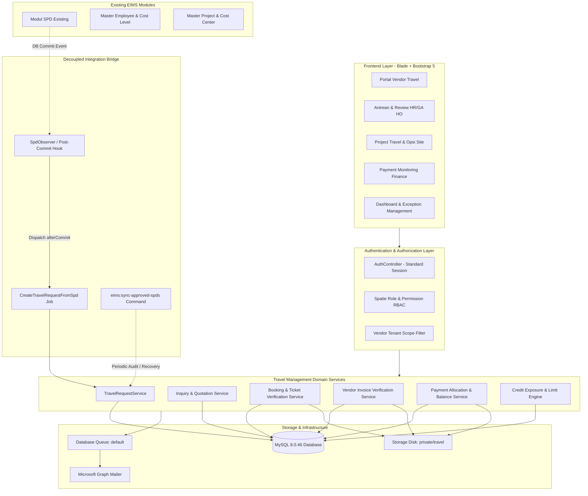
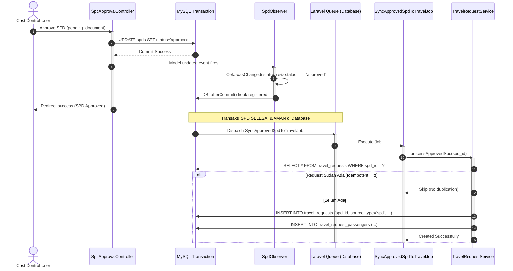
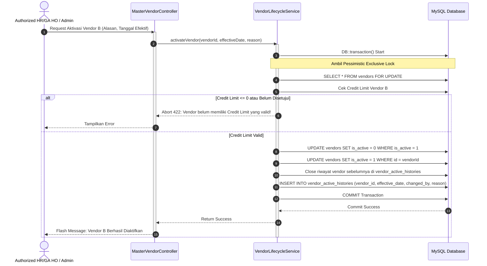
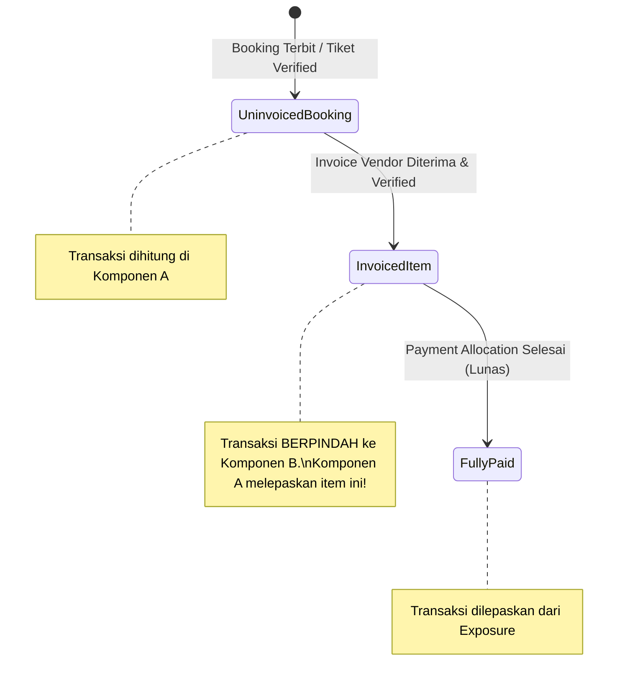

# EIMS TECHNICAL IMPLEMENTATION BLUEPRINT (P0.2)
## Modul: Travel Management & Vendor Payment Monitoring
**Aplikasi:** Enterprise Information Management System (EIMS) — Rapid Infrastruktur Indonesia  
**Versi Dokumen:** P0.2 — Refined Blueprint  
**Status:** DRAFT BLUEPRINT (REVIEW ONLY — Menunggu Persetujuan Pemilik Proyek)  
**Dokumen Pendukung Terkait:**
1. [`EIMS_DATABASE_DESIGN_P0.2.md`](file:///c:/Users/it/Documents/projects/eims/EIMS_DATABASE_DESIGN_P0.2.md)
2. [`EIMS_AUTHENTICATION_AUTHORIZATION_DESIGN_P0.2.md`](file:///c:/Users/it/Documents/projects/eims/EIMS_AUTHENTICATION_AUTHORIZATION_DESIGN_P0.2.md)
3. [`EIMS_REGRESSION_TEST_PLAN_P0.2.md`](file:///c:/Users/it/Documents/projects/eims/EIMS_REGRESSION_TEST_PLAN_P0.2.md)

---

## 1. PENDAHULUAN & PRINSIP DASAR ARSITEKTUR

### 1.1 Tujuan Dokumen
Dokumen ini menyajikan cetak biru teknis (*technical architecture blueprint*) untuk implementasi modul **Travel Management & Vendor Payment Monitoring** pada aplikasi EIMS Rapid Infrastruktur Indonesia, menyempurnakan hasil audit awal P0 (`EIMS_REPOSITORY_AUDIT.md`) sesuai batasan bisnis pada `PRD_EIMS_Travel_Management_v1.2.md`.

### 1.2 Status Informasi
Dokumen ini secara ketat membedakan tiga status informasi:
- **[FAKTA TERKONFIRMASI]:** Temuan konkret hasil pemeriksaan repository, skema database MySQL 8.0.46, routing, model, dan kontrol otorisasi yang ada.
- **[REKOMENDASI TEKNIS]:** Usulan arsitektur, pola kode, skema delta, dan mekanisme proteksi yang dirancang untuk menjaga stabilitas sistem.
- **[KEPUTUSAN BISNIS BELUM FINAL (OPEN DECISIONS)]:** Butir keputusan bisnis (O-01 s/d O-12) yang belum disahkan oleh Finance/Management/HRGA dan membutuhkan konfigurasi adaptif.

### 1.3 Prinsip Rekayasa (*Engineering Tenets*)
1. **Zero Impact on Existing Workflows:** Modul SPD (Surat Perjalanan Dinas), Cuti (*Leave Request*), Manajemen Karyawan, dan Master Data tidak boleh mengalami perubahan alur perilaku (*breaking changes*).
2. **Decoupled Integration:** Hubungan antara modul SPD dan Travel Management bersifat asinkron dan terisolasi. Kegagalan sistem Travel tidak boleh menggagalkan status approval SPD.
3. **Strict Financial Integrity:** Nilai tagihan, pembayaran, sisa hutang (*outstanding*), dan limit kredit dihitung menggunakan tipe data presisi tinggi (`DECIMAL(15,2)`), dilindungi transaksi database atomik, dan memiliki audit trail lengkap.
4. **Tenant Isolation:** Rekanan Travel (Vendor) beroperasi di portal terisolasi tanpa visibilitas terhadap transaksi atau penawaran vendor lain.

---

## 2. ARSITEKTUR SISTEM & KOMPONEN

### 2.1 Diagram Arsitektur Keseluruhan



---

## 3. INTEGRASI TERISOLASI & IDEMPOTEN DENGAN MODUL SPD

### 3.1 Masalah & Analisis Risiko Integrasi
- **[FAKTA TERKONFIRMASI]:** Di dalam `app/Http/Controllers/HR/SpdApprovalController.php` (baris 275–336), saat Cost Control menyetujui SPD pada tahap `pending_document`, status SPD langsung diubah menjadi `approved`:
  ```php
  $spd->document_approved_at = now();
  $spd->status = 'approved';
  $spd->save();
  ```
- **[REKOMENDASI TEKNIS]:** Jika pemanggilan pembuatan `TravelRequest` diletakkan langsung di dalam `SpdApprovalController::approve()` secara sinkron tanpa isolasi, maka error pada modul Travel (misal validasi schema, koneksi database timeout, atau tabel baru bermasalah) akan melempar `Exception` yang menggagalkan transaksi persetujuan SPD. Hal ini melanggar klausul D-01 PRD v1.2.

### 3.2 Desain Mekanisme Integrasi Decoupled (After-Commit & Idempotent)

Integrasi dilakukan melalui **3 lapis pengamanan (*defense-in-depth*)**:



#### Komponen Pengaman 1: `SpdObserver` dengan `afterCommit`
Mendaftarkan observer model pada `Spd` yang hanya dieksekusi setelah transaksi database utama di-*commit* secara permanen:
```php
namespace App\Observers;

use App\Models\Spd;
use App\Jobs\Travel\SyncApprovedSpdToTravelJob;
use Illuminate\Support\Facades\DB;
use Illuminate\Support\Facades\Log;

class SpdObserver
{
    public function updated(Spd $spd): void
    {
        // Hanya picu jika status berubah secara riil menjadi 'approved'
        if ($spd->wasChanged('status') && $spd->status === 'approved') {
            DB::afterCommit(function () use ($spd) {
                try {
                    // Dispatch ke antrean background
                    SyncApprovedSpdToTravelJob::dispatch($spd->id);
                } catch (\Throwable $e) {
                    // Kegagalan dispatch TIDAK BOLEH menggagalkan SPD yang sudah commit
                    Log::channel('daily')->error('Gagal dispatch SyncApprovedSpdToTravelJob: ' . $e->getMessage(), [
                        'spd_id' => $spd->id,
                        'trace' => $e->getTraceAsString(),
                    ]);
                }
            });
        }
    }
}
```

#### Komponen Pengaman 2: Garansi Idempotensi di Layer Service
Pada `travel_requests`, kolom `spd_id` memiliki indeks **`UNIQUE`**. Service menggunakan mekanisme atomik:
```php
$existing = TravelRequest::where('spd_id', $spd->id)->first();
if ($existing) {
    Log::info("Travel Request untuk SPD {$spd->spd_number} sudah ada (ID: {$existing->id}). Lewati.");
    return $existing;
}
```
Jika terjadi *race condition* eksekusi bersamaan, constraint `UNIQUE(spd_id)` di MySQL akan menolak *insert* ganda pada level storage engine.

#### Komponen Pengaman 3: Safe Retry & Self-Healing Command
Menyediakan artisan scheduled command `php artisan travel:sync-approved-spds` yang berjalan secara periodik (misal setiap 30 menit). Command ini mencari seluruh SPD berstatus `approved` yang belum memiliki relasi di `travel_requests`:
```php
Spd::where('status', 'approved')
    ->whereDoesntHave('travelRequest')
    ->chunkById(50, function ($unlinkedSpds) {
        foreach ($unlinkedSpds as $spd) {
            SyncApprovedSpdToTravelJob::dispatch($spd->id);
        }
    });
```
Dengan mekanisme ini, seandainya worker antrean *down* atau terjadi kendala jaringan saat approval SPD berlangsung, sistem akan memulihkan dirinya sendiri (*self-healing*) tanpa keterlibatan manual DBA.

---

## 4. ARSITEKTUR AKTIVASI VENDOR TUNGGAL (SINGLE ACTIVE VENDOR)

### 4.1 Persyaratan Bisnis & Masalah Konkurensi
- **[FAKTA TERKONFIRMASI]:** Klausul **D-04** dan **FR-04** menetapkan:
  1. EIMS dapat menyimpan banyak master vendor Travel (vendor lama dan rekanan baru).
  2. Pada satu waktu, **hanya ada satu vendor aktif** yang ditetapkan untuk menerima proses booking baru.
  3. Riwayat pergantian vendor harus tercatat (tanggal efektif, aktor, alasan).
  4. Vendor lama yang dinonaktifkan tetap memegang outstanding historisnya sendiri (D-05).
- **[REKOMENDASI TEKNIS]:** Bahaya konkurensi terjadi jika dua administrator membuka menu master vendor pada saat bersamaan dan mengaktifkan dua vendor berbeda. Tanpa kontrol konkurensi di tingkat database, kedua request dapat menghasilkan dua vendor dengan flag `is_active = 1`.

### 4.2 Desain Mekanisme Single Active Vendor



### 4.3 Implementasi Transaksional & Proteksi Mutex
Aktivasi vendor dibungkus dalam transaksi database dengan *exclusive lock* pada tabel master:
```php
namespace App\Services\Travel;

use App\Models\Travel\Vendor;
use App\Models\Travel\VendorActiveHistory;
use Illuminate\Support\Facades\DB;
use Illuminate\Validation\ValidationException;

class VendorLifecycleService
{
    public function activateVendor(int $targetVendorId, string $effectiveDate, string $reason, int $userId): Vendor
    {
        return DB::transaction(function () use ($targetVendorId, $effectiveDate, $reason, $userId) {
            // 1. Kunci seluruh tabel vendors dari mutasi konkuren
            $vendors = Vendor::lockForUpdate()->get();
            $targetVendor = $vendors->firstWhere('id', $targetVendorId);

            if (!$targetVendor) {
                throw ValidationException::withMessages(['vendor_id' => 'Vendor tidak ditemukan.']);
            }

            // 2. Validasi Prasyarat: Vendor wajib memiliki Credit Limit > 0 yang disetujui (D-06, FR-04)
            if ($targetVendor->credit_limit <= 0) {
                throw ValidationException::withMessages([
                    'vendor_id' => 'Vendor tidak dapat diaktifkan sebelum Credit Limit ditetapkan dan disetujui.',
                ]);
            }

            if ($targetVendor->is_active) {
                return $targetVendor; // Sudah aktif, tidak perlu mutasi
            }

            $currentActive = $vendors->firstWhere('is_active', true);

            // 3. Nonaktifkan vendor yang sedang aktif saat ini
            if ($currentActive) {
                $currentActive->update(['is_active' => false]);

                // Tutup record riwayat aktif sebelumnya
                VendorActiveHistory::where('vendor_id', $currentActive->id)
                    ->whereNull('deactivated_date')
                    ->update(['deactivated_date' => $effectiveDate]);
            }

            // 4. Aktifkan target vendor
            $targetVendor->update(['is_active' => true]);

            // 5. Catat riwayat aktivasi baru
            VendorActiveHistory::create([
                'vendor_id' => $targetVendor->id,
                'effective_date' => $effectiveDate,
                'deactivated_date' => null,
                'changed_by' => $userId,
                'reason' => $reason,
            ]);

            return $targetVendor;
        });
    }
}
```

---

## 5. ARSITEKTUR CREDIT LIMIT & PENCEGAHAN DOUBLE COUNTING

### 5.1 Status Keputusan Bisnis Terkait Exposure
- **[KEPUTUSAN BISNIS BELUM FINAL (O-01, O-02)]:**
  - **O-01:** Titik mula perhitungan credit exposure belum disahkan oleh Finance/Management (apakah sejak instruksi booking dikirim, tiket diterbitkan, atau saat invoice diterima).
  - **O-02:** Titik pelepasan exposure setelah pembayaran belum disahkan (apakah saat bukti transfer diunggah oleh Finance atau saat vendor mengonfirmasi dana masuk).
- **[REKOMENDASI TEKNIS]:** Arsitektur sistem harus mengisolasi formula exposure di dalam satu *dedicated engine* (`VendorCreditEngine`) dengan parameter konfigurasi, bukan *hardcoded* di berbagai tempat.

### 5.2 Strategi Pencegahan Double Counting (*Anti-Double Counting Engine*)
Tantangan terbesar dalam perhitungan exposure vendor adalah transisi status transaksi: ketika sebuah pesanan tiket (*booking*) yang sebelumnya belum ditagihkan, kemudian dicantumkan ke dalam sebuah tagihan (*invoice*). Jika sistem menghitung `Total Booking + Total Invoice`, maka transaksi tersebut akan terhitung dua kali.



#### Formula Konseptual yang Direkomendasikan:
$$\text{Credit Exposure} = \text{Uninvoiced Bookings} + \text{Unpaid Verified Invoices}$$

Di mana:
1. **$\text{Uninvoiced Bookings}$ (Komponen A):**  
   Total nilai nominal booking terkonfirmasi yang **belum ditautkan** ke item invoice manapun (`WHERE NOT EXISTS (SELECT 1 FROM vendor_invoice_items WHERE travel_booking_id = travel_bookings.id)`).
2. **$\text{Unpaid Verified Invoices}$ (Komponen B):**  
   Total sisa saldo (*balance*) dari invoice berstatus `verified` / `ready_for_finance` / `partially_paid` yang belum terbayar:
   $$\text{Unpaid Invoice Balance} = \sum (\text{invoice.total\_amount} - \text{invoice.paid\_amount})$$

Dengan memisahkan booking yang *sudah ditagihkan* dari booking yang *belum ditagihkan*, **duplikasi perhitungan (double counting) dijamin $0\%$ secara matematis**.

### 5.3 Mekanisme Pemblokiran & Exception Approval (D-07, FR-18)
1. **Pengecekan Ambang Batas (*Limit Check*):**  
   Saat HR/GA HO hendak mengirimkan *Final Booking Confirmation*, sistem memvalidasi:
   $$\text{Current Exposure} + \text{Estimated New Booking Cost} \le \text{Vendor Credit Limit}$$
2. **Kondisi Pelanggaran Limit:**
   - Tombol kirim booking diblokir di UI.
   - Sistem menampilkan pesan: *"Credit Limit vendor tercapai (Exposure: RpX / Limit: RpY). Booking memerlukan persetujuan khusus Management."*
   - Status booking berubah menjadi `awaiting_credit_exception`.
3. **Persetujuan Khusus Management:**
   - User dengan kewenangan Management (role `Board of Director` atau permission `travel.exception-approve`) dapat menyetujui *exception* via menu/dialog khusus.
   - Mencatat record audit di tabel `credit_limit_exceptions`: waktu, approver, nominal exposure saat disetujui, dan alasan justifikasi bisnis.
   - **Penting:** Persetujuan exception **TIDAK mengubah angka credit limit vendor** pada master data.

---

## 6. MATRIKS URUTAN MIGRASI (MIGRATION SEQUENCING)

Untuk memastikan integritas *Foreign Key Constraints* (FK) dan kompatibilitas skema tanpa *downtime*, urutan eksekusi migrasi database dirancang dalam 6 kelompok logis:

| No | Nama Migrasi Usulan | Tabel yang Dibuat / Diubah | Ketergantungan Foreign Key | Alasan Urutan |
|---|---|---|---|---|
| **01** | `add_vendor_support_to_users_table.php` | Alter `users` | FK `vendors` (dibuat nullable, foreign key ditambahkan setelah tabel vendors ada) | Menyiapkan kolom `email` dan `user_type` pada tabel `users`. |
| **02** | `create_vendors_and_histories_tables.php` | `vendors`<br>`vendor_active_histories`<br>`vendor_credit_limit_histories` | FK `users.id` | Fondasi utama master vendor dan riwayat kredit sebelum transaksi dibuat. |
| **03** | `create_travel_requests_tables.php` | `travel_requests`<br>`travel_request_passengers` | FK `spds.id`<br>`projects.id`<br>`employees.id`<br>`users.id` | Struktur permintaan perjalanan (SPD & Project Travel) multi-penumpang. |
| **04** | `create_inquiries_and_quotations_tables.php` | `travel_inquiries`<br>`vendor_quotations`<br>`vendor_quotation_options`<br>`vendor_quotation_revisions` | FK `travel_requests.id`<br>`vendors.id` | Alur inquiry rekanan dan multi-opsi alternatif penerbangan/hotel/transport. |
| **05** | `create_bookings_and_tickets_tables.php` | `travel_bookings`<br>`travel_tickets`<br>`credit_limit_exceptions` | FK `quotation_options.id`<br>`travel_request_passengers.id`<br>`vendors.id` | Final booking, multi-service e-ticket privat, dan approval exception limit. |
| **06** | `create_invoices_payments_and_audit_tables.php` | `vendor_invoices`<br>`vendor_invoice_items`<br>`vendor_payments`<br>`vendor_payment_allocations`<br>`travel_audit_logs` | FK `vendors.id`<br>`travel_bookings.id`<br>`travel_tickets.id`<br>`users.id` | Penagihan multi-item, alokasi pembayaran parsial/lunas, dan audit trail trail. |

---

## 7. STRATEGI ROLLBACK & RENCANA PEMULIHAN BENCANA

Setiap migrasi wajib menyediakan fungsi `down()` yang simetris dan aman. Jika terjadi kendala pada saat deployment di staging/production:

1. **Aturan Safe Drop:**
   Migrasi harus mendrop tabel anak (*child table*) sebelum tabel induk (*parent table*) untuk menghindari pelanggaran integritas referensial:
   ```php
   // Contoh pada down() migrasi pembayaran
   Schema::dropIfExists('vendor_payment_allocations');
   Schema::dropIfExists('vendor_payments');
   Schema::dropIfExists('vendor_invoice_items');
   Schema::dropIfExists('vendor_invoices');
   ```
2. **Isolasi Kolom Existing:**
   Migrasi tidak boleh menghapus atau mengubah tipe data kolom pada tabel inti eksisting (`employees`, `spds`, `projects`, `users`). Perubahan pada `users` hanya bersifat menambahkan kolom nullable (`email`, `vendor_id`).
3. **Rollback Snapshot:**
   Sebelum migrasi tahap P1 dijalankan pada environment staging/production, DBA wajib melakukan *full physical backup* database menggunakan MySQL dump:
   ```bash
   mysqldump -u root -p --single-transaction --routines --triggers eims > eims_pre_p1_backup.sql
   ```

---

## 8. DAFTAR FILE EKSISTING YANG POTENSIAL TERPENGARUH

Meskipun modul baru dibangun secara terisolasi, terdapat sejumlah berkas konfigurasi dan shared view yang perlu disesuaikan pada saat fase implementasi (P1–P8):

| File Eksisting | Peran / Hubungan | Jenis Penyesuaian yang Direncanakan |
|---|---|---|
| `app/Models/employee.php` | Model Karyawan | **Rename fisik** menjadi `app/Models/Employee.php` untuk mencegah fatal error autoloader di server Linux (Fix Temuan SF-01). |
| `bootstrap/app.php` | Registrasi Middleware | Mendaftarkan alias middleware Spatie `'permission' => \Spatie\Permission\Middleware\PermissionMiddleware::class`. |
| `app/Providers/AppServiceProvider.php` | Service Provider Utama | Mendaftarkan `Spd::observe(SpdObserver::class)` untuk integrasi trigger pasif. |
| `resources/views/layouts/app.blade.php` | Layout Navigasi Induk | Menambahkan blok menu navigasi Travel Management, Inquiry, Verifikasi Tiket, Invoice, dan Payment Monitoring sesuai hak akses role. |
| `database/seeders/RolePermissionSeeder.php` | Seeder RBAC | Menambahkan definisi 15 permission baru terkait modul Travel tanpa mengubah permission eksisting. |
| `app/Models/User.php` | Model Akun Pengguna | Memperbarui method `routeNotificationForMail()` agar dapat membaca email dari profil vendor jika akun bertipe vendor. |

---

## 9. STATUS PENYELESAIAN OPEN DECISIONS (PRD v1.2)

| ID | Topik Open Decision | Analisis Teknis | Rekomendasi Solusi Sementara di Tingkat Kode |
|---|---|---|---|
| **O-01** | Titik mula Credit Exposure | Menentukan kapan kewajiban mulai memotong limit. | Sediakan parameter konfigurasi `config('travel.credit_exposure_start_stage')` default `'booking_confirmed'`. |
| **O-02** | Titik pelepasan Exposure | Menentukan kapan limit dikembalikan. | Sediakan opsi di `VendorCreditEngine`: saat payment dialokasikan ke invoice (`payment_allocated`). |
| **O-03** | Apakah Partial Payment diizinkan | Berpengaruh pada status invoice dan alokasi. | Skema database dirancang mendukung partial payment (`vendor_payment_allocations`). Jika Finance melarang, batasi di layer validasi UI/FormRequest tanpa mengubah skema tabel. |
| **O-04** | 1 Payment untuk banyak Invoice | Pembayaran gelondongan (*bulk payment*). | Model `vendor_payments` memiliki relasi `hasMany` ke `vendor_payment_allocations`, secara native mendukung pembayaran multi-invoice. |
| **O-05** | Pencegahan penagihan ganda per item | Mencegah 1 booking ditagih 2x. | Constraint unik & validasi di `vendor_invoice_items`: kolom `travel_booking_id` diverifikasi agar tidak terikat ke invoice aktif lainnya. |
| **O-06** | Dasar tanggal dan band aging | Laporan umur hutang vendor. | Dihitung dinamis menggunakan `DATEDIFF(NOW(), vendor_invoices.due_date)` dengan band default 0–30, 31–60, 61–90, >90 hari. |
| **O-07** | Invoice portal vs hardcopy | Media penerimaan tagihan. | Mendukung upload berkas PDF di portal dan nomor referensi fisik/kearsipan internal. |
| **O-08** | Format data wajib Project Travel | Data minimal penumpang site. | Mendukung nama, NIK (opsional jika non-employee), nomor kontak, nomor KTP/identitas, dan catatan rute. |
| **O-09** | Approval matrix Exception Limit | Siapa yang berwenang meloloskan booking saat limit habis. | Menggunakan Spatie Permission `travel.exception-approve` yang dapat ditugaskan secara fleksibel ke role `Board of Director` atau level manajemen lain. |
| **O-10** | Kebijakan pembatalan SPD/Booking | Dampak pembatalan terhadap tiket dan refund. | Pembatalan booking tidak menghapus invoice; pengurangan kewajiban wajib melalui dokumen nota kredit / penyesuaian (*credit adjustment*). |
| **O-11** | Vendor nonaktif upload invoice | Hak akses rekanan lama. | Diizinkan khusus untuk pesanan lama yang diterbitkan sebelum tanggal nonaktif vendor tersebut. |
| **O-12** | Validitas Credit Limit awal Rp75.000.000 | Plafon awal rekanan aktif. | Dimasukkan ke dalam seeder awal dengan riwayat persetujuan resmi di `vendor_credit_limit_histories`. |

---
*Blueprint arsitektur teknis selesai disusun. Lanjutkan penelaahan pada dokumen skema database dan dokumen autentikasi.*
