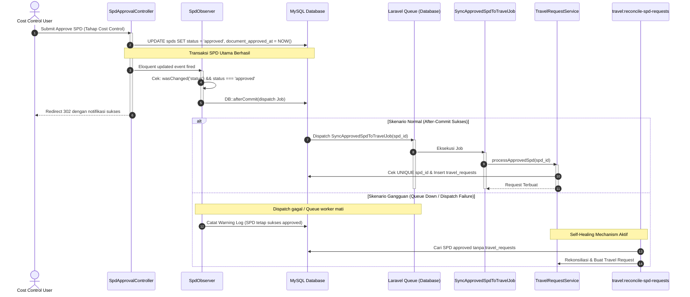
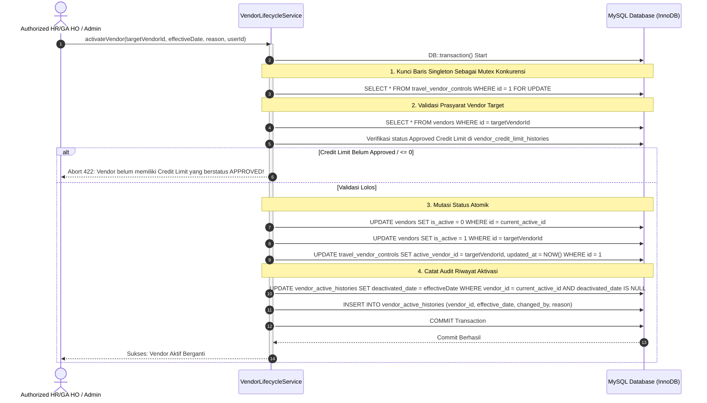
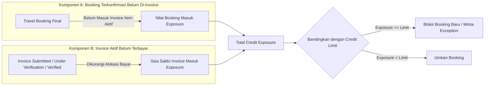
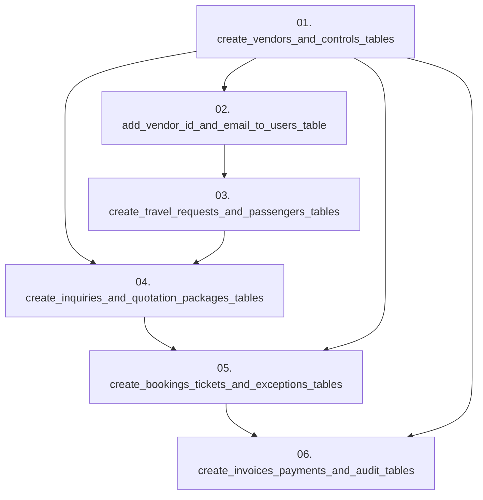

# EIMS TECHNICAL IMPLEMENTATION BLUEPRINT (P0.3)
## Modul: Travel Management & Vendor Payment Monitoring
**Aplikasi:** Enterprise Information Management System (EIMS) — Rapid Infrastruktur Indonesia  
**Versi Dokumen:** P0.3 — Refined Architectural Specification  
**Status:** DRAFT BLUEPRINT (REVIEW ONLY — Menunggu Persetujuan Pemilik Proyek)  
**Dokumen Pendukung Terkait:**
1. [`EIMS_DATABASE_DESIGN_P0.3.md`](file:///c:/Users/it/Documents/projects/eims/EIMS_DATABASE_DESIGN_P0.3.md)
2. [`EIMS_AUTHENTICATION_AUTHORIZATION_DESIGN_P0.3.md`](file:///c:/Users/it/Documents/projects/eims/EIMS_AUTHENTICATION_AUTHORIZATION_DESIGN_P0.3.md)
3. [`EIMS_REGRESSION_TEST_PLAN_P0.3.md`](file:///c:/Users/it/Documents/projects/eims/EIMS_REGRESSION_TEST_PLAN_P0.3.md)

---

## 1. PENDAHULUAN & TAKSONOMI INFORMASI

### 1.1 Tujuan Dokumen
Dokumen ini merupakan cetak biru teknis (*technical architecture blueprint*) versi **P0.3** yang menyempurnakan arsitektur P0.2 untuk modul **Travel Management & Vendor Payment Monitoring** pada aplikasi EIMS Rapid Infrastruktur Indonesia. Dokumen ini disusun untuk memastikan keselarasan $100\%$ terhadap kebutuhan bisnis `PRD_EIMS_Travel_Management_v1.2.md` (`PRD.md`) dengan prioritas mutlak: **menjaga seluruh workflow eksisting (SPD, Leave, Employee, User Management) agar tidak rusak**.

### 1.2 Taksonomi Status Informasi
Sepanjang dokumen ini, setiap pernyataan diklasifikasikan ke dalam 3 kategori:
- **`[FAKTA REPOSITORY]`**: Informasi faktual yang diverifikasi langsung dari source code, file konfigurasi, atau database MySQL `eims` eksisting.
- **`[REKOMENDASI TEKNIS]`**: Usulan arsitektur, pola kode, mekanisme locking, dan strategi proteksi yang diusulkan oleh tim teknis.
- **`[KEPUTUSAN BISNIS BELUM FINAL (OPEN DECISIONS)]`**: Butir keputusan bisnis (O-01 s/d O-12) yang memerlukan pengesahan formal dari pemilik proyek (Finance / Management / HRGA).

---

## 2. ARSITEKTUR INTEGRASI SPD TERISOLASI, IDEMPOTEN, DAN SELF-HEALING

### 2.1 Analisis Workflow SPD Eksisting `[FAKTA REPOSITORY]`
Pada repository aktual:
- Model `Spd` ([app/Models/Spd.php](file:///c:/Users/it/Documents/projects/eims/app/Models/Spd.php)) memiliki status: `pending_manager`, `pending_document`, `approved`, `rejected`.
- Transisi status menjadi `approved` terjadi pada baris ke-285 di file [app/Http/Controllers/HR/SpdApprovalController.php](file:///c:/Users/it/Documents/projects/eims/app/Http/Controllers/HR/SpdApprovalController.php):
  ```php
  $spd->document_approved_at = now();
  $spd->status = 'approved';
  $spd->save();
  ```
- **Kondisi Kritis:** Di dalam controller tersebut, mutasi status `approved` saat ini **tidak dibungkus `DB::transaction`**, melainkan pemanggilan save langsung diikuti pengiriman notifikasi email antrean.

### 2.2 Desain Integrasi After-Commit & Fault Tolerance `[REKOMENDASI TEKNIS]`
Untuk menjamin prinsip **D-01** (integrasi tidak boleh mengubah atau merusak alur SPD yang berjalan), alur pemicu dirancang dengan pola *decoupled asynchronous event*:



#### 1. Implementasi `SpdObserver`
Observer didaftarkan pada `Spd` untuk mendeteksi perubahan status secara pasif tanpa menyentuh controller SPD:
```php
namespace App\Observers;

use App\Models\Spd;
use App\Jobs\Travel\SyncApprovedSpdToTravelJob;
use Illuminate\Support\Facades\DB;
use Illuminate\Support\Facades\Log;

class SpdObserver
{
    public function updated(Spd $spd): void
    {
        // Hanya picu jika status berubah secara riil menjadi 'approved'
        if ($spd->wasChanged('status') && $spd->status === 'approved') {
            DB::afterCommit(function () use ($spd) {
                try {
                    SyncApprovedSpdToTravelJob::dispatch($spd->id);
                } catch (\Throwable $e) {
                    // PENTING: Kegagalan antrean TIDAK BOLEH menggagalkan SPD yang sudah disetujui!
                    Log::channel('daily')->critical("Gagal mendispatch SyncApprovedSpdToTravelJob untuk SPD #{$spd->id}: {$e->getMessage()}", [
                        'spd_id' => $spd->id,
                        'trace' => $e->getTraceAsString(),
                    ]);
                }
            });
        }
    }
}
```

#### 2. Ketahanan Job (`SyncApprovedSpdToTravelJob`) & Idempotensi Mutlak
Job dirancang aman terhadap konkurensi dan kegagalan sementara (*transient failure*):
```php
namespace App\Jobs\Travel;

use App\Models\Spd;
use App\Services\Travel\TravelRequestService;
use Illuminate\Bus\Queueable;
use Illuminate\Contracts\Queue\ShouldQueue;
use Illuminate\Foundation\Bus\Dispatchable;
use Illuminate\Queue\InteractsWithQueue;
use Illuminate\Queue\SerializesModels;
use Illuminate\Support\Facades\Log;

class SyncApprovedSpdToTravelJob implements ShouldQueue
{
    use Dispatchable, InteractsWithQueue, Queueable, SerializesModels;

    public int $tries = 5;
    public array $backoff = [10, 60, 300, 900, 3600];

    public function __construct(public int $spdId) {}

    public function handle(TravelRequestService $service): void
    {
        $spd = Spd::find($this->spdId);

        if (!$spd || $spd->status !== 'approved') {
            Log::info("Job lewati: SPD #{$this->spdId} tidak ditemukan atau status bukan approved.");
            return;
        }

        // Service mengeksekusi dengan garansi idempotensi di level query atomik
        $service->createFromApprovedSpd($spd);
    }

    public function failed(\Throwable $exception): void
    {
        Log::channel('daily')->emergency("SyncApprovedSpdToTravelJob GAGAL PERMANEN untuk SPD #{$this->spdId}: {$exception->getMessage()}");
    }
}
```

#### 3. Rekonsiliasi Otomatis (*Self-Healing Scheduled Command*)
Menyediakan perintah artisan yang disinkronkan di `routes/console.php`:
```php
// Nama harmonis di seluruh dokumen:
// Artisan Command: php artisan travel:reconcile-spd-requests
```
Command ini mencari semua SPD berstatus `approved` yang belum memiliki relasi di `travel_requests` (misal karena server antrean *restart* saat approval dilakukan), lalu secara otomatis memicu proses integrasi ulang.

---

## 3. ARSITEKTUR AKTIVASI REKANAN VENDOR TUNGGAL (SINGLE ACTIVE VENDOR)

### 3.1 Kebutuhan Bisnis `[PRD D-04, FR-04]`
1. Mendukung banyak master vendor Travel (rekanan lama dan rekanan baru).
2. Hanya ada **satu rekanan aktif untuk menerima proses booking baru** pada satu waktu.
3. Vendor nonaktif tetap dapat menyelesaikan transaksi/invoice lama miliknya sendiri (D-05).
4. Riwayat aktivasi, tanggal efektif, aktor, dan alasan wajib diaudit.

### 3.2 Desain Mekanisme Concurrency Lock Menggunakan Control Row Singleton `[REKOMENDASI TEKNIS]`
Untuk menghindari *table-level locking* yang berisiko memicu deadlock pada tabel `vendors` saat konkurensi tinggi, sistem menggunakan tabel kendali khusus berskala satu baris (*singleton control table*): `travel_vendor_controls`.



#### Struktur Tabel Singleton Control: `travel_vendor_controls`
```sql
CREATE TABLE `travel_vendor_controls` (
    `id` TINYINT UNSIGNED NOT NULL DEFAULT 1,
    `active_vendor_id` BIGINT UNSIGNED NULL,
    `updated_at` TIMESTAMP NULL DEFAULT CURRENT_TIMESTAMP ON UPDATE CURRENT_TIMESTAMP,
    PRIMARY KEY (`id`),
    CONSTRAINT `fk_tvc_vendor` FOREIGN KEY (`active_vendor_id`) 
        REFERENCES `vendors` (`id`) ON UPDATE CASCADE ON DELETE RESTRICT,
    CONSTRAINT `chk_singleton_row` CHECK (`id` = 1)
) ENGINE=InnoDB DEFAULT CHARSET=utf8mb4 COLLATE=utf8mb4_unicode_ci;
```

#### Implementasi Mutex Transaksional pada `VendorLifecycleService`
```php
namespace App\Services\Travel;

use App\Models\Travel\Vendor;
use App\Models\Travel\VendorActiveHistory;
use App\Models\Travel\VendorCreditLimitHistory;
use Illuminate\Support\Facades\DB;
use Illuminate\Validation\ValidationException;

class VendorLifecycleService
{
    public function activateVendor(int $targetVendorId, string $effectiveDate, string $reason, int $userId): Vendor
    {
        return DB::transaction(function () use ($targetVendorId, $effectiveDate, $reason, $userId) {
            // 1. Ambil kunci eksklusif pada baris singleton (Mutex global konkurensi aktivasi)
            $control = DB::table('travel_vendor_controls')->where('id', 1)->lockForUpdate()->first();

            $targetVendor = Vendor::findOrFail($targetVendorId);

            // 2. Validasi Kritis: Credit limit wajib > 0 DAN berstatus APPROVED secara resmi di riwayat
            $hasApprovedLimit = VendorCreditLimitHistory::where('vendor_id', $targetVendorId)
                ->where('approval_status', 'approved')
                ->where('new_limit', '>', 0)
                ->where('effective_date', '<=', now()->toDateString())
                ->exists();

            if (!$hasApprovedLimit || $targetVendor->credit_limit <= 0) {
                throw ValidationException::withMessages([
                    'vendor_id' => 'Rekanan tidak dapat diaktifkan sebelum memiliki Credit Limit berstatus APPROVED yang sah dari Management.',
                ]);
            }

            $currentActiveId = $control?->active_vendor_id;

            if ($currentActiveId === $targetVendorId && $targetVendor->is_active) {
                return $targetVendor; // Sudah aktif
            }

            // 3. Nonaktifkan rekanan lama (jika ada)
            if ($currentActiveId) {
                Vendor::where('id', $currentActiveId)->update(['is_active' => false]);

                VendorActiveHistory::where('vendor_id', $currentActiveId)
                    ->whereNull('deactivated_date')
                    ->update(['deactivated_date' => $effectiveDate]);
            }

            // 4. Aktifkan rekanan baru
            $targetVendor->update(['is_active' => true]);

            // 5. Perbarui pointer control row singleton
            DB::table('travel_vendor_controls')->updateOrInsert(
                ['id' => 1],
                ['active_vendor_id' => $targetVendorId, 'updated_at' => now()]
            );

            // 6. Catat riwayat aktivasi baru
            VendorActiveHistory::create([
                'vendor_id' => $targetVendorId,
                'effective_date' => $effectiveDate,
                'deactivated_date' => null,
                'changed_by' => $userId,
                'reason' => $reason,
            ]);

            return $targetVendor;
        });
    }
}
```

---

## 4. FORMULA CREDIT EXPOSURE & PENCEGAHAN KEBOCORAN SALDO

### 4.1 Identifikasi Celah P0.2 & Koreksi Desain P0.3 `[REKOMENDASI TEKNIS]`
Pada tinjauan P0.2, teridentifikasi risiko *exposure leak*: jika sebuah pesanan tiket (*booking*) dicantumkan ke dalam invoice berstatus `submitted` / `under_verification`, pesanan tersebut dikeluarkan dari antrean un-invoiced, sementara invoice belum dihitung sebagai utang verified. Akibatnya, ada rentang waktu di mana transaksi tersebut "hilang" dari eksposur kredit vendor!

### 4.2 Formula Terpadu Anti-Leak & Anti-Double Counting



#### Formula Matematis Baku:
$$\text{Credit Exposure} = \text{Uninvoiced Confirmed Bookings} + \sum (\text{Active Invoice Total} - \text{Confirmed Payment Allocations})$$

Di mana:
1. **$\text{Uninvoiced Confirmed Bookings}$:**  
   Total pesanan tiket yang sudah dikonfirmasi (`confirmed`, `ticket_uploaded`, `ticket_verified`) yang **belum dicatat dalam item invoice aktif**.
2. **$\text{Active Invoices}$:**  
   Seluruh invoice vendor yang berstatus `submitted`, `under_verification`, `need_clarification`, `verified`, atau `partially_paid` (kecuali invoice berstatus `rejected` atau `cancelled`).
3. **Pelepasan Exposure:**  
   Exposure berkurang saat pembayaran direalisasikan dan dialokasikan ke invoice (`vendor_payment_allocations`).

---

## 5. URUTAN MIGRASI DATABASE (CORRECTED DEPENDENCY ORDER)

Memperbaiki kelemahan dependensi migrasi pada P0.2, skema baru disusun dalam urutan yang menjamin tabel induk (*parent table*) selalu dibuat mendahului tabel anak (*child table*):



### Rincian Tahapan Migrasi:
- **Batch Step 1:** `create_vendors_and_controls_tables.php`  
  Menciptakan `vendors`, `travel_vendor_controls`, `vendor_active_histories`, `vendor_credit_limit_histories`.
- **Batch Step 2:** `add_vendor_id_and_email_to_users_table.php`  
  Menambahkan kolom `vendor_id` (FK ke `vendors.id`), `email`, dan `user_type` pada tabel `users`.
- **Batch Step 3:** `create_travel_requests_and_passengers_tables.php`  
  Menciptakan `travel_requests` (FK ke `spds`, `projects`, `users`) dan `travel_request_passengers` (FK ke `employees`).
- **Batch Step 4:** `create_inquiries_and_quotation_packages_tables.php`  
  Menciptakan `travel_inquiries`, `vendor_quotations`, `vendor_quotation_packages`, `vendor_quotation_services`.
- **Batch Step 5:** `create_bookings_tickets_and_exceptions_tables.php`  
  Menciptakan `travel_bookings`, `travel_booking_services`, `travel_tickets`, `credit_limit_exceptions`.
- **Batch Step 6:** `create_invoices_payments_and_audit_tables.php`  
  Menciptakan `vendor_invoices`, `vendor_invoice_items`, `vendor_payments`, `vendor_payment_allocations`, `vendor_credit_notes`, `travel_audit_logs`.

---

## 6. KLARIFIKASI STATUS MODEL `employee.php` `[FAKTA REPOSITORY]`

1. **Hasil Pengecekan Terkini:**
   File model karyawan pada repository saat ini tercatat di path fisik:
   `app/Models/employee.php` (panjang 2.210 byte, baris 10: `class Employee extends Model`).
2. **Ketetapan Tindakan Teknis P0.3:**
   - **TIDAK ADA rename file yang dilakukan pada tahap P0.3 ini.**
   - Perubahan nama file model menjadi `Employee.php` dicatat sebagai rekomendasi teknis yang **hanya boleh dieksekusi setelah persetujuan formal P1 diberikan**.
   - Selama masa review P0.3, seluruh rancangan referensi class tetap menggunakan namespace standar Laravel `App\Models\Employee`.

---

## 7. STANDARISASI PENAMAAN KOMPONEN (HARMONIZED COMPONENT REGISTRY)

Seluruh berkas dokumen teknis P0.3 menggunakan daftar nama baku berikut secara konsisten:

| Tipe Komponen | Nama Baku Kelas / Perintah | Lokasi File |
|---|---|---|
| **Eloquent Observer** | `SpdObserver` | `app/Observers/SpdObserver.php` |
| **Background Job** | `SyncApprovedSpdToTravelJob` | `app/Jobs/Travel/SyncApprovedSpdToTravelJob.php` |
| **Artisan Command** | `travel:reconcile-spd-requests` | `app/Console/Commands/Travel/ReconcileSpdRequestsCommand.php` |
| **Travel Service** | `TravelRequestService` | `app/Services/Travel/TravelRequestService.php` |
| **Vendor Service** | `VendorLifecycleService` | `app/Services/Travel/VendorLifecycleService.php` |
| **Credit Engine** | `VendorCreditEngine` | `app/Services/Travel/VendorCreditEngine.php` |
| **Invoice Service** | `VendorInvoiceService` | `app/Services/Travel/VendorInvoiceService.php` |
| **Payment Service** | `VendorPaymentService` | `app/Services/Travel/VendorPaymentService.php` |

---
*Lanjutkan penelaahan pada berkas database design P0.3.*
